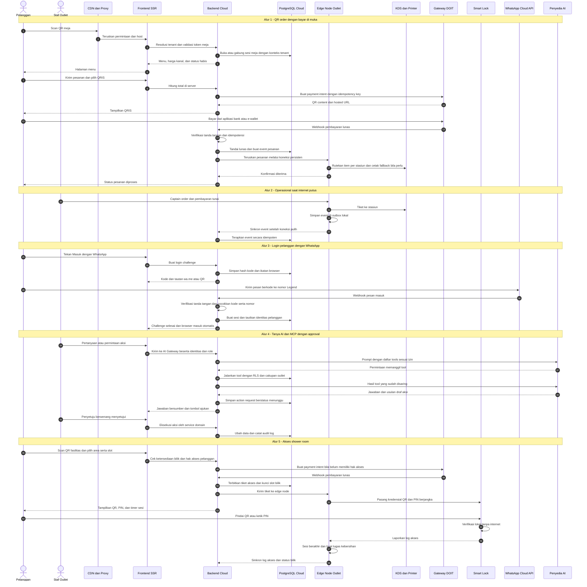
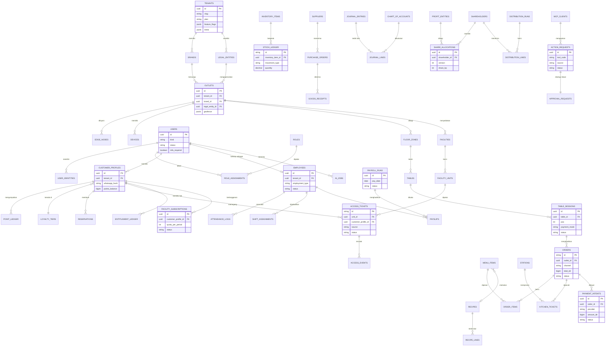

# PRD — Project Requirements Document

## 1. Overview

**Nama Proyek:** Legend Super App — Sistem Operasional Terpadu untuk Cafe Legend

**Versi Dokumen:** 1.8 · 9 November 2026 · Akses support read-write memerlukan persetujuan owner tenant (F4, TEN-04, Q37/Q38). Arsitektur dibuat general untuk dijual ke cafe lain: Design System Platform dua lapis (Base Theme dan Tenant Theme), aturan tanpa kode khusus tenant, whitelabel, kamus istilah, dan template tenant dari konfigurasi Legend; memuat keputusan final D1–D44 dan register risiko R01–R27.

**Pemilik Platform:** PT Sultan Solusi Nusantara. Cafe Legend (selanjutnya Legend) adalah tenant pertama dan untuk sementara juga dioperasikan oleh PT Sultan Solusi Nusantara. Operator cafe atau restoran lain dapat memakai platform yang sama sebagai tenant berbayar (whitelabel).

**Target Rilis:** 25 Desember 2026, bertepatan dengan pembukaan Cafe Legend untuk umum. Mockup selesai dan disetujui paling lambat 2 November 2026.

**Profil Tenant Pertama:** Cafe Legend di Kota Bandung dengan kapasitas 250–300 seat, shower room 4 bilik (2 area pria dan 2 area wanita, terpisah), minimal 30 karyawan, dan minimal 4 pemegang saham.

### Masalah yang Diselesaikan
Cafe berkapasitas 250–300 seat menghadapi tekanan operasional yang jauh lebih besar dibanding cafe biasa: puluhan meja aktif bersamaan, beberapa stasiun produksi, puluhan karyawan bergiliran, dan beberapa pemegang saham yang berhak atas laporan transparan. Tanpa sistem yang tepat sejak hari pertama:
- **Pesanan lambat dan antrean panjang.** Pada jam ramai, waiter dan kasir menjadi hambatan; pelanggan menunggu untuk memesan, menunggu tagihan, dan menunggu membayar.
- **Kesalahan pesanan antara meja dan dapur.** Tiket kertas hilang, salah stasiun, atau tertukar antarmeja; tidak ada data berapa lama setiap menu disajikan.
- **Kebocoran yang sulit dideteksi.** Void, diskon, refund, selisih kas, pemakaian bahan di luar resep, dan bahan terbuang tidak tercatat atau tidak dianalisis.
- **HPP tidak terkendali.** Harga bahan berubah, resep tidak dibakukan, dan selisih antara food cost teoretis dan aktual baru diketahui di akhir bulan.
- **Data pelanggan tidak terkumpul.** Pelanggan datang dan pergi tanpa jejak, sehingga loyalty dan pemasaran ulang tidak mungkin dilakukan secara terarah.
- **Sistem terpecah-pecah.** Solusi di pasar seperti ESB unggul di POS, ERP, dan pemesanan, tetapi tidak menyediakan HRIS lengkap, asisten AI berbasis role, MCP, maupun dashboard khusus pemegang saham. Menggabungkan beberapa vendor berarti data tersebar dan biaya berlapis.
- **Administrasi SDM berat.** Minimal 30 karyawan dengan shift bergilir membutuhkan absensi, jadwal, lembur, cuti, payroll (PPh 21, BPJS, THR, service charge), dan onboarding yang tertib.
- **Transparansi kepada pemegang saham.** Minimal 4 pemegang saham membutuhkan gambaran kondisi bisnis yang dapat dipercaya serta porsi bagi hasil masing-masing tanpa membuka data pihak lain.
- **Ketergantungan pada internet.** Gangguan koneksi saat cafe penuh dapat melumpuhkan kasir, dapur, dan pembayaran.
- **Biaya komunikasi.** Sejak 1 Oktober 2026, balasan WhatsApp di dalam customer service window kembali dikenai biaya setelah kuota gratis 1.000 pesan per nomor per bulan; desain notifikasi harus hemat biaya sejak awal.
- **Kursi tersita tamu WFC.** Bandung memiliki banyak pekerja yang bekerja dari kafe (WFC). Tamu WFC mengisi kursi saat jam sepi, tetapi pada jam ramai dapat menempati kursi berjam-jam dengan belanja kecil, sehingga omzet per kursi turun. Cafe perlu tetap nyaman untuk WFC tanpa kehilangan kursi dan omzet.
- **Peluang pasar pagi.** Orang yang berolahraga pagi, bersepeda ke kantor, atau transit sebelum bekerja membutuhkan tempat mandi yang bersih sekaligus tempat sarapan dan ngopi. Shower room yang dipesan dan dibuka secara digital menjadikan Legend tujuan pagi hari dan mendorong kunjungan berulang, tetapi pengelolaannya membutuhkan sistem akses, jadwal kebersihan, dan pembayaran yang terintegrasi dengan F&B.
- **Peluang bisnis.** Operator cafe lain menghadapi masalah serupa dan berpotensi menjadi pengguna berbayar platform yang sama.

### Tujuan Utama Aplikasi
Membangun **satu platform multi-tenant** yang untuk setiap tenant menyediakan enam wajah, yaitu **Pelanggan** (QR order, member, reservasi, akses fasilitas), **Operasional Depan** (POS, waiter, kasir), **Dapur** (KDS dan expo), **Manajemen** (back office ERP, HRIS, CRM), **Owner dan Shareholder** (dashboard dan Tanya AI), serta **Karyawan** (HRIS self-service), ditambah **Panel Platform** untuk Super Admin dan **MCP Server** untuk integrasi agentic. Untuk Cafe Legend, platform ini bertujuan agar:
1. **Pelanggan memesan dan membayar dari meja** melalui ponsel tanpa memasang aplikasi, dengan pesanan langsung sampai ke stasiun yang tepat.
2. **Dapur bekerja tertib dan terukur** dengan KDS per stasiun, expo untuk runner, dan analisis serving time.
3. **Operasional tetap berjalan saat internet putus** melalui edge node di outlet.
4. **Setiap rupiah dan setiap gram tercatat** dari pembelian, produksi, penjualan, hingga jurnal akuntansi.
5. **Pelanggan kembali lagi** melalui program loyalty, CRM, dan reservasi yang terintegrasi.
6. **Shower room menjadi alasan datang di pagi hari** dengan pemesanan, pembayaran, dan akses pintu melalui ponsel, baik sekali pakai, paket sarapan, benefit belanja, maupun langganan bulanan.
7. **Karyawan dikelola dari satu tempat** dengan HRIS setara Talenta, dapat diakses sebagai PWA di ponsel.
8. **Owner dan pemegang saham memahami kondisi bisnis kapan pun** melalui dashboard mobile-first dan Tanya AI.
9. **Sistem siap agentic** melalui MCP Server yang kapabilitasnya mengikuti role.
10. **Siap whitelabel** sehingga outlet baru, brand baru, maupun tenant baru dapat dilayani dari codebase yang sama.

**Ukuran keberhasilan** (ditinjau ulang 30 hari setelah pembukaan):

| No | Indikator | Target | Cara Ukur |
|----|-----------|--------|-----------|
| U1 | Pesanan dine-in melalui QR order | ≥ 60% pesanan dine-in dalam 30 hari | Kanal pesanan |
| U2 | Waktu dari pesanan dikirim hingga tersaji | Median ≤ 6 menit untuk minuman dan ≤ 12 menit untuk makanan; p90 ≤ 2× median | Timestamp KDS dan expo |
| U3 | Waktu dari scan QR hingga pesanan terkirim | Median ≤ 3 menit | Event sesi meja |
| U4 | Transaksi yang terhubung ke member | ≥ 40% transaksi dalam 90 hari | Transaksi dengan `customer_profile_id` |
| U5 | Repeat visit member | ≥ 30% member bertransaksi ≥ 2 kali dalam 60 hari | Ledger poin dan transaksi |
| U6 | Ketersediaan operasional outlet | POS, KDS, dan cetak berjalan ≥ 99,9% jam buka, termasuk saat internet putus | Monitoring edge node |
| U7 | Selisih stok opname | ≤ 1,5% dari nilai persediaan per bulan | Laporan stok opname |
| U8 | Selisih food cost teoretis dan aktual | ≤ 2 poin persentase per bulan | Laporan HPP |
| U9 | Selisih kas tutup shift | 100% shift ditutup; setiap selisih memiliki penjelasan dan persetujuan | Laporan tutup shift |
| U10 | Ketepatan payroll | Payroll dibayar tepat tanggal yang dikonfigurasi dengan nol koreksi material | Payroll run dan keluhan slip |
| U11 | Kepatuhan absensi | ≥ 95% shift terjadwal memiliki absensi sah | Data absensi |
| U12 | Laporan pemegang saham | Terbit ≤ 7 hari setelah tutup buku bulanan | Status tutup periode |
| U13 | Adopsi Tanya AI | ≥ 70% pengguna role manajemen dan owner memakai minimal sekali per minggu pada bulan kedua | Event AI agregat |
| U14 | Biaya notifikasi | ≥ 90% notifikasi melalui kanal gratis; biaya WhatsApp dan AI tidak melebihi plafon | Laporan biaya per kanal |
| U15 | Kebocoran data, termasuk lintas tenant dan lintas role | Nol pada rangkaian uji di CI | Uji keamanan otomatis |
| U16 | Utilisasi shower room | ≥ 50% slot terisi pada jam operasional default dalam 60 hari | Tiket akses per slot |
| U17 | Konversi pengguna shower ke F&B | ≥ 60% sesi shower disertai pembelian F&B pada hari yang sama | Tiket akses dan transaksi pelanggan yang sama |
| U18 | Keandalan akses pintu | ≥ 99,5% tiket sah berhasil membuka pintu pada percobaan pertama, termasuk saat internet putus | Log akses smart lock |
| U19 | Omzet per kursi di Zona WFC | RevPASH Zona WFC pada jam ramai tidak lebih rendah dari zona reguler | Lapisan metrik per zona dan per jam |
| U20 | Item gagal setelah dibayar | ≤ 0,2% dari seluruh item terjual | Catatan pemulihan pesanan |
| U21 | Kepatuhan checklist operasional | ≥ 98% checklist selesai tepat waktu | Data checklist |

### Prinsip Produk
- **Semua jadi satu** — pelanggan, operasional, dapur, back office, HRIS, dashboard, dan MCP berada dalam satu codebase dan satu sumber data per tenant.
- **Offline-first di outlet** — kasir, dapur, dan cetak tidak boleh berhenti hanya karena internet putus.
- **Mobile-first untuk pelanggan, owner, shareholder, dan karyawan** — mayoritas akses berasal dari ponsel; dashboard manajemen tetap optimal di desktop.
- **General sejak awal, dikonfigurasi untuk Legend** — seluruh kebutuhan Cafe Legend dipenuhi melalui pengaturan tenant, tidak pernah melalui kode yang hanya berlaku untuk satu tenant, sehingga platform siap dijual ke cafe lain tanpa dibongkar ulang.
- **Dapat dikonfigurasi, bukan di-hardcode** — role, pajak, service charge, mode bayar, tanggal gajian, komponen gaji, porsi bagi hasil, loyalty, gateway pembayaran, dan modul aktif diatur dari panel.
- **Setiap angka bisa ditelusuri** — setiap angka di dashboard dapat diturunkan sampai ke transaksi sumbernya.
- **Isolasi mutlak** — data satu tenant tidak dapat dibaca tenant lain, dan data satu role tidak terbuka bagi role lain tanpa izin.
- **Hemat biaya komunikasi** — pelanggan yang memulai percakapan WhatsApp; sistem memakai kanal gratis lebih dahulu.
- **AI membantu, manusia memutuskan** — AI dan agen MCP hanya membaca dan menyusun draf aksi; aksi yang mengubah data atau uang selalu memerlukan persetujuan manusia yang berwenang.
- **Uang tidak pernah ditebak** — nominal ditentukan server, status lunas hanya berasal dari konfirmasi gateway terverifikasi atau petugas berwenang, dan transaksi final tidak pernah dihapus.

---

## 2. Requirements

### Kebutuhan Fungsional
| No | Kebutuhan | Keterangan |
|----|-----------|------------|
| F1 | Multi-tenant dengan hierarki tenant → brand → outlet dan Panel Platform | WS-01 · P0. Feature flag, kuota, plafon biaya, support access |
| F2 | Edge node per outlet dengan mode offline-first dan print agent | WS-02 · P0 |
| F3 | Autentikasi staf (login web, PIN perangkat, MFA manajemen) dan pelanggan (email, Google OAuth, WhatsApp reverse OTP) | WS-01 · P0. Nomor WhatsApp terverifikasi menjadi kunci identitas pelanggan |
| F4 | RBAC, struktur organisasi, dan matriks approval yang diatur dari panel | WS-01 · P0 |
| F5 | Master menu, varian, modifier, paket, harga per kanal, dan routing stasiun | WS-03 · P0 |
| F6 | Denah multizona, meja, dan QR meja | WS-03 · P0 |
| F7 | QR order pelanggan dengan sesi meja dinamis, split bill, panggil waiter, dan minta tagihan | WS-03 · P0. Mode bayar di muka (default) dan open bill per zona |
| F8 | POS kasir dan captain order waiter | WS-04 · P0. Hold & fire, void dan diskon berpersetujuan, tutup shift |
| F9 | KDS per stasiun, expo, dan pickup display | WS-04 · P0 |
| F10 | Orkestrasi pembayaran melalui adapter multi-gateway, dengan DOIT sebagai satu-satunya gateway online saat rilis, ditambah tunai | WS-05 · P0. Integrasi Duitku menyusul pada P1 |
| F10a | Integrasi EDC multi-bank melalui ECR untuk kartu debit, kartu kredit, dan QRIS di kasir, tanpa input nominal ulang | WS-05 dan WS-02 · P0 |
| F11 | Pajak dan service charge yang dapat dikonfigurasi, termasuk aturan pajak per item | WS-05 · P0. Default PBJT Kota Bandung 10% |
| F12 | Notifikasi multikanal hemat biaya | WS-05 · P0 |
| F13 | Inventori multilokasi, stok real-time, stok opname, dan waste | WS-06 · P0 |
| F14 | Resep bertingkat, produksi semi-finished, HPP, dan menu engineering | WS-06 · P0 |
| F15 | Purchasing dan supplier (PR → PO → GRN → invoice → pembayaran) | WS-06 · P0 |
| F16 | Akuntansi dan keuangan dengan jurnal otomatis, rekonsiliasi, aset, anggaran, dan pelaporan pajak | WS-07 · P0 |
| F17 | Loyalty: poin, tier, mission, reward, ulang tahun, dan referral | WS-08 · P0 |
| F18 | CRM, segmentasi, promo engine, voucher, kampanye, dan ulasan | WS-08 · P0 |
| F19 | Reservasi dengan DP, private room, dan waitlist | WS-08 · P0 |
| F20 | Integrasi GoFood, GrabFood, dan ShopeeFood | WS-08 · P0 arsitektur dan adapter; aktivasi mengikuti persetujuan mitra |
| F21 | Website publik Legend (beranda, menu, reservasi, pendaftaran member) | WS-08 · P0 |
| F22 | Akses Fasilitas: pemesanan shower room, tiket QR dan PIN, smart lock yang tetap berfungsi offline, dan siklus kebersihan bilik | WS-09 · P0. Modul generik untuk fasilitas lain |
| F23 | Hak akses fasilitas: sekali bayar, paket menu, minimum belanja, benefit tier, dan langganan bulanan, beserta add-on opsional | WS-09 · P0 |
| F24 | Data karyawan, kontrak, organisasi, onboarding, dan offboarding | WS-10 · P0 |
| F25 | Absensi selfie dengan geofence dan pengikatan perangkat | WS-10 · P0 |
| F26 | Penjadwalan shift berbasis prediksi keramaian dan tukar shift | WS-10 · P0 |
| F27 | Cuti, izin, lembur, dan hari libur | WS-10 · P0 |
| F28 | Payroll lengkap (PPh 21 TER, BPJS, THR, service charge, kasbon) dengan tanggal gajian yang dapat dikonfigurasi | WS-10 · P0 |
| F29 | Reimbursement, kinerja (KPI), pelatihan, dan pustaka SOP | WS-10 · P0 |
| F30 | HRIS self-service karyawan sebagai PWA | WS-10 · P0 |
| F31 | Dashboard Owner mobile-first | WS-11 · P0 |
| F32 | Dashboard Shareholder mobile-first dengan porsi bagi hasil pribadi | WS-11 · P0 |
| F33 | Dashboard Manajemen dengan RBAC, kotak approval, dan 100+ laporan | WS-11 · P0 |
| F34 | Bagi hasil dan dividen berversi | WS-07 · P0 |
| F35 | Tanya AI per role (owner, shareholder, manajemen, karyawan) | WS-12 · P0 |
| F36 | MCP Server dengan kapabilitas per role dan aksi berpersetujuan | WS-12 · P0 |
| F37 | Tata kelola AI dan MCP | WS-12 · P0. Berlaku untuk seluruh fitur AI sejak awal |
| F38 | Wi-Fi tamu terintegrasi dengan captive portal dan login WhatsApp | WS-02 dan WS-09 · P0 |
| F39 | Kebijakan WFC: zonasi, Wi-Fi berbasis belanja, jam ramai, minimum spend per jam, day pass, reservasi kursi, dan langganan WFC | WS-09 · P0 |
| F40 | Order pacing dan estimasi waktu saji real-time | WS-04 · P0 |
| F41 | Pemulihan pesanan: item gagal setelah dibayar, remake, comp, dan voucher permintaan maaf | WS-03 dan WS-04 · P0 |
| F42 | Sarapan siap saat keluar shower | WS-09 · P0 |
| F43 | Kontrol open bill, menu cetak otomatis, serta e-receipt dan kuitansi | WS-03 dan WS-04 · P0 |
| F44 | Nomor struk berurutan tanpa celah dan pencatatan setoran kas ke bank | WS-04 dan WS-07 · P0 |
| F45 | Operasional harian: checklist, log keamanan pangan, label prep, daftar prep, perawatan peralatan, dan serah terima shift | WS-14 · P0 |
| F46 | Kesiapan whitelabel: tanpa kode khusus tenant, Design System Platform dua lapis, teks dan brand dari konfigurasi tenant, kamus istilah, serta ekspor dan impor konfigurasi sebagai template tenant | WS-00 dan WS-01 · P0 |
| F47 | Self-order kiosk, pre-order pickup online, dan menu bahasa Inggris | Pascarilis · P1 |
| F48 | Integrasi Duitku (kartu kredit, e-wallet langsung, paylater) dan pencairan payroll otomatis | Pascarilis · P1 |
| F49 | DOIT Platform (sub-merchant) untuk settlement per tenant dan komisi platform | Pascarilis · P1 |
| F50 | Central kitchen dan manajemen multi-outlet lanjutan | Pascarilis · P1 |
| F51 | E-voucher hadiah, tip digital, sensor suhu otomatis, serta lost & found, insiden, dan K3 | Pascarilis · P1 |
| F52 | Theme Kit self-service, template tenant tambahan, editor kamus istilah, label "powered by", tenant demo, dan billing langganan | Pascarilis · P1 |
| F53 | Onboarding tenant self-service dan marketplace supplier | Pascarilis · P2 |

### Kebutuhan Non-Fungsional
- **Kemudahan pakai:**
  - Pelanggan dapat memesan dalam ≤ 3 langkah setelah scan (pilih menu, tinjau, kirim atau bayar) tanpa wajib login.
  - Kasir dapat menyelesaikan transaksi standar dalam ≤ 15 detik.
  - Karyawan dapat absen dalam ≤ 3 ketukan dari layar utama PWA.
  - Pelanggan dapat memesan shower dan menerima tiket akses dalam ≤ 2 menit setelah scan, termasuk login dan pembayaran.
  - Pelanggan dapat tersambung ke Wi-Fi tamu dalam ≤ 30 detik setelah login.
  - Teks dasar 16 px, target sentuh minimal 44 × 44 px, dan setiap pesan error disertai petunjuk perbaikan.
- **Kapasitas puncak (desain per outlet):** 300 perangkat pelanggan bersamaan, 150 sesi meja aktif, 600 item pesanan per jam, 40 perangkat staf, 4 bilik shower dengan hingga 8 sesi per jam, serta Wi-Fi tamu untuk 300 perangkat bersamaan. Mode shared harus mampu menampung minimal 50 outlet tanpa perubahan arsitektur.
- **Kinerja:**
  - Halaman menu QR memiliki LCP ≤ 2,5 detik di jaringan 4G (p75).
  - Pesanan tampil di KDS ≤ 2 detik setelah dikirim, baik dalam kondisi online maupun offline di jaringan outlet.
  - Simpan transaksi POS ≤ 1 detik ke edge node.
  - Dashboard owner p95 ≤ 3 detik.
  - Jawaban Tanya AI p95 ≤ 10 detik.
- **Offline-first:**
  - Bila internet putus, POS, captain order, KDS, expo, cetak, pembayaran tunai, dan EDC tetap berjalan melalui edge node. EDC terhubung ke bank melalui jaringannya sendiri, sedangkan ECR hanya memakai jaringan lokal outlet, sehingga kartu dan QRIS melalui EDC tetap dapat diproses saat internet cafe putus, selama jaringan EDC tersedia.
  - Smart lock shower room tetap menerima tiket sah yang sudah terbit, dan staf tetap dapat menerbitkan tiket di POS untuk pembayaran tunai atau EDC selama internet putus.
  - Data tersinkron otomatis tanpa duplikasi saat koneksi pulih.
  - QR order pelanggan dan pembayaran QRIS memerlukan internet; jaringan outlet memakai dual WAN (fiber dan 4G) untuk memperkecil risiko.
- **Perangkat dan browser:**
  - Responsif dari 360 px hingga ≥ 1440 px.
  - Diuji di Chrome Android, Safari iOS, serta Chrome, Edge, Safari, dan Firefox desktop versi terbaru dan satu versi sebelumnya.
  - Ruang pelanggan, karyawan, owner, dan shareholder dapat dipasang sebagai PWA dengan web push, termasuk iOS 16.4 ke atas.
- **Desain dan aksesibilitas:**
  - Seluruh antarmuka memakai Design System Platform: Base Theme netral untuk semua tenant ditambah Tenant Theme per tenant, dengan tiga mode kepadatan (Hangat & Visual, Kontras Tinggi, Padat & Presisi). Cafe Legend adalah Tenant Theme pertama.
  - Kontras warna setiap Tenant Theme diperiksa otomatis terhadap WCAG 2.2 AA; tema yang gagal tidak dapat diaktifkan.
  - Mode Kontras Tinggi untuk POS, KDS, dan layar staf memakai target sentuh 56–64 px dan mode gelap di dapur.
  - Setiap daftar memiliki state loading, empty, dan error.
  - Mendukung dark mode dan menghormati `prefers-reduced-motion`.
  - Target WCAG 2.2 AA untuk ruang pelanggan dan karyawan.
- **Isolasi multi-tenant:**
  - Setiap tabel milik tenant memiliki `tenant_id` dan dilindungi PostgreSQL Row Level Security (RLS) sekaligus pemeriksaan di service layer.
  - Cakupan outlet ditegakkan untuk role yang dibatasi per outlet.
  - Cache, file storage, search index, embedding AI, antrean job, dan token MCP dipisah per tenant.
  - Tenant ditentukan dari domain atau token, tidak pernah dari parameter klien.
- **Keamanan:**
  - Pelanggan masuk dengan WhatsApp reverse OTP, magic link email, atau Google OAuth; kode dan token disimpan sebagai hash, sekali pakai, dan berumur pendek.
  - Seluruh role manajemen, owner, shareholder, dan Super Admin wajib MFA (TOTP atau passkey) untuk akses back office, dan autentikasi ulang untuk tindakan sensitif.
  - Staf operasional memakai PIN pribadi pada perangkat terdaftar; PIN supervisor diperlukan untuk override di POS.
  - Data kartu tidak pernah menyentuh server platform (hosted payment dan EDC). Melalui ECR, POS hanya menerima status, approval code, jenis kartu, dan nomor kartu yang disamarkan, sehingga cakupan PCI DSS diminimalkan.
  - Webhook gateway dan WhatsApp diverifikasi tanda tangannya dan diproses idempoten.
  - Kontak, NIK, NPWP, rekening, dan gaji dienkripsi di tingkat aplikasi; pencarian memakai blind index (HMAC).
  - Sanitasi input, CSRF, Content Security Policy, query terparameterisasi, pemindaian upload, dan pembersihan EXIF/GPS foto.
  - Kredensial akses pintu (QR dan PIN) bersifat sekali pakai, berjangka waktu sesi, terikat ke bilik atau area tertentu, dan disimpan sebagai hash.
  - Uji keamanan mengacu OWASP Top 10 dan OWASP Top 10 for LLM Applications sebelum rilis.
- **Privasi (UU No. 27 Tahun 2022 tentang Pelindungan Data Pribadi dan peraturan pelaksananya):**
  - Setiap tenant bertindak sebagai pengendali data pelanggan dan karyawannya, sedangkan PT Sultan Solusi Nusantara bertindak sebagai pemroses data. Untuk Legend, selama dioperasikan PT Sultan Solusi Nusantara, PT Sultan bertindak sebagai pengendali sekaligus pemilik platform.
  - Persetujuan terpisah dan berversi untuk keanggotaan loyalty, pesan pemasaran, dan pemakaian data oleh AI.
  - Pemilihan area shower (pria atau wanita) hanya dicatat pada tiket akses; sistem tidak menyimpan jenis kelamin di profil pelanggan. Tidak ada kamera di dalam bilik maupun ruang ganti.
  - Foto selfie absensi hanya untuk verifikasi manual, tidak diproses dengan pengenalan wajah otomatis, dan dihapus 90 hari setelah periode payroll terkait ditutup.
  - Kegagalan pelindungan data diberitahukan kepada subjek data dan lembaga berwenang paling lambat 3 × 24 jam.
  - Pengiriman data ke penyedia di luar negeri (AI, email, WhatsApp) hanya berisi data minimum, dilindungi perjanjian pemrosesan data, dan memakai penyedia yang tidak melatih model dengan data pelanggan.
  - Masa simpan: catatan transaksi dan keuangan 10 tahun; data payroll dan kepegawaian sesuai ketentuan ketenagakerjaan dan perpajakan; audit log dan log akses pintu 2 tahun; output AI yang tidak disimpan ≤ 7 hari; akun pelanggan yang dihapus dianonimkan dalam 30 hari kecuali data yang wajib disimpan.
- **AI dan MCP:**
  - Permission-first: setiap tool memeriksa izin pemanggil di server.
  - Input minimum, output sebagai saran, dan aksi selalu melalui approval.
  - Plafon biaya bulanan per tenant, kill switch per fitur, evaluasi sebelum rilis, dan audit log lengkap.
- **Ketersediaan dan pemulihan:**
  - Cloud: target uptime 99,9% per bulan, WAL archiving untuk point-in-time recovery (RPO ≤ 5 menit), backup di lokasi berbeda, dan RTO 4 jam.
  - Edge node: snapshot lokal setiap 15 menit dan sinkron berkelanjutan ke cloud, dengan unit cadangan (standby) yang dapat diaktifkan ≤ 15 menit.
  - Uji restore sebelum rilis dan setiap kuartal.
- **Portabilitas dan modularitas:**
  - Seluruh layanan berjalan melalui Docker, baik mode dedicated maupun shared.
  - Penyedia eksternal (gateway pembayaran, WhatsApp, email, AI, ojek online) diakses melalui adapter.
  - Setiap modul dapat dimatikan per tenant melalui feature flag.
- **Observabilitas:**
  - Structured log tanpa data pribadi.
  - Monitoring cloud dan edge node, termasuk heartbeat setiap perangkat KDS, printer, POS, dan smart lock (termasuk level baterai).
  - Alert untuk kegagalan webhook, sinkronisasi, cetak, dan pembayaran.
  - Dashboard biaya AI, WhatsApp, dan gateway per tenant.
- **Biaya operasional:** WhatsApp template dan balasan WhatsApp nonaktif secara default. Fitur berbiaya variabel memiliki plafon bulanan per tenant dan berhenti otomatis saat plafon tercapai.

### Batasan (Constraints)
- **Template:** proyek dibangun di atas template **"Starter Monorepo" v0.1.0 (NgodingPakeAI)**, dengan memakai ulang modul yang sudah dibangun pada proyek 119connect di https://github.com/ifanshori99/119connect-portal-alumni (lihat Bagian 7).
- **Stack dikunci:** **Frontend TanStack, Backend Node.js, Database PostgreSQL, Deployment Docker**. Edge node, realtime, antrean job, pencarian, vektor, dan MCP dipenuhi di dalam stack ini.
- **SSR:** halaman publik dan menu QR wajib SSR agar cepat di ponsel dan dapat diindeks mesin pencari.
- **Mode deployment:** satu codebase mendukung mode dedicated dan shared. Legend berjalan di deployment shared milik PT Sultan Solusi Nusantara di region Jakarta, ditambah edge node di outlet.
- **WhatsApp:** memakai WhatsApp Business Platform (Cloud API) resmi. Setiap tenant dapat memakai nomor dan display name sendiri; Legend memakai nomor khusus dengan display name "Legend". Gateway WhatsApp tidak resmi tidak dipakai.
- **Payment gateway:** diakses melalui adapter multi-gateway yang dikonfigurasi di Super Admin dan per tenant. Saat rilis hanya DOIT yang aktif, untuk QRIS dan Virtual Account. Tidak ada transfer bank. Di kasir: tunai, kartu debit dan kredit melalui EDC bank yang terintegrasi melalui ECR (lihat batasan EDC), serta QRIS; e-wallet dibayar melalui QRIS. Kartu kredit online dilayani Duitku pada P1 (pascarilis) tanpa mengubah modul lain; e-wallet langsung dan paylater juga pascarilis. Kredensial merchant dimiliki dan disimpan per tenant.
- **Akun dan badan usaha:** seluruh akun pihak ketiga (WhatsApp, DOIT, ojek online, email, domain, dan infrastruktur) atas nama PT Sultan Solusi Nusantara. Untuk sementara Cafe Legend juga dioperasikan oleh PT Sultan Solusi Nusantara, sehingga dana penjualan dicairkan ke rekening PT Sultan. Sistem tetap memisahkan pembukuan per badan usaha dan per outlet sejak awal, sehingga bila kelak Legend dialihkan ke badan usaha lain, cukup didaftarkan sebagai badan usaha baru di sistem dan di DOIT (fitur badan usaha dengan KYC dan rekening pencairan sendiri) tanpa migrasi data.
- **EDC dan ECR:** EDC disediakan oleh beberapa bank sekaligus atas nama PT Sultan Solusi Nusantara. Setiap bank wajib menyetujui fasilitas ECR (Electronic Cash Register) dan memberikan spesifikasi integrasinya; model EDC harus mendukung ECR melalui LAN atau koneksi lokal lain yang dapat diakses edge node. Integrasi per bank dibangun sebagai implementasi adapter `EdcProvider`. Dana kartu dan QRIS melalui EDC disettle langsung oleh bank masing-masing, terpisah dari settlement DOIT.
- **Wi-Fi:** perangkat Wi-Fi (controller dan access point) wajib mendukung captive portal eksternal, otorisasi per perangkat melalui RADIUS atau API controller, pembatasan bandwidth per pengguna, dan walled garden ke domain pemesanan. Vendor dipilih paling lambat 2 November 2026.
- **Smart lock:** vendor dan model smart lock wajib mendukung kredensial PIN atau QR berjangka waktu yang dapat diverifikasi lokal tanpa internet, integrasi melalui jaringan lokal atau API yang dapat dipanggil dari edge node, pembukaan darurat dari dalam, kunci mekanik, serta log akses. Vendor dipilih paling lambat 2 November 2026.
- **Integrasi ojek online:** dibangun sejak awal, tetapi aktivasinya bergantung pada persetujuan masing-masing platform sebagai mitra integrasi. Sampai disetujui, pesanan ojek online dimasukkan manual melalui POS dengan kanal yang benar.
- **Kendali jadwal:** kontrol keamanan, keuangan, dan isolasi tidak dilonggarkan demi tanggal rilis. Modul yang belum lulus kriteria penerimaan disembunyikan dengan feature flag tanpa menunda pembukaan cafe.
- **Prasyarat payroll:** payroll pertama dijalankan secara paralel dengan perhitungan manual untuk verifikasi sebelum dibayarkan.
- **Kebijakan perjanjian:** perjanjian penggunaan platform dan Data Processing Agreement dengan tenant eksternal, maupun dengan badan usaha Legend bila kelak dialihkan, disusun terpisah dari PRD ini.
- **Pajak layanan fasilitas:** perlakuan pajak layanan shower room dan paket campuran (F&B ditambah shower) dikonfirmasi kepada konsultan pajak sebelum go-live. Sistem menyediakan aturan pajak per item dan alokasi pajak per komponen paket.
- **Di luar cakupan rilis 25 Desember 2026:**
  - aplikasi native dan armada pengiriman sendiri;
  - pengenalan wajah otomatis;
  - auto-debit dan penyimpanan data kartu;
  - marketplace supplier;
  - pinjaman atau permodalan;
  - chatbot publik bebas;
  - posting media sosial otomatis.
- **Bahasa:** antarmuka berbahasa Indonesia; menu pelanggan dalam bahasa Inggris adalah P1.

**Keputusan final yang telah disetujui (28 Oktober 2026):**

| No | Topik | Keputusan |
|----|-------|-----------|
| D1 | Nama | Cafe Legend (tenant pertama); nama sistem Legend Super App |
| D2 | Kepemilikan platform | PT Sultan Solusi Nusantara; tenant lain sebagai pengguna berbayar |
| D3 | Model produk | Multi-tenant dengan hierarki tenant → brand → outlet; siap untuk cabang baru dan whitelabel |
| D4 | Stack | TanStack Start, Node.js, PostgreSQL, dan Docker di atas Starter Monorepo; modul 119connect disalin lalu disesuaikan |
| D5 | Hosting | Deployment shared di region Jakarta, ditambah edge node utama dan cadangan di outlet |
| D6 | Akun pihak ketiga | Seluruhnya atas nama PT Sultan Solusi Nusantara |
| D7 | Badan usaha operator | Sementara PT Sultan Solusi Nusantara; pembukuan tetap dipisah per badan usaha dan outlet sehingga Legend dapat dialihkan ke badan usaha lain tanpa migrasi data |
| D8 | Jadwal (sementara) | Seluruh P0 aktif 25 Desember 2026; mockup disetujui 2 November; feature-complete 30 November; code freeze 6 Desember; soft opening 18–22 Desember; go/no-go 23 Desember |
| D9 | Feature flag | Modul yang belum lulus uji disembunyikan tanpa menunda pembukaan |
| D10 | Mode bayar | Default bayar di muka; open bill dapat diaktifkan per zona atau tipe meja |
| D11 | Payment gateway | Adapter multi-gateway yang dikonfigurasi di Super Admin; saat rilis hanya DOIT (QRIS dan Virtual Account) untuk pembayaran online; tanpa transfer bank; kartu online via Duitku pada P1 |
| D12 | Ojek online | GoFood, GrabFood, dan ShopeeFood disiapkan sejak awal; aktivasi mengikuti persetujuan mitra; sementara pesanan diinput manual di POS |
| D13 | Pajak | Dapat dikonfigurasi di Super Admin dan Admin tenant; default PBJT 10% sesuai Perda Kota Bandung No. 1 Tahun 2024; service charge per zona; aturan pajak dapat dibedakan per item |
| D14 | Metode bayar rilis pertama (keputusan founder 2026-11-09) | Online: QRIS dan Virtual Account via DOIT, tanpa transfer bank; kartu online via Duitku pada P1. Kasir: tunai, EDC (kartu debit/kredit), dan QRIS; e-wallet dibayar lewat QRIS; paylater dan e-wallet langsung pascarilis |
| D14 | Akses staf | Staf outlet masuk dengan PIN pribadi; void, diskon besar, dan refund wajib PIN supervisor |
| D15 | Login pelanggan | Email (magic link), Google OAuth, dan WhatsApp reverse OTP yang diinisiasi pelanggan; sistem tidak membalas pesan di WhatsApp |
| D16 | Identitas pelanggan | Nomor WhatsApp terverifikasi menjadi kunci identitas dan syarat memperoleh poin serta akses fasilitas |
| D17 | Nomor WhatsApp | Setiap tenant memakai nomornya sendiri; Legend memakai display name "Legend" |
| D18 | Loyalty | Satu mata uang poin; tier berdasarkan belanja 12 bulan bergulir; mission (termasuk stamp card), hadiah ulang tahun, dan referral; poin kedaluwarsa 12 bulan; poin dihitung dari belanja setelah diskon, sebelum pajak dan service charge |
| D19 | Modul Akses Fasilitas | Modul generik dengan shower room sebagai penggunaan pertama; kelak dapat dipakai untuk locker, meeting room, atau co-working |
| D20 | Bilik shower | 4 bilik: 2 di area pria dan 2 di area wanita, terpisah; tiket hanya membuka pintu area yang dipilih; jenis kelamin tidak disimpan di profil pelanggan |
| D21 | Durasi sesi | Default 20 menit ditambah jeda pembersihan yang dapat dikonfigurasi (default 10 menit); kapasitas maksimal 8 sesi per jam |
| D22 | Jam operasional shower | Dapat dikonfigurasi; default 06.00–10.00; dapat diperluas sepanjang jam buka cafe |
| D23 | Cara mendapatkan akses | Sekali bayar, menu paket (misalnya Paket Sarapan + Shower), minimum belanja F&B, benefit tier loyalty, dan langganan bulanan; seluruhnya aktif saat rilis |
| D24 | Langganan bulanan | Kuota akses per bulan; tagihan berulang DOIT berbasis tautan pembayaran (tanpa auto-debit); tagihan dikirim via web push dan email; akses dihentikan bila tagihan belum lunas setelah masa tenggang |
| D25 | Add-on fasilitas | Handuk, amenities, locker, dan hair dryer bersifat opsional, diaktifkan lewat konfigurasi, dan terhubung ke inventori |
| D26 | Akses pintu | QR dan PIN 6 digit sekali pakai dalam jendela waktu sesi; smart lock tetap berfungsi offline melalui edge node; pintu selalu dapat dibuka dari dalam; tombol darurat dan kunci mekanik staf; tanpa kamera di dalam bilik |
| D27 | HRIS | Setara Talenta; tanggal gajian dan kuota karyawan dapat dikonfigurasi (Legend minimal 30 karyawan) |
| D28 | Absensi | Selfie, geofence, dan pengikatan perangkat; tanpa pengenalan wajah otomatis; selfie dihapus 90 hari setelah periode payroll ditutup |
| D29 | Payroll pertama | Dijalankan paralel dengan perhitungan manual sebelum dibayarkan |
| D30 | Shareholder | Minimal 4 orang; semua melihat kondisi bisnis agregat; porsi bagi hasil dan dividen hanya terlihat oleh pemiliknya; porsi diatur Super Admin atau pengelola dan tercatat berversi |
| D31 | Dashboard | Owner dan shareholder mobile-first; dashboard manajemen dengan RBAC; HRIS karyawan berbentuk PWA |
| D32 | AI dan MCP | Tanya AI per role; AI dan agen MCP hanya membaca dan menyusun draf; setiap aksi wajib disetujui manusia berwenang; Tanya AI dan MCP memakai lapisan tools yang sama |
| D33 | Pascarilis (P1) | Self-order kiosk, pre-order pickup online, menu bahasa Inggris, pencairan gaji otomatis, integrasi Duitku, e-voucher hadiah, tip digital, sensor suhu otomatis, lost & found, insiden, dan K3, serta paket penjualan platform (Theme Kit self-service, template tambahan, editor kamus istilah, label "powered by", tenant demo, dan billing langganan) |
| D34 | Metode development | Agentic development dengan AI agent dan subagent paralel; tanpa fase kode; contract-first; 13 workstream setelah Fondasi (WS-00) |
| D35 | Pakai ulang 119connect | Modul dari https://github.com/ifanshori99/119connect-portal-alumni disalin dan disesuaikan, tidak dibangun dua kali |
| D36 | EDC terintegrasi | EDC multi-bank terhubung ke POS melalui ECR; kasir tidak mengetik ulang nominal; EDC melayani kartu debit, kartu kredit, dan QRIS untuk pelanggan yang membayar di kasir; pilihan bank dan metode di kasir diatur per outlet |
| D37 | Wi-Fi tamu | Captive portal yang dibuka dari QR meja dengan login WhatsApp yang sama; maksimal 2 perangkat per akun; halaman pemesanan dan pembayaran selalu dapat diakses tanpa login Wi-Fi |
| D38 | Kebijakan WFC | Zona WFC terpisah dari zona reguler; Wi-Fi gratis 2 jam per hari dan bertambah 1 jam setiap belanja Rp30.000; jam ramai: durasi gratis 1 jam dan minimum spend per jam di Zona WFC; koneksi diturunkan, tidak diputus; day pass, reservasi kursi, dan langganan WFC; seluruh angka dapat dikonfigurasi |
| D39 | Item gagal setelah dibayar | Diperlakukan sebagai kegagalan operasional atau sistem; pelanggan hanya ditawari ganti menu atau kredit voucher; refund hanya manual oleh supervisor dengan approval bila pelanggan menolak keduanya |
| D40 | Struk | Nomor struk berurutan tanpa celah; e-receipt dan kuitansi memuat nama dan alamat Cafe Legend |
| D41 | Operasional Harian | Modul baru (WS-14): checklist, log keamanan pangan, label prep, daftar prep, perawatan peralatan, dan serah terima shift |
| D42 | Design system | Design System Platform dua lapis: Base Theme netral untuk semua tenant dan Tenant Theme per tenant, dengan Cafe Legend sebagai tema pertama; tiga mode kepadatan; Tailwind CSS dan shadcn/ui; DESIGN.md platform di root repo sebagai acuan seluruh agent; referensi pola dari getdesign.md (Starbucks dan Airbnb untuk pelanggan, Uber untuk operasional, Linear, Mercury, Stripe, dan Sentry untuk manajemen) tanpa meniru identitas visual brand lain |
| D43 | Nama platform | "Legend Super App" tetap menjadi nama platform; whitelabel penuh, sehingga pelanggan dan karyawan tenant lain hanya melihat brand cafe mereka; nama platform hanya tampil di Panel Platform |
| D44 | Strategi general | Arsitektur general masuk P0 (tanpa kode khusus tenant, tema dua lapis, teks dari konfigurasi, whitelabel, serta ekspor dan impor konfigurasi); pengemasan produk untuk dijual masuk P1 (Theme Kit self-service, template tambahan, editor kamus istilah, label "powered by", tenant demo, dan billing langganan) |

**Data dan aset yang dibutuhkan dari pengelola Legend** (semuanya dapat dimasukkan lewat panel sehingga tidak menghambat coding):

| No | Kebutuhan | Dibutuhkan Sebelum |
|----|-----------|--------------------|
| A1 | Logo, palet warna, font, dan aset brand Cafe Legend; bila belum ada, identitas visual dibuat lebih dahulu sebagai dasar Tenant Theme Cafe Legend | Mockup, 31 Oktober 2026 |
| A2 | Denah cafe: zona, jumlah dan tipe meja, kapasitas per meja, private room | Mockup, 2 November 2026 |
| A3 | Pengajuan akun Meta Business atas nama PT Sultan Solusi Nusantara dan nomor WhatsApp khusus dengan display name "Legend" | 28 Oktober 2026 |
| A4 | Pengajuan akun DOIT atas nama PT Sultan Solusi Nusantara, beserta dokumen KYC, rekening pencairan, dan aktivasi tagihan berulang (Duitku menyusul pada P1) | 28 Oktober 2026 |
| A5 | Pengajuan kemitraan GoFood, GrabFood, dan ShopeeFood atas nama PT Sultan Solusi Nusantara | 28 Oktober 2026 |
| A6 | Domain Legend dan domain platform Legend Super App | 30 Oktober 2026 |
| A7 | Pemesanan hardware outlet (lihat Fitur 2) | Dipesan 2 November; terpasang 5 Desember 2026 |
| A8 | Daftar menu lengkap: kategori, harga, varian, modifier, foto, dan stasiun produksi | Uji POS, 10 November 2026 |
| A9 | Resep dan takaran per menu, termasuk bahan semi-finished | Uji HPP, 20 November 2026 |
| A10 | Daftar supplier, bahan baku, satuan, dan harga awal | Uji purchasing, 20 November 2026 |
| A11 | Data karyawan, struktur organisasi, jabatan, dan pemegang role | Uji HRIS, 25 November 2026 |
| A12 | Komponen gaji, kebijakan lembur, cuti, service charge, dan tanggal gajian | Uji payroll, 25 November 2026 |
| A13 | Daftar pemegang saham, porsi bagi hasil, dan kebijakan distribusi | Uji dashboard, 30 November 2026 |
| A14 | Chart of accounts, saldo awal, rekening bank, dan status PKP badan usaha | Uji akuntansi, 1 Desember 2026 |
| A15 | Kebijakan loyalty: rasio poin, tier, reward awal | Uji loyalty, 30 November 2026 |
| A16 | SOP, kebijakan karyawan, dan materi onboarding untuk pustaka Tanya AI | Uji AI, 5 Desember 2026 |
| A17 | Plafon biaya bulanan untuk AI, WhatsApp, dan email | Rilis, 1 Desember 2026 |
| A18 | Denah shower room (area pria dan wanita, 4 bilik, ruang ganti, locker) serta pilihan vendor dan model smart lock | Pemesanan hardware, 2 November 2026 |
| A19 | Daftar harga shower: sekali pakai, paket menu, ambang minimum belanja, benefit per tier, paket langganan bulanan, add-on, biaya kelebihan waktu, dan masa tenggang | Uji Akses Fasilitas, 25 November 2026 |
| A20 | Konfirmasi perlakuan pajak layanan shower dan paket campuran dari konsultan pajak | Uji pajak, 1 Desember 2026 |
| A21 | Pengajuan EDC dan fasilitas ECR ke beberapa bank atas nama PT Sultan Solusi Nusantara, termasuk aktivasi QRIS di EDC, dokumen spesifikasi ECR, dan unit EDC untuk uji | Pengajuan 2 November; spesifikasi diterima 16 November; EDC terpasang 5 Desember 2026 |
| A22 | Denah Zona WFC dan titik colokan, serta pilihan perangkat Wi-Fi yang mendukung captive portal | 2 November 2026 |
| A23 | Harga dan ketentuan produk WFC (day pass, reservasi kursi, langganan), serta angka kebijakan Wi-Fi dan minimum spend | Uji WFC, 25 November 2026 |
| A24 | Daftar peralatan beserta jadwal servis, template checklist operasional, ambang suhu, dan batas pakai bahan prep | Uji Operasional Harian, 25 November 2026 |

**Manajemen risiko:**

Risiko tidak dapat dihapus sepenuhnya, tetapi dampaknya terhadap pembukaan cafe dapat ditekan mendekati nol. Karena itu, setiap risiko di bawah memiliki empat lapis penanganan:
- **pencegahan**, agar risiko tidak terjadi;
- **deteksi dini**, agar risiko diketahui sebelum berdampak;
- **rencana cadangan**, agar operasional tetap berjalan bila risiko terjadi;
- **PIC**, pihak yang bertanggung jawab.

Aturan pengelolaan:
- **Rapat risiko mingguan.** Setiap Senin sampai rilis, register ini ditinjau dan status setiap risiko diperbarui (hijau, kuning, atau merah).
- **Eskalasi.** Risiko berstatus merah diputuskan owner paling lambat 24 jam.
- **Cakupan uji.** Setiap rencana cadangan diuji minimal sekali sebelum soft opening.

| ID | Risiko | Pencegahan | Deteksi Dini | Rencana Cadangan | PIC |
|----|--------|------------|--------------|------------------|-----|
| R01 | Waktu hingga feature-complete sangat padat | 13 workstream paralel dengan contract-first; modul 119connect dipakai ulang; test kriteria penerimaan ditulis lebih dahulu | Dashboard progres harian: persentase kriteria penerimaan yang lulus per workstream; workstream di bawah target dua hari berturut-turut berstatus kuning | Agent tambahan dialihkan ke workstream yang tertinggal; fitur di dalam modul yang belum lulus disembunyikan dengan feature flag tanpa menunda pembukaan | Lead Engineer |
| R02 | Kontrak antar-workstream tidak konsisten atau berubah | WS-00 mengunci kontrak sebelum workstream lain mulai; contract test otomatis di CI | Contract test gagal pada pull request | Perubahan kontrak hanya melalui pull request yang direview, disertai migrasi dan perbaikan seluruh modul terdampak dalam pull request yang sama | Lead Engineer |
| R03 | Review manusia menjadi hambatan | Review manusia hanya untuk kode sensitif (uang, autentikasi, isolasi, izin AI dan MCP); kode lain lulus CI dan review otomatis | Antrean review lebih dari 24 jam | Reviewer kedua yang ditunjuk sejak awal; jadwal review harian tetap | Lead Engineer |
| R04 | Repositori 119connect belum dapat diakses agent | Akses diberikan sebelum WS-00 dimulai | Inventarisasi modul gagal di awal WS-00 | Modul dibangun dari spesifikasi PRD; estimasi tambahan 2–3 hari pada WS-00 dan WS-01 | Owner |
| R05 | Verifikasi Meta dan nomor WhatsApp tertunda | Diajukan 28 Oktober dengan dokumen lengkap; display name sesuai brand | Status verifikasi dipantau setiap hari | Login email dan Google tetap tersedia; penautan WhatsApp untuk poin diaktifkan menyusul tanpa perubahan kode | Owner |
| R06 | KYC atau aktivasi live DOIT tertunda | Diajukan 28 Oktober; checklist onboarding DOIT diselesaikan di sandbox sejak WS-05 dimulai | Status per metode (QRIS, VA) dipantau setiap hari | Tunai, kartu, dan QRIS melalui EDC bank yang terintegrasi; QRIS statis bank dengan konfirmasi manual kasir sebagai cadangan terakhir | Owner |
| R07 | Gangguan DOIT saat operasional (satu gateway online) | Monitoring status DOIT dan webhook; idempotensi dan pengecekan status terjadwal | Alert bila tingkat kegagalan pembayaran lebih dari 5% dalam 10 menit atau webhook tertunda | Halaman pelanggan otomatis mengarahkan ke pembayaran di kasir (tunai, atau kartu dan QRIS melalui EDC bank); integrasi Duitku pada P1 sebagai gateway kedua | Lead Engineer |
| R08 | Kemitraan ojek online tertunda | Diajukan 28 Oktober | Status pengajuan dipantau setiap minggu | Pesanan ojek online diinput manual di POS dengan kanal dan harga yang benar | Owner |
| R09 | Internet outlet terputus saat ramai | Dua ISP berbeda (fiber utama dan cadangan) ditambah modem 4G; edge node offline-first | Monitoring koneksi per jalur dengan alert ke supervisor | POS, KDS, cetak, absensi, dan smart lock tetap berjalan melalui edge node; waiter memakai captain order | Lead Engineer |
| R10 | Edge node atau listrik outlet gagal | Edge node utama dan standby; UPS minimal 2 jam untuk edge node dan jaringan | Heartbeat edge node dan status UPS | Pengalihan ke standby ≤ 15 menit; kasir dan dapur memakai printer fallback | Lead Engineer |
| R11 | Smart lock tidak mendukung offline, terlambat dipasang, atau gagal | Syarat offline sebagai kriteria wajib pemilihan vendor; 1 unit cadangan dibeli; instalasi paling lambat 5 Desember | Uji 4 jam tanpa internet; alert baterai lemah dan kegagalan buka | Kunci mekanik staf; attendant membukakan pintu; unit cadangan dipasang | Outlet Manager |
| R12 | Hardware lain terlambat atau rusak | Pemesanan 2 November dari pemasok dengan stok tersedia; cadangan 1 unit untuk tablet KDS, printer, dan ponsel waiter | Status pengiriman dipantau setiap minggu | Unit cadangan; tiket dicetak di printer stasiun bila KDS bermasalah | Outlet Manager |
| R13 | Data menu, resep, dan supplier belum lengkap | Template impor sejak awal; target tanggal A8–A10 | Laporan kelengkapan data harian | Menu tanpa resep tetap dapat dijual dan ditandai di laporan HPP; pengisian resep dilanjutkan setelah rilis dengan prioritas menu terlaris | Outlet Manager |
| R14 | Karyawan belum terbiasa dengan sistem | Pelatihan per role, mode latihan, modul pelatihan di HRIS, dan soft opening 5 hari | Kuis pelatihan; jumlah override dan kesalahan selama soft opening | Tim development siaga di lokasi pada minggu pertama; Tanya AI untuk panduan SOP | Outlet Manager |
| R15 | Kesalahan perhitungan payroll | Minimal 30 kasus uji PPh 21 dan BPJS; approval dua tingkat | Perbandingan dengan perhitungan manual | Payroll pertama dijalankan paralel dengan perhitungan manual, dan hasil manual dipakai bila ada selisih | Finance dan HR |
| R16 | Kebocoran data lintas tenant atau lintas role | RLS, cakupan outlet, enkripsi data sensitif, dan review manusia untuk kode sensitif | Uji isolasi otomatis di CI pada setiap pull request; audit log akses data sensitif | Rencana respons insiden: pencabutan akses, investigasi, dan pemberitahuan dalam 3 × 24 jam sesuai UU PDP | Lead Engineer |
| R17 | AI atau agen MCP disalahgunakan, termasuk prompt injection | Tool berizin, aksi hanya berupa draf yang wajib disetujui, PII scanner, rate limit | Evaluasi sebelum rilis; alert pola pemanggilan tidak wajar | Kill switch per fitur dan per tenant; pencabutan token MCP ≤ 1 menit | Lead Engineer |
| R18 | Biaya AI dan WhatsApp melonjak | Plafon bulanan per tenant; tanpa balasan WhatsApp default | Peringatan otomatis di 80% plafon | Penghentian otomatis di 100% plafon; fitur inti operasional tidak bergantung pada AI | Owner |
| R19 | Dana penjualan bercampur dengan keuangan PT Sultan Solusi Nusantara | Pembukuan per badan usaha dan per outlet sejak awal; laporan laba rugi Legend terpisah | Rekonsiliasi bulanan per outlet | Legend dapat dialihkan ke badan usaha tersendiri tanpa migrasi data | Finance |
| R20 | Perubahan tarif pajak daerah, BPJS, atau PPh 21 | Seluruh tarif dikonfigurasi berversi dengan tanggal efektif | Pemantauan regulasi bulanan oleh Finance | Tarif baru diaktifkan dari panel tanpa redeploy | Finance |
| R21 | Perlakuan pajak layanan shower belum pasti | Konfirmasi konsultan pajak (A20) sebelum 1 Desember | Status A20 di rapat risiko mingguan | Aturan pajak per item dapat diubah dari panel kapan pun; transaksi yang sudah terjadi dikoreksi melalui jurnal penyesuaian | Finance |
| R22 | Persetujuan atau spesifikasi ECR dari bank tertunda, atau integrasi ECR gagal di outlet | Pengajuan ECR ke beberapa bank sekaligus pada 2 November; model EDC dikonfirmasi mendukung ECR sebelum dipasang; uji integrasi per bank di staging dengan perangkat asli | Status pengajuan per bank di rapat risiko mingguan; heartbeat koneksi ECR per terminal dan alert bila terputus | Bank yang lebih dulu siap dipakai sebagai default; EDC bank lain berjalan standalone dengan input manual nomor referensi, wajib PIN supervisor, dan ditandai untuk dicocokkan pada rekonsiliasi | Owner dan Lead Engineer |
| R23 | Perangkat Wi-Fi tidak mendukung captive portal eksternal atau tidak sanggup melayani 300 perangkat | Syarat captive portal dan RADIUS atau API sebagai kriteria wajib pemilihan vendor; survei area sebelum pemasangan | Uji beban Wi-Fi dengan 300 perangkat; monitoring koneksi per access point | Wi-Fi tamu dengan password yang berganti harian ditampilkan di meja, tanpa kuota otomatis, sambil perangkat diganti | Lead Engineer |
| R24 | Kebijakan WFC dirasa tidak nyaman dan memicu ulasan buruk | Koneksi tidak pernah diputus, pengingat sopan melalui ponsel, staf tidak menegur, dan jam sepi dilonggarkan | Rating dan keluhan yang menyebut Wi-Fi atau WFC dipantau setiap minggu | Angka kebijakan diubah seketika dari panel; uji coba selama soft opening | Outlet Manager |
| R25 | Pelanggan menolak ganti menu maupun voucher untuk item gagal | Pencegahan item gagal melalui status habis real-time, pacing, dan pemantauan peralatan | Kasus item gagal dilaporkan ke supervisor seketika | Refund manual oleh supervisor dengan approval dan alasan tertulis | Outlet Manager |
| R26 | Tampilan tidak seragam karena dikerjakan banyak agent paralel, atau terlihat meniru brand lain | DESIGN.md platform dan token dikunci di WS-00; seluruh komponen diambil dari pustaka bersama; referensi getdesign.md hanya untuk pola, bukan warna, logo, atau elemen khas brand lain | Review visual per workstream terhadap DESIGN.md; pemeriksaan otomatis penggunaan warna dan komponen di luar token | Komponen yang menyimpang diganti dengan komponen pustaka; perubahan token cukup di satu tempat | Lead Engineer |
| R27 | Kebutuhan Legend dikerjakan sebagai kode khusus, sehingga platform sulit dijual ke cafe lain | Aturan tanpa kode khusus tenant; seluruh kebutuhan Legend dibuat sebagai pengaturan tenant | Pemeriksaan otomatis di CI terhadap ID, nama, atau domain tenant di kode, serta review manusia | Kode khusus yang lolos diubah menjadi pengaturan sebelum rilis berikutnya | Lead Engineer |

---

## 3. Core Features

Pengembangan memakai **agentic development**: beberapa AI agent dan subagent bekerja paralel, masing-masing pada satu workstream. Karena itu, fitur tidak dibangun per fase berurutan. Fitur disusun **per kelompok domain**, dan seluruhnya berstatus **[P0]** (wajib aktif pada 25 Desember 2026) kecuali bagian Pascarilis, yang memakai label **[P1]** (Januari–Maret 2027) dan **[P2]** (pengembangan bisnis atau eksplorasi lanjutan). Setiap fitur AI diberi kode AI-xx dan setiap tool MCP diberi kode TL-xx agar mudah ditelusuri dalam task dan pull request.

### Prinsip Pengembangan Paralel
- **Contract-first:** setiap workstream mulai dari kontrak di shared package (schema Zod, tipe data, event domain, interface service, dan tools). Workstream lain memakai kontrak dan mock tersebut, sehingga tidak perlu menunggu implementasi selesai.
- **Satu-satunya urutan wajib adalah Fondasi.** WS-00 dikunci lebih dulu agar seluruh agent membangun di atas konvensi yang sama. Setelah WS-00 selesai, seluruh workstream lain berjalan bersamaan.
- **Definisi selesai:** sebuah workstream dinyatakan selesai bila seluruh ID kriteria penerimaannya lulus sebagai test otomatis di CI, alur end-to-end terkait berhasil di staging, dan kode sensitif sudah direview manusia.
- **Integrasi berkelanjutan:** setiap pull request menjalankan seluruh test lintas modul. WS-13 memantau integrasi, keamanan, dan beban sejak hari pertama, bukan hanya di akhir.

### Peta Workstream Paralel
| WS | Workstream | Fitur | Kriteria Wajib | Dependensi |
|----|------------|-------|----------------|------------|
| WS-00 | Fondasi Bersama | 3, serta kerangka inti 4, 6, dan 7 | TEN-01, TEN-02, CI hijau | Repositori dan akses repo 119connect |
| WS-01 | Platform, Identitas & Akses | 4, 6, 7 | TEN, AUTH | WS-00 |
| WS-02 | Edge Node, Perangkat, Print, EDC, Wi-Fi & Lock Agent | 5, serta lock agent pada 25 | EDG, EDC-05, FAC-03, FAC-08 | WS-00 |
| WS-03 | Menu, Meja & QR Order | 8, 9, 10 | ORD | WS-00; kontrak pembayaran WS-05 |
| WS-04 | POS & Dapur | 11, 12 | POS, KDS | WS-00; kontrak WS-02 dan WS-05 |
| WS-05 | Pembayaran, EDC, Pajak & Notifikasi | 13, 14, 15 | PAY, EDC | WS-00; EDC agent dari WS-02 |
| WS-06 | Inventori, Resep & Purchasing | 16, 17, 18 | INV | WS-00; event penjualan WS-03 dan WS-04 |
| WS-07 | Akuntansi & Bagi Hasil | 19, 37 | ACC, SH-03, SH-04 | WS-00; event domain seluruh modul |
| WS-08 | Pelanggan, Loyalty, CRM, Reservasi, Ojek Online & Website | 20, 21, 22, 23, 24 | LOY, RSV | WS-00; kontrak WS-03 dan WS-05 |
| WS-09 | Akses Fasilitas (Shower Room & WFC) | 25 | FAC | WS-00; kontrak WS-02, WS-05, dan WS-08 |
| WS-10 | HRIS & Payroll | 26–33 | HR, PAYR | WS-00 |
| WS-11 | Dashboard & Laporan | 34, 35, 36 | DASH, SH-01, SH-02 | WS-00; lapisan metrik dan event domain |
| WS-12 | Tanya AI & MCP | 38, 39, 40 | AIG, MCP | WS-00; service baca setiap modul |
| WS-13 | QA, Keamanan & Integrasi | Lintas modul | Seluruh 125 kriteria, uji beban, uji keamanan | Berjalan sejak WS-00 |
| WS-14 | Operasional Harian | 41 | OPS | WS-00; kontrak WS-06 dan WS-10 |
| — | Mockup & Desain | 1 | Mockup disetujui owner | Aset brand (A1) dan denah (A2) |
| — | Persiapan Non-Kode | 2 | Akun live, hardware terpasang | Dikerjakan manusia, terikat kalender |

### Kalender Milestone
Pekerjaan kode tidak lagi dibagi per fase. Kalender di bawah hanya memuat milestone yang terikat waktu, terutama pekerjaan non-kode yang tidak dapat dipercepat oleh agent.

| Tanggal | Milestone | Keterangan |
|---------|-----------|------------|
| 28 Okt 2026 | Pengajuan akun pihak ketiga | Meta Business, nomor WhatsApp, DOIT, dan ojek online atas nama PT Sultan Solusi Nusantara |
| 30 Okt–3 Nov 2026 | WS-00 Fondasi selesai | Dikerjakan paralel dengan mockup karena tidak bergantung pada tampilan |
| 2 Nov 2026 | Mockup disetujui; hardware dan smart lock dipesan | Persetujuan owner |
| 3–30 Nov 2026 | WS-01 s.d. WS-12 berjalan paralel | WS-13 berjalan terus-menerus |
| **30 Nov 2026** | **Feature-complete** | Seluruh fitur P0 terpasang di staging dan seluruh test kriteria penerimaan berjalan |
| 1–6 Des 2026 | Penyempurnaan integrasi | Perbaikan dari hasil uji lintas modul |
| 5 Des 2026 | Hardware dan jaringan terpasang | Edge node, POS, KDS, printer, smart lock, tombol darurat, access point, dan dual WAN |
| **6 Des 2026** | **Code freeze** | Setelah tanggal ini hanya perbaikan bug yang masuk |
| 1–10 Des 2026 | UAT per role | Pengujian oleh calon pengguna nyata dengan skenario tertulis |
| 7–12 Des 2026 | Uji beban, keamanan, restore, EDC, dan shower room | Simulasi 300 perangkat pelanggan, 150 sesi meja, 600 item per jam; uji OWASP, isolasi, prompt injection, dan restore; uji smart lock online dan offline serta simulasi pagi dengan 8 sesi per jam; uji ECR setiap bank dengan EDC asli, termasuk void, putus koneksi, dan settlement |
| 7–17 Des 2026 | Input data produksi | Menu, resep, supplier, stok awal, karyawan, payroll, CoA, saldo awal, dan pemegang saham |
| 10–17 Des 2026 | Pelatihan karyawan | Per role, memakai mode latihan dan modul pelatihan di HRIS |
| 18–22 Des 2026 | Soft opening | Operasional nyata terbatas (undangan) dengan transaksi sungguhan |
| 23 Des 2026 | Go/no-go | Keputusan per modul berdasarkan kriteria penerimaan; modul yang belum lulus disembunyikan dengan feature flag |
| **25 Des 2026** | **Rilis** | Cafe Legend buka, dengan tim development siaga di lokasi selama minggu pertama |

### Kelompok A — Mockup & Persiapan
Mockup dikerjakan paralel dengan WS-00. Persiapan non-kode dikerjakan manusia dan menjadi jalur kritis jadwal.

**1. Clickable Mockup** — Prototipe yang dapat diklik di ponsel, tablet, dan desktop untuk divalidasi owner.
- **Layar Pelanggan [P0]** — Scan QR meja, jumlah tamu, menu, detail item dengan modifier, keranjang bersama, pembayaran, status pesanan, panggil waiter, minta tagihan, split bill, login, dan halaman member.
- **Layar Operasional [P0]** — POS kasir, captain order waiter di ponsel, papan status meja, tutup shift, dan override supervisor.
- **Layar Dapur [P0]** — KDS per stasiun, expo runner, dan pickup display.
- **Layar Manajemen [P0]** — Dashboard manajemen, kotak approval, inventori, purchasing, akuntansi, CRM, dan pengaturan.
- **Layar Owner dan Shareholder [P0]** — Dashboard owner, dashboard shareholder, laporan bagi hasil, dan Tanya AI di ponsel.
- **Layar Shower Room [P0]** — Scan QR fasilitas, pilih area dan slot, pembayaran atau penukaran hak akses, tiket QR dan PIN dengan timer, halaman langganan, papan status bilik untuk staf, dan checklist kebersihan.
- **Layar Karyawan [P0]** — Beranda HRIS, absensi, jadwal, tukar shift, cuti, slip gaji, dan Tanya AI onboarding.
- **Layar Platform [P0]** — Daftar tenant, detail tenant, outlet, feature flag, integrasi, dan support access.
- **Design System Platform [P0]** — Satu design system berbasis token (warna, tipografi, radius, spacing, elevasi, motion) yang dipakai seluruh tenant, terdiri atas dua lapis:
  - **Base Theme:** tema netral milik platform yang berlaku untuk semua tenant dan menjadi tampilan default.
  - **Tenant Theme:** override per tenant untuk logo, warna utama dan pendukung, font dari daftar pilihan, gaya sudut, dan foto. Tenant Theme pertama adalah Cafe Legend, diturunkan dari aset brand Legend (A1) dan diisi oleh Super Admin. Kontras warna diperiksa otomatis sebelum tema diaktifkan.
  - **Mode Hangat & Visual** untuk QR order, member, shower, WFC, website, dan HRIS karyawan: kartu menu berfoto besar, CTA berbentuk pill, dan visual tier loyalty. Referensi pola: Starbucks (alur pemesanan dan rewards) dan Airbnb (foto sebagai pusat, UI membulat).
  - **Mode Kontras Tinggi** untuk POS, captain order, KDS, expo, pickup display, dan papan bilik: hitam-putih tegas, mode gelap untuk dapur, warna status semantik, dan target sentuh 56–64 px. Referensi pola: Uber.
  - **Mode Padat & Presisi** untuk dashboard manajemen, owner, shareholder, dan keuangan: tabel rapi, angka tabular, dan kesan terpercaya untuk data keuangan. Referensi pola: Linear, Mercury, Stripe, dan Sentry.
  - **Batas referensi:** referensi dari getdesign.md hanya dipakai untuk pola alur, tata letak, dan kepadatan, bukan warna, logo, maupun elemen visual khas brand lain.
  - **Komponen khas platform:** kartu dan denah status meja, tiket KDS dengan timer, tiket akses shower (QR, PIN, timer sesi), meteran kuota Wi-Fi, kartu tier member, kartu approval, tile metrik dengan tautan ke data sumber, dan jawaban Tanya AI beserta sumbernya.
  - **Dokumentasi:** DESIGN.md platform (Base Theme) di root repo, dengan format yang sama seperti file di getdesign.md, ditambah file tema per tenant, serta artifact Design System yang dapat dilihat dan diedit owner.

**2. Persiapan Infrastruktur, Akun & Hardware** — Pekerjaan non-kode yang menjadi jalur kritis jadwal.
- **Domain & Cloud [P0]** — Domain Legend dan domain platform, server cloud region Jakarta, object storage, serta CDN.
- **WhatsApp Business Platform [P0]** — Verifikasi Meta Business, pendaftaran nomor khusus dengan display name "Legend", dan metode pembayaran di Billing Hub untuk mengantisipasi pesan berbayar.
- **Payment Gateway [P0]** — Pendaftaran dan KYC DOIT atas nama PT Sultan Solusi Nusantara, uji sandbox, penyelesaian checklist onboarding hingga live, serta aktivasi QRIS, Virtual Account, dan tagihan berulang.
- **Smart Lock [P0]** — Pemilihan vendor dan model yang memenuhi syarat offline (lihat Batasan), uji kompatibilitas dengan edge node, dan pemesanan unit.
- **Ojek Online [P0]** — Pengajuan sebagai mitra atau pengguna integrasi GoFood, GrabFood, dan ShopeeFood.
- **Email [P0]** — Penyedia email transaksional beserta SPF, DKIM, dan DMARC.
- **Jaringan Outlet [P0]** — Router multi-WAN dengan dua ISP berbeda (fiber utama dan cadangan) ditambah modem 4G, VLAN terpisah untuk perangkat operasional dan Wi-Fi tamu, access point yang mencakup seluruh area 300 seat dan area shower room, serta UPS untuk edge node dan perangkat jaringan.
- **Hardware Outlet [P0]** — Kebutuhan indikatif untuk 250–300 seat, difinalkan setelah denah (A2):

| Perangkat | Jumlah Indikatif | Kegunaan |
|-----------|------------------|----------|
| Mini PC edge node | 2 (utama dan standby) | Server lokal, sinkronisasi, dan print agent |
| UPS | 2 | Daya cadangan minimal 2 jam untuk edge node dan perangkat jaringan |
| Terminal POS layar sentuh | 3 | Kasir utama, kasir kedua, dan meja pickup |
| Customer display | 2 | Tampilan transaksi untuk pelanggan di kasir |
| Tablet KDS | 6 + 1 cadangan | Bar kopi, bar nonkopi, dapur panas, dapur dingin, pastry, dan expo |
| Layar pickup display | 1 | Nomor antrean pengambilan pesanan |
| Ponsel Android waiter | 10–15 + 1 cadangan | Captain order, panggilan waiter, dan pembayaran di meja |
| Printer thermal | 8 + 1 cadangan | Struk kasir (2) dan cadangan tiket per stasiun (6) |
| Cash drawer | 2 | Kasir |
| EDC bank dengan ECR | 2–3 (dari beberapa bank) | Kartu debit, kartu kredit, dan QRIS di kasir, terhubung ke POS melalui LAN |
| Smart lock bilik shower | 4 + 1 cadangan | Akses bilik dengan QR atau PIN berjangka |
| Smart lock pintu area (opsional) | 2 | Akses area pria dan area wanita |
| Tombol darurat bilik | 4 | Panggilan bantuan ke staf |
| Tablet status shower room | 1 | Papan status bilik dan checklist kebersihan di area housekeeping |
| Wi-Fi controller dan access point dengan captive portal eksternal | Sesuai survei area | Wi-Fi tamu untuk 300 perangkat dan jaringan operasional |
| Printer label | 2 | Label prep dan bahan semi-finished |
| Termometer digital | 2 | Log suhu chiller dan freezer |

- **Akses Repositori [P0]** — Akses baca agent ke repositori 119connect (https://github.com/ifanshori99/119connect-portal-alumni, repositori privat) diberikan sebelum WS-00 dimulai.

### Kelompok B — Fondasi, Platform & Operasional Outlet
Workstream WS-00 s.d. WS-05.

**3. Fondasi Teknis (WS-00)** — Kerangka yang membuat platform aman, cepat, dan mudah dirawat. Seluruh workstream lain dibangun di atasnya.
- **Inventarisasi Modul 119connect [P0]** — Langkah pertama WS-00: memetakan modul yang benar-benar ada di repositori 119connect terhadap tabel modul pakai ulang di Bagian 7, lalu menyalin dan menyesuaikannya. Modul yang belum ada dibangun dari spesifikasi PRD ini.
- **Kontrak Bersama [P0]** — Konvensi tenant dan RLS, kerangka sesi dan pemeriksaan izin, model event dan outbox, schema dan tipe data per domain, katalog event domain, interface adapter (`PaymentProvider`, `EdcProvider`, `WifiProvider`, `MessagingProvider`, `DeliveryChannel`, `LockProvider`), lapisan metrik, serta Design System Platform (token Base Theme, struktur Tenant Theme, komponen dasar, dan DESIGN.md) yang dikunci sebelum workstream lain mulai.
- **Aktivasi SSR [P0]** — TanStack Start mode SSR dengan area rute publik, pelanggan, operasional, dapur, manajemen, owner, karyawan, platform, dan MCP.
- **Environment & Deployment [P0]** — Development, staging, dan production berbasis Docker, ditambah image edge node. Environment di luar production hanya memakai data sintetis.
- **CI Quality Gate [P0]** — Lint, type check, automated test (termasuk uji isolasi tenant dan role), uji sinkronisasi offline, Lighthouse, dan pemindaian dependensi.
- **Backup & Monitoring [P0]** — Point-in-time recovery, uptime monitoring, structured log, heartbeat perangkat outlet, dan alert aktif sejak staging.
- **Modul Pakai Ulang [P0]** — Hasil inventarisasi: autentikasi WhatsApp reverse OTP, magic link, MFA, sesi, multi-tenant RLS, RBAC, outbox notifikasi, audit log, dan AI gateway diambil dari 119connect lalu disesuaikan dengan kebutuhan Legend.

**4. Multi-Tenant & Super Admin** — Satu platform untuk banyak operator dengan data terisolasi.
- **Hierarki Organisasi [P0]** — **Tenant** (perusahaan pengguna platform) → **Brand** (misalnya Cafe Legend) → **Outlet** (lokasi fisik). Satu tenant dapat memiliki beberapa brand dan outlet, serta beberapa badan usaha (legal entity) dengan NPWP dan status PKP masing-masing.

  Super Admin dapat memulihkan tenant berstatus `archived` ke status sebelumnya (`active` atau `suspended`), dan outlet berstatus `closed` ke status sebelumnya (`preopening` atau `active`), dalam 30 hari sejak transisi, dengan alasan wajib yang tercatat di audit log (TEN-04). Sesudah 30 hari status menjadi final. Data lama yang tidak memiliki waktu transisi dianggap final. Saat outlet dipulihkan, perangkat edge yang belum dicabut dapat tersambung kembali tanpa daftar ulang karena kredensial tidak dicabut saat tutup, tetapi layanan edge di perangkat itu harus dijalankan ulang karena edge berhenti mencoba setelah ditolak; nomor struk melanjutkan urutan yang sama. Aturan ini mengikuti keputusan founder Q40.
- **Isolasi Data [P0]** — Seluruh data tenant memiliki `tenant_id` dan dilindungi RLS serta pemeriksaan di service layer. Data operasional juga membawa `outlet_id` agar role per outlet hanya melihat outletnya.
- **Domain [P0]** — Custom domain per brand dan subdomain default di domain platform, dengan TLS otomatis.
- **Feature Flag & Paket [P0]** — Modul POS, QR Order, KDS, Inventori, Akuntansi, Loyalty, CRM, Reservasi, Ojek Online, HRIS, Payroll, Dashboard Shareholder, Tanya AI, dan MCP dapat diaktifkan per tenant sesuai paket.
- **Kuota & Plafon [P0]** — Jumlah outlet, jumlah karyawan aktif (default Legend minimal 30 dan dapat diubah), jumlah perangkat, kuota AI, serta plafon biaya WhatsApp dan AI per bulan.
- **Integrasi per Tenant [P0]** — Kredensial gateway pembayaran, nomor WhatsApp, email pengirim, dan akun ojek online disimpan terenkripsi per tenant atau per outlet, dikelola melalui halaman Integrasi.
- **Super Admin [P0]** — Role tingkat platform yang dipegang Ilham dan satu akun cadangan break-glass, keduanya wajib MFA. Super Admin membuat dan menonaktifkan tenant, mengatur paket, feature flag, kuota, gateway yang tersedia, dan plafon, melihat kesehatan sistem dan audit lintas tenant, serta menunjuk admin pertama tenant.
- **Support Access [P0]** — Data pribadi dan keuangan tenant hanya dapat dibuka Super Admin melalui sesi berjangka (default 60 menit) dengan alasan wajib, read-only secara default, tercatat di audit log, dan memicu notifikasi ke admin tenant. Akses read-write hanya aktif setelah disetujui owner tenant (Q37): owner harus sudah melewati 2FA, Super Admin tidak dapat menyetujui permintaannya sendiri, dan permintaan kedaluwarsa bila tidak diputuskan dalam 24 jam. Jendela akses dihitung sejak disetujui. Durasi 15, 30, 60, atau 120 menit dengan default 60; read-write maksimal 30 menit (Q38). Sesi hasil impersonasi tetap dibatasi 60 menit. Setiap transisi (diminta, disetujui, ditolak, kedaluwarsa) tercatat di audit log dan owner mendapat notifikasi. Akses read-only tidak berubah. Layar persetujuan owner dikerjakan pada kartu terpisah.
- **Tanpa Kode Khusus Tenant [P0]** — Seluruh kebutuhan tenant, termasuk Cafe Legend, dipenuhi melalui pengaturan, feature flag, atau data konfigurasi. Kode tidak boleh berisi percabangan berdasarkan ID, nama, atau domain tenant tertentu; aturan ini diperiksa otomatis di CI.
- **Whitelabel [P0]** — Pelanggan dan karyawan hanya melihat brand tenant: nama, logo, domain, nomor WhatsApp, email pengirim, struk, dokumen, dan notifikasi. Nama platform hanya tampil di Panel Platform.
- **Teks & Kamus Istilah [P0]** — Seluruh teks antarmuka diambil dari katalog teks, bukan ditulis langsung di kode. Tenant dapat mengganti istilah tertentu (misalnya nama tier, nama stasiun, "Zona WFC", atau "Shower Room") melalui kamus istilah. Pada rilis awal kamus diisi untuk Legend oleh Super Admin; editornya di panel tenant menyusul pada P1.
- **Konfigurasi sebagai Data & Template Tenant [P0]** — Konfigurasi tenant (modul aktif, role dan izin, matriks approval, CoA, pajak, service charge, zona, checklist, kebijakan loyalty, fasilitas, Wi-Fi, dan payroll) dapat diekspor dan diimpor. Konfigurasi Cafe Legend yang sudah berjalan menjadi template tenant pertama untuk cafe berikutnya.

*Kriteria penerimaan multi-tenant:*
| ID | Kriteria wajib |
|----|----------------|
| TEN-01 | Pengguna tenant A tidak dapat membaca, mencari, mengunduh, menerima notifikasi, atau memanggil tool AI dan MCP yang berisi data tenant B, termasuk melalui API langsung, cache, file, embedding, dan token MCP (diuji otomatis di CI) |
| TEN-02 | Query tanpa konteks tenant ditolak oleh RLS; tenant ditentukan dari domain atau token, bukan dari parameter klien |
| TEN-03 | Role dengan cakupan outlet hanya melihat data outlet yang ditugaskan, termasuk dalam laporan, ekspor, Tanya AI, dan MCP |
| TEN-04 | Super Admin tidak dapat membuka data pribadi atau keuangan tenant tanpa support access aktif; akses read-write hanya aktif setelah disetujui owner tenant; setiap sesi dan setiap transisi permintaan tercatat dan terlihat oleh admin tenant |
| TEN-05 | Modul yang dimatikan melalui feature flag tidak dapat diakses lewat UI, API, Tanya AI, maupun MCP |
| TEN-06 | Tenant, brand, dan outlet baru dapat dibuat dari panel tanpa redeploy |
| TEN-07 | Pemeriksaan CI gagal bila kode berisi percabangan berdasarkan ID, nama, atau domain tenant tertentu |
| TEN-08 | Tidak ada nama, logo, atau tautan platform yang tampil di ruang pelanggan dan karyawan tenant |
| TEN-09 | Konfigurasi satu tenant dapat diekspor lalu diimpor ke tenant baru, menghasilkan tenant yang langsung berfungsi tanpa data transaksi tenant asal |
| TEN-10 | Tenant Theme dengan kontras di bawah WCAG 2.2 AA tidak dapat diaktifkan |

**5. Edge Node & Offline-First** — Operasional outlet tetap berjalan tanpa internet.
- **Server Lokal [P0]** — Setiap outlet memiliki edge node yang menjalankan image Docker yang sama dengan cloud dalam mode edge: API operasional, PostgreSQL lokal, WebSocket, dan print agent. Seluruh perangkat staf terhubung ke edge node melalui VLAN operasional.
- **Pembagian Sumber Kebenaran [P0]** — Master data (menu, harga, resep, karyawan, role) bersumber dari cloud dan disalin ke edge. Data transaksi yang sedang berjalan (sesi meja, pesanan, tiket dapur, pembayaran tunai dan EDC, absensi di outlet) ditulis di edge lebih dahulu sebagai event append-only lalu disinkronkan ke cloud.
- **Sinkronisasi [P0]** — Outbox per arah dengan ID event unik (ULID), idempoten, terurut per agregat, dan dapat dilanjutkan setelah putus. Konflik master data dimenangkan cloud; event transaksi tidak pernah ditimpa.
- **Pesanan Pelanggan dari Cloud [P0]** — Pelanggan memesan lewat internet ke cloud; cloud meneruskan pesanan ke edge melalui koneksi persisten. Bila koneksi cloud–edge putus, halaman pelanggan menampilkan "Silakan pesan melalui waiter" dan waiter memakai captain order lokal.
- **EDC Agent [P0]** — Layanan di edge node yang menghubungkan POS dengan terminal EDC setiap bank melalui adapter `EdcProvider`: mengirim permintaan pembayaran (nominal, metode kartu atau QRIS, nomor referensi POS), menerima hasil, membatalkan transaksi yang sedang berjalan, dan memeriksa status bila koneksi terputus di tengah transaksi.
- **Wi-Fi Agent [P0]** — Layanan captive portal di edge node yang terhubung ke controller Wi-Fi melalui adapter `WifiProvider` (RADIUS atau API controller): otorisasi perangkat, batas bandwidth dan durasi per akun, walled garden ke domain pemesanan dan pembayaran, serta pencabutan sesi.
- **Print Agent [P0]** — Mencetak struk, tiket stasiun, dan laporan tutup shift ke printer thermal ESC/POS melalui jaringan atau USB, dengan antrean cetak, cetak ulang, dan peringatan printer offline.
- **Fallback Berlapis [P0]** — KDS mati → tiket dicetak otomatis di printer stasiun; edge utama mati → unit standby diaktifkan dari snapshot dan event terakhir; internet putus → pembayaran tunai serta kartu dan QRIS melalui EDC; ECR bermasalah → EDC standalone dengan pencatatan referensi.
- **Registri Perangkat [P0]** — Setiap POS, KDS, ponsel waiter, printer, EDC, dan smart lock terdaftar per outlet dengan heartbeat, versi aplikasi, dan kemampuan dicabut dari panel.
- **Mode Latihan [P0]** — Perangkat dapat dialihkan ke mode latihan dengan data sandbox untuk pelatihan karyawan tanpa memengaruhi laporan.

*Kriteria penerimaan edge node:*
| ID | Kriteria wajib |
|----|----------------|
| EDG-01 | Dengan internet diputus selama 4 jam, POS, captain order, KDS, expo, cetak, tutup shift, serta pembayaran tunai dan EDC tetap berfungsi penuh |
| EDG-02 | Setelah koneksi pulih, seluruh event tersinkron tanpa duplikasi dan tanpa kehilangan; total penjualan cloud sama dengan edge |
| EDG-03 | Perangkat yang dicabut tidak dapat bertransaksi, termasuk saat offline setelah sinkron terakhir |
| EDG-04 | Pengalihan ke edge standby selesai ≤ 15 menit dengan kehilangan data maksimal pada event yang belum tersimpan di disk |
| EDG-05 | Kegagalan printer atau KDS terdeteksi ≤ 30 detik dan memicu fallback serta notifikasi ke supervisor |

**6. Autentikasi & Identitas** — Masuk tanpa kata sandi bagi pelanggan dan masuk cepat namun aman bagi staf.
- **Pelanggan — WhatsApp Reverse OTP [P0]** — Halaman login membuat *login challenge* dengan kode acak yang terikat ke browser. Di ponsel, tombol "Masuk dengan WhatsApp" membuka WhatsApp dengan pesan terisi otomatis (misalnya `MASUK LEGEND K7Q4-M2XD`) ke nomor Legend; di desktop, kode ditampilkan sebagai QR. Webhook Cloud API menerima pesan, mencocokkan kode dan nomor pengirim, lalu browser masuk otomatis. **Sistem tidak membalas di WhatsApp secara default**; konfirmasi tampil di browser.
- **Pelanggan — Magic Link Email dan Google OAuth [P0]** — Alternatif masuk bagi pelanggan yang tidak ingin memakai WhatsApp.
- **Penautan WhatsApp [P0]** — Pelanggan yang masuk via email atau Google diminta menghubungkan nomor WhatsApp melalui alur reverse OTP yang sama sebelum dapat mengumpulkan atau menukar poin maupun memesan fasilitas. Insentif bonus poin dapat diatur.
- **Graf Identitas Pelanggan [P0]** — Satu akun dapat memiliki beberapa identitas (WhatsApp, email, Google). Nomor WhatsApp terverifikasi menjadi kunci profil pelanggan per tenant. Bila dua akun terbukti memiliki nomor yang sama, keduanya digabung dengan riwayat yang utuh.
- **Pesan Gagal Login [P0]** — Halaman login memperingatkan agar tidak mengirim kode yang diberikan orang lain; pesan dari nomor yang tidak cocok dengan challenge ditolak tanpa membuka informasi akun.
- **Staf — Login Web [P0]** — Staf masuk ke back office atau HRIS dengan WhatsApp reverse OTP atau magic link email. Role manajemen, finance, HR, owner, shareholder, dan Super Admin wajib MFA (TOTP atau passkey).
- **Staf — PIN Perangkat [P0]** — Di POS, captain order, dan KDS, staf berganti pengguna dengan PIN pribadi 6 digit pada perangkat terdaftar. PIN dikunci setelah 5 kali salah.
- **Override Supervisor [P0]** — Void, diskon di atas ambang, refund, buka laci tanpa transaksi, dan koreksi harga memerlukan PIN supervisor atau approval dari ponsel supervisor, beserta alasan.
- **Sesi & Perangkat [P0]** — Sesi disimpan di server dan dapat dicabut per perangkat. Sesi pelanggan bertahan 90 hari; sesi manajemen berakhir setelah 30 menit tidak aktif.

*Kriteria penerimaan autentikasi:*
| ID | Kriteria wajib |
|----|----------------|
| AUTH-01 | Kode login WhatsApp memiliki entropi ≥ 40 bit, berlaku 5 menit, sekali pakai, dan terikat ke browser peminta |
| AUTH-02 | Webhook WhatsApp diverifikasi tanda tangannya (`X-Kirim-Signature`: `t=`,`v1=`, HMAC-SHA256 atas `t.rawbody`, jendela 300 detik, mendukung rotasi secret) dan diproses idempoten per `X-Kirim-Event-Id` (message ID); pesan palsu, kedaluwarsa, atau duplikat tidak pernah membuat sesi |
| AUTH-03 | Alur login tidak mengirim pesan WhatsApp apa pun secara default; bila balasan diaktifkan, sistem menghitung pemakaian kuota gratis bulanan dan berhenti membalas saat plafon tercapai |
| AUTH-04 | Rate limit: maksimal 5 challenge aktif per perangkat atau IP per 15 menit dan 10 pesan login per nomor per jam |
| AUTH-05 | Role yang mewajibkan MFA tidak dapat membuka back office atau dashboard tanpa faktor kedua |
| AUTH-06 | Override di POS selalu mencatat pemohon, penyetuju, alasan, dan nilai; penyetuju tidak dapat sama dengan pemohon |
| AUTH-07 | Pelanggan tanpa WhatsApp terverifikasi tidak dapat mengumpulkan atau menukar poin |

**7. RBAC, Organisasi & Matriks Approval** — Seluruh pengaturan akses dilakukan dari panel.
- **Template Role [P0]** — Role bawaan dengan izin yang sudah ditetapkan, dapat diberikan kepada pengguna dengan cakupan (tenant, brand, atau outlet) dan masa berlaku.
- **Custom Role [P0]** — Admin tenant dapat membuat role baru dari katalog izin.
- **Matriks Approval [P0]** — Admin mengatur siapa yang menyetujui apa dan pada ambang berapa: void, diskon, refund, pengeluaran, PO, penyesuaian stok, perubahan harga, payroll, distribusi dividen, serta aksi yang diusulkan AI dan agen MCP. Penyetuju selalu berbeda dari pemohon.
- **Kotak Approval [P0]** — Semua permintaan masuk ke satu kotak di dashboard manajemen dan ponsel, dengan notifikasi dan batas waktu.
- **Pemberian Role [P0]** — Memerlukan autentikasi ulang dan tercatat di audit log; pengguna tidak dapat menaikkan hak dirinya sendiri.

| Template Role | Pekerjaan Utama | Batas Akses |
|---------------|-----------------|-------------|
| Super Admin (platform) | Mengelola tenant, paket, integrasi platform, dan kesehatan sistem | Data tenant hanya melalui support access |
| Owner / Direksi | Melihat seluruh kinerja, menyetujui keputusan besar, mengatur bagi hasil | Seluruh tenant sesuai cakupan |
| Shareholder | Melihat kondisi bisnis agregat dan porsi bagi hasil miliknya | Hanya agregat dan data miliknya; tanpa data pribadi pelanggan atau karyawan |
| Admin Tenant | Mengatur role, organisasi, integrasi, pajak, dan konfigurasi | Tidak otomatis memiliki kewenangan keuangan |
| General Manager | Memimpin operasional seluruh outlet dalam cakupannya | Tidak mengubah data payroll |
| Outlet Manager | Mengelola satu outlet: jadwal, stok, kinerja, approval harian | Hanya outlet yang ditugaskan |
| Supervisor / Captain | Memimpin shift, override POS, menangani keluhan | Override dengan PIN; tanpa akses laporan keuangan |
| Kasir | Menerima pembayaran, membuka dan menutup shift kasir | Hanya transaksi shift-nya |
| Waiter / Runner | Captain order, melayani panggilan, mengantar pesanan | Tanpa akses pembayaran kecuali bila diizinkan |
| Barista / Cook | Memproses tiket di stasiunnya | Hanya KDS stasiun yang ditugaskan |
| Attendant Fasilitas | Mengelola status bilik, checklist kebersihan, tombol darurat, dan bantuan akses shower room | Hanya modul Akses Fasilitas pada outlet yang ditugaskan; tanpa akses pembayaran kecuali bila diizinkan |
| Kitchen Lead | Mengelola dapur, resep, waste, dan permintaan bahan | Tanpa akses pembayaran |
| Purchasing | Mengelola supplier, PR, dan PO | Tanpa akses payroll |
| Gudang | Penerimaan barang, transfer, dan stok opname | Tanpa akses harga jual dan laporan keuangan |
| Finance / Akuntan | Jurnal, rekonsiliasi, pembayaran supplier, laporan, pajak | Tanpa akses data pribadi pelanggan |
| HR | Data karyawan, absensi, jadwal, cuti, payroll | Tanpa akses keuangan operasional |
| Marketing / CRM | Loyalty, promo, kampanye, ulasan | Kontak pelanggan sesuai persetujuan; tanpa ekspor massal tanpa approval |
| Karyawan | HRIS self-service | Hanya data miliknya |

**8. Master Menu & Harga** — Katalog yang menjadi dasar seluruh kanal penjualan.
- **Struktur Menu [P0]** — Kategori, subkategori, item, varian (ukuran, panas atau dingin), modifier group (tingkat gula, es, susu alternatif, extra shot, topping) dengan batas minimum dan maksimum, serta catatan bebas.
- **Paket & Combo [P0]** — Paket dengan pilihan isi, harga paket, dan alokasi pendapatan per item untuk laporan menu.
- **Harga per Kanal [P0]** — Daftar harga untuk dine-in, takeaway, GoFood, GrabFood, ShopeeFood, dan reservasi, dengan markup atau harga khusus per kanal serta tanggal efektif.
- **Ketersediaan [P0]** — Jadwal ketersediaan (misalnya menu sarapan atau happy hour), batas stok menu harian, dan status habis (86) yang langsung tersiar ke QR order, POS, dan ojek online.
- **Routing Stasiun [P0]** — Setiap item dan modifier dipetakan ke stasiun produksi (bar kopi, bar nonkopi, dapur panas, dapur dingin, pastry) serta course (minuman, pembuka, utama, penutup).
- **Konten Menu [P0]** — Foto, deskripsi, label (baru, terlaris, pedas, vegetarian), informasi alergen yang diisi pengelola, dan urutan tampil.
- **Impor Massal [P0]** — Impor menu dari template CSV/XLSX dengan preview dan validasi.
- **Menu Cetak Otomatis [P0]** — Menu cetak (PDF siap cetak, termasuk versi huruf besar) dibuat otomatis dari master menu dan diperbarui satu klik saat harga atau ketersediaan berubah. Waiter dapat memesankan atas nama pelanggan yang tidak memakai ponsel melalui captain order.

**9. Denah & Meja** — Representasi digital ruang cafe.
- **Zona [P0]** — Indoor, outdoor, smoking, mezzanine, private room, dan bar, masing-masing dengan pengaturan mode bayar, service charge, minimum spend, dan jam operasional.
- **Meja [P0]** — Nomor, kapasitas, tipe, posisi di denah, serta QR permanen dengan token bertanda tangan.
- **Operasi Meja [P0]** — Gabung meja (merge/link), pindah meja, pindah item, pisah tagihan, dan pemindahan sesi.
- **Papan Status [P0]** — Denah real-time dengan status kosong, terisi, menunggu pesanan, menunggu tagihan, perlu dibersihkan, dan direservasi, beserta durasi duduk.

**10. QR Order Pelanggan** — Pelanggan memesan dan membayar dari meja melalui ponsel.
- **Scan & Sesi Meja [P0]** — Scan QR meja membuka halaman menu tanpa instalasi. Pemindai pertama mengisi jumlah tamu dan membuka *sesi meja*; tamu lain di meja yang sama bergabung ke sesi tersebut dengan memindai QR yang sama dalam radius waktu sesi aktif.
- **Keamanan Sesi [P0]** — Token QR dirotasi per sesi di sisi server; sesi berakhir otomatis setelah tagihan lunas dan meja ditandai bersih. Pada zona open bill, sesi harus dikonfirmasi waiter atau kasir sebelum pesanan pertama diteruskan ke dapur.
- **Menu & Keranjang [P0]** — Telusuri kategori, cari, filter label, pilih varian dan modifier, catatan per item, dan keranjang bersama yang terlihat oleh semua tamu dalam sesi.
- **Rekomendasi (AI-01) [P0]** — Saran pasangan menu dan upgrade berdasarkan pola pesanan outlet dan riwayat member, dengan aturan bisnis (margin, stok, jam) yang diatur pengelola.
- **Mode Bayar [P0]** — Default **bayar di muka**: pesanan diteruskan ke dapur setelah pembayaran sukses. **Open bill** dapat diaktifkan per zona atau tipe meja: pesanan langsung diteruskan dan dibayar di akhir. Pengaturan per zona dapat diubah dari panel.
- **Split Bill [P0]** — Bagi rata, per orang, atau per item; setiap tamu dapat membayar bagiannya sendiri dari ponselnya.
- **Panggil Waiter & Minta Tagihan [P0]** — Tombol panggil waiter (dengan alasan: tambah pesanan, minta alat makan, keluhan) dan minta tagihan yang masuk ke ponsel waiter zona terkait.
- **Status Pesanan [P0]** — Status per item: diterima, diproses, siap, diantar, dengan estimasi waktu.
- **Login Opsional [P0]** — Pelanggan dapat memesan sebagai tamu. Sistem mengajak login untuk mendapatkan poin, menyimpan favorit, dan memesan ulang, tanpa memaksa.
- **Klaim Poin per Orang [P0]** — Setiap tamu dalam sesi dapat mengklaim poin atas porsi yang dibayarnya; pada pembayaran gabungan, poin dapat dibagi melalui QR klaim di struk dalam 24 jam.
- **Estimasi Waktu Saji [P0]** — Estimasi waktu saji real-time dari order pacing (Fitur 12) tampil sebelum checkout dan pada status pesanan.
- **Pemulihan Item Gagal [P0]** — Item yang sudah dibayar tetapi tidak dapat dibuat (misalnya bahan habis mendadak atau peralatan rusak) dicatat sebagai kegagalan operasional atau sistem untuk dievaluasi. Pelanggan langsung diberi tahu di ponselnya dan diberi dua pilihan: **ganti menu** (selisih harga dibayar atau dikreditkan) atau **kredit ke voucher** senilai item. Refund tidak ditawarkan kepada pelanggan; hanya supervisor yang dapat membuka refund manual dengan approval dan alasan tertulis bila pelanggan menolak kedua pilihan.
- **Voucher Permintaan Maaf [P0]** — Supervisor dapat menerbitkan voucher pemulihan dari ponsel untuk menangani keluhan, dengan batas nilai sesuai matriks approval.
- **Kontrol Open Bill [P0]** — Batas nilai tagihan per sesi, peringatan ke waiter bila sesi open bill tidak beraktivitas selama durasi tertentu atau permintaan tagihan tidak diselesaikan, dan meja tidak dapat ditandai kosong sebelum tagihan lunas atau dikonfirmasi waiter.
- **Ulasan Pascamakan [P0]** — Permintaan rating singkat setelah sesi selesai, dengan ajakan menulis ulasan Google bagi yang memberi nilai tinggi.

*Kriteria penerimaan QR order:*
| ID | Kriteria wajib |
|----|----------------|
| ORD-01 | Pelanggan dapat memesan tanpa login dan tanpa instalasi dari Chrome Android dan Safari iOS |
| ORD-02 | Pada mode bayar di muka, tidak ada item yang sampai ke KDS sebelum pembayaran terkonfirmasi oleh webhook gateway terverifikasi |
| ORD-03 | Harga, pajak, service charge, dan total selalu dihitung di server; manipulasi di klien ditolak |
| ORD-04 | QR meja dari sesi yang sudah ditutup tidak dapat dipakai untuk memesan atas nama sesi tersebut |
| ORD-05 | Item berstatus habis tidak dapat ditambahkan; item yang habis saat checkout dikeluarkan dengan pemberitahuan yang jelas |
| ORD-06 | Split bill menghasilkan total bagian yang persis sama dengan total tagihan, termasuk pembulatan |
| ORD-07 | Panggilan waiter tampil di ponsel waiter zona terkait ≤ 3 detik |
| ORD-08 | Item gagal setelah dibayar selalu memicu notifikasi ke pelanggan ≤ 1 menit dan hanya menawarkan ganti menu atau kredit voucher |
| ORD-09 | Refund manual untuk item gagal hanya dapat dibuka supervisor dengan approval dan alasan tertulis |
| ORD-10 | Meja open bill tidak dapat ditandai kosong sebelum tagihan lunas atau dikonfirmasi waiter |
| ORD-11 | Estimasi waktu saji tampil sebelum checkout pada setiap pesanan QR |

**11. POS Kasir & Captain Order** — Pusat transaksi di outlet.
- **Pesanan Langsung [P0]** — Dine-in, takeaway, dan pesanan ojek online manual, dengan pencarian cepat, modifier, catatan, dan nomor panggilan untuk takeaway.
- **Captain Order [P0]** — Waiter mencatat pesanan dari ponsel di meja, termasuk menambah pesanan ke sesi QR yang sedang berjalan.
- **Hold & Fire [P0]** — Item dapat ditahan dan dikirim per course sesuai ritme makan.
- **Pembayaran [P0]** — Tunai dengan hitung kembalian, QRIS dinamis DOIT di customer display (termasuk e-wallet), kartu debit dan kredit serta QRIS melalui EDC bank yang terintegrasi, Virtual Account untuk pembayaran korporat, voucher, poin, serta kombinasi beberapa metode.
- **Penjualan Fasilitas [P0]** — Kasir dapat menjual tiket shower, paket, dan langganan, lalu mencetak atau menampilkan tiket akses, termasuk saat offline.
- **Diskon, Void & Refund [P0]** — Diskon manual dan promo otomatis dari promo engine, void sebelum dan sesudah diproses dapur, serta refund, semuanya dengan alasan baku dan approval sesuai matriks.
- **Shift Kasir [P0]** — Buka shift dengan modal awal, kas masuk dan keluar dengan alasan, tutup shift dengan blind count (kasir menghitung tanpa melihat angka sistem), laporan selisih, dan approval supervisor.
- **Tutup Hari [P0]** — Rekap penjualan per kanal dan metode, pemotongan stok akhir hari bila dipilih, serta sinkronisasi ke akuntansi.
- **Struk & Kuitansi [P0]** — Cetak, e-receipt melalui tautan atau QR, dan email. Struk WhatsApp tidak dikirim secara default karena berbiaya. E-receipt dan kuitansi PDF untuk reimbursement mencantumkan nama dan alamat Cafe Legend, rincian item, pajak, dan metode pembayaran. Invoice dapat dibuat untuk event dan pemesanan korporat.
- **Nomor Struk Berurutan [P0]** — Nomor struk berurutan tanpa celah per outlet dan per perangkat, termasuk saat offline (prefiks perangkat diikuti nomor urut). Struk yang di-void tetap tercatat dengan nomornya.
- **Customer Display [P0]** — Tampilan item, total, dan QRIS bagi pelanggan di kasir.

*Kriteria penerimaan POS:*
| ID | Kriteria wajib |
|----|----------------|
| POS-01 | Transaksi standar tersimpan ≤ 1 detik di edge node, online maupun offline |
| POS-02 | Void, diskon di atas ambang, dan refund tidak dapat dilakukan tanpa approval yang sah dan selalu tercatat dengan alasan |
| POS-03 | Tutup shift memakai blind count; selisih kas tidak dapat disembunyikan atau diubah setelah disetujui |
| POS-04 | Transaksi final tidak dapat dihapus; koreksi dilakukan melalui void atau refund yang tertaut |
| POS-05 | Total penjualan harian di POS, akuntansi, dan dashboard identik untuk periode yang sama |
| POS-06 | Nomor struk berurutan tanpa celah per outlet dan perangkat, termasuk saat offline; struk yang di-void tetap tercatat dengan nomornya |
| POS-07 | E-receipt dan kuitansi selalu memuat nama dan alamat outlet, rincian item, pajak, dan metode pembayaran |

**12. KDS, Expo & Pickup Display** — Dapur bekerja tertib dan terukur.
- **KDS per Stasiun [P0]** — Setiap stasiun hanya menerima item yang dirutekan kepadanya, dengan modifier dan catatan yang menonjol, warna timer berdasarkan target waktu, serta status per item.
- **Aksi Tiket [P0]** — Mulai, selesai (bump), panggil ulang (recall), tandai habis, dan prioritas, melalui layar sentuh atau pemindai.
- **All-Day Count [P0]** — Ringkasan jumlah item yang sedang antre per stasiun untuk produksi batch.
- **Expo [P0]** — Layar expo menggabungkan item dari semua stasiun per meja, menandai kapan pesanan lengkap, dan menugaskan runner.
- **Pickup Display [P0]** — Nomor panggilan untuk takeaway dan ojek online dengan notifikasi suara dan promosi.
- **Analitik Serving Time [P0]** — Waktu per item, per stasiun, per jam, dan per karyawan, dengan target yang dapat diatur.
- **Order Pacing [P0]** — Kapasitas per stasiun per 15 menit (jumlah item atau poin beban per menu) diatur per jam. Bila kapasitas hampir penuh, estimasi waktu saji di QR order dan POS diperbarui, menu dengan waktu persiapan panjang dapat dijeda otomatis untuk kanal tertentu, dan supervisor menerima peringatan. Prioritas dine-in terhadap ojek online dapat diatur.
- **Estimasi Waktu Saji Real-time [P0]** — Dihitung dari antrean aktual per stasiun dan riwayat serving time.
- **Remake & Comp [P0]** — Remake dan menu gratis dicatat dengan alasan baku (salah pesanan, kualitas, terlambat, keluhan), stasiun, dan karyawan. Bahan yang terpakai memotong stok sebagai biaya comp, dan polanya dilaporkan ke dashboard.
- **Fallback Cetak [P0]** — Bila tablet KDS tidak merespons, tiket dicetak otomatis di printer stasiun.

*Kriteria penerimaan KDS:*
| ID | Kriteria wajib |
|----|----------------|
| KDS-01 | Item tampil di KDS stasiun yang benar ≤ 2 detik setelah diteruskan, online maupun offline |
| KDS-02 | Tidak ada item yang hilang atau tampil ganda saat perangkat KDS terputus lalu terhubung kembali |
| KDS-03 | Item yang dibatalkan setelah diteruskan langsung ditandai batal di KDS dan expo |
| KDS-04 | Setiap perubahan status tercatat dengan waktu dan pengguna untuk analitik serving time |
| KDS-05 | Saat kapasitas stasiun penuh, estimasi waktu di QR order diperbarui ≤ 30 detik dan menu yang dijeda tidak dapat dipesan dari kanal terkait |
| KDS-06 | Median estimasi waktu saji berselisih ≤ 3 menit dari waktu aktual pada uji beban |
| KDS-07 | Setiap remake dan comp tercatat dengan alasan, pengguna, dan biaya bahan |

**13. Orkestrasi Pembayaran** — Satu antarmuka untuk banyak gateway.
- **Adapter Gateway [P0]** — Interface `PaymentProvider` dengan implementasi **DOIT** saat rilis. Implementasi **Duitku** menyusul pada P1 tanpa perubahan modul lain. Super Admin mengaktifkan gateway yang tersedia; admin tenant memasukkan kredensial dan memilih routing.
- **Metode DOIT [P0]** — QRIS dinamis (seluruh bank dan e-wallet) dan Virtual Account per bank. Transfer bank tidak masuk rilis pertama. Daftar metode aktif diambil dari endpoint DOIT, bukan ditulis tetap di kode.
- **Routing per Metode [P0]** — Default Legend: seluruh metode online melalui DOIT. Routing dapat diubah per tenant atau outlet tanpa redeploy setelah gateway lain tersedia.
- **Failover [P0]** — Selama hanya DOIT yang aktif, kegagalan gateway membuat halaman pelanggan mengarahkan pembayaran ke kasir (tunai atau EDC) dan memberi tahu supervisor. Setelah gateway kedua aktif, transaksi baru otomatis dialihkan ke gateway cadangan yang mendukung metode tersebut.
- **Siklus Pembayaran [P0]** — Payment intent dibuat server dengan nominal dari server, idempotency key unik, masa berlaku, dan status `pending` → `paid` / `expired` / `failed` → `refunded`. Pembayaran yang lunas setelah kedaluwarsa diterima dan ditandai untuk ditindaklanjuti.
- **Webhook Terverifikasi [P0]** — Webhook DOIT diverifikasi dengan header `PayBridge-Signature` (HMAC-SHA256), dideduplikasi per ID event, dan disimpan lebih dahulu lalu diproses idempoten. Urutan kedatangan tidak dijadikan acuan; status pada payload yang menjadi sumber kebenaran. Verifikasi Duitku (signature HMAC-SHA256 dan whitelist IP) disiapkan bersama adapter P1.
- **Tagihan Berulang [P0]** — Langganan fasilitas memakai fitur Recurring Billing DOIT (paket, langganan, dan event `invoice.created`). DOIT tidak menyimpan kartu dan tidak melakukan auto-debit, sehingga setiap periode sistem mengirim tautan pembayaran kepada pelanggan.
- **QRIS Dinamis [P0]** — QR dirender di layar pelanggan atau customer display dan otomatis diperbarui saat kedaluwarsa (QR DOIT berumur sekitar 10 menit).
- **Tunai [P0]** — Dicatat per shift kasir dan disertakan dalam rekonsiliasi kas.
- **EDC Terintegrasi Multi-bank [P0]** — Integrasi ECR dengan EDC dari beberapa bank sekaligus melalui adapter `EdcProvider`, satu implementasi per bank:
  - **Tanpa input ulang:** kasir memilih metode (kartu atau QRIS) dan terminal EDC, lalu POS mengirim nominal ke EDC. Kasir tidak mengetik nominal di mesin EDC.
  - **Hasil otomatis:** EDC mengembalikan status, approval code, nomor referensi bank, jenis dan issuer kartu, serta nomor kartu yang disamarkan (atau issuer QRIS). Transaksi tercatat lunas otomatis, struk tercetak, dan jurnal terbentuk.
  - **QRIS melalui EDC:** untuk pelanggan yang membayar langsung di kasir, EDC menampilkan QRIS dinamis bank. QRIS DOIT di customer display tetap tersedia sebagai alternatif.
  - **Routing kasir:** admin outlet mengatur metode default di kasir per terminal: QRIS melalui EDC bank tertentu atau melalui DOIT, serta terminal EDC per kasir. Kasir dapat memilih bank tertentu bila pelanggan memintanya, misalnya untuk promo kartu bank.
  - **Void dan refund:** void di hari yang sama dikirim ke EDC melalui ECR; refund setelah settlement mengikuti prosedur bank dengan approval.
  - **Settlement EDC:** penutupan batch EDC dipicu dari POS saat tutup hari, dan laporan settlement per bank direkonsiliasi otomatis dengan transaksi POS serta mutasi rekening, termasuk MDR per bank dan per jenis kartu.
  - **Mode standalone:** bila ECR bermasalah, kasir dapat memproses di EDC secara manual dan memasukkan nomor referensi. Mode ini wajib PIN supervisor dan transaksinya ditandai untuk dicocokkan pada rekonsiliasi.
- **Refund [P0]** — Refund penuh atau parsial melalui gateway bila didukung, atau secara manual dengan approval.
- **Rekonsiliasi Settlement [P0]** — Pencocokan otomatis transaksi, biaya (MDR dan biaya layanan), dan dana yang diterima di rekening, dengan kasus untuk setiap selisih.

*Kriteria penerimaan pembayaran dan EDC:*
| ID | Kriteria wajib |
|----|----------------|
| PAY-01 | Nominal disimpan sebagai bilangan bulat rupiah dan ditentukan server |
| PAY-02 | Status lunas hanya ditetapkan oleh webhook terverifikasi, pengecekan status ke gateway, respons EDC melalui ECR, atau konfirmasi petugas berwenang untuk tunai dan EDC mode standalone; redirect browser tidak pernah melunasi |
| PAY-03 | Webhook duplikat atau tidak berurutan tidak pernah menggandakan pelunasan; webhook palsu ditolak |
| PAY-04 | Pembayaran ganda atau lebih bayar tercatat sebagai dana belum teralokasi dan diselesaikan melalui refund atau kredit dengan approval |
| PAY-05 | Pengalihan gateway tidak mengubah struktur pesanan, jurnal, maupun laporan |
| PAY-06 | Kredensial gateway disimpan terenkripsi, tidak pernah dikirim ke klien, dan tidak tampil di log |
| EDC-01 | Nominal yang diproses EDC selalu sama dengan tagihan di POS; kasir tidak dapat mengubah nominal di sisi POS setelah permintaan dikirim |
| EDC-02 | Transaksi yang ditolak, dibatalkan, atau tidak terkonfirmasi oleh EDC tidak pernah tercatat lunas |
| EDC-03 | Bila koneksi ECR terputus di tengah transaksi, sistem memeriksa status ke EDC sebelum mengizinkan percobaan ulang, sehingga tidak terjadi penagihan ganda |
| EDC-04 | Setiap transaksi EDC mode standalone wajib PIN supervisor, nomor referensi, dan tanda untuk rekonsiliasi |
| EDC-05 | Dengan internet cafe diputus, pembayaran kartu dan QRIS melalui EDC tetap tercatat di edge node dan tersinkron setelah koneksi pulih |
| EDC-06 | Laporan settlement EDC setiap bank cocok dengan transaksi POS; setiap selisih menjadi kasus rekonsiliasi |
| EDC-07 | Integrasi mendukung minimal dua bank yang aktif bersamaan di satu outlet |

**14. Pajak & Service Charge** — Perhitungan yang patuh dan dapat dikonfigurasi.
- **Aturan Pajak Berversi [P0]** — Jenis pajak, tarif, tanggal efektif, wilayah, kanal, dan item atau kategori item. Default Legend: PBJT makanan dan/atau minuman 10%. Layanan fasilitas dapat memakai aturan pajak tersendiri.
- **Paket Campuran [P0]** — Paket berisi komponen F&B dan fasilitas (misalnya Paket Sarapan + Shower) mengalokasikan harga ke setiap komponen, lalu pajak dihitung per komponen sesuai aturannya.
- **Service Charge [P0]** — Persentase per zona atau tipe pesanan, dengan pilihan apakah service charge menjadi bagian dasar pengenaan pajak.
- **Opsi Perhitungan [P0]** — Harga sudah atau belum termasuk pajak, urutan perhitungan diskon–service charge–pajak, dan aturan pembulatan.
- **Laporan Pajak [P0]** — Rekap PBJT bulanan per outlet untuk pelaporan ke pemerintah daerah.

**15. Notifikasi Hemat Biaya** — Pemberitahuan otomatis yang memakai kanal gratis lebih dahulu.
- **Urutan Kanal [P0]** — (1) In-app sebagai catatan resmi; (2) web push melalui PWA; (3) email; (4) WhatsApp template berbayar, nonaktif secara default dan hanya untuk kategori yang diizinkan dalam plafon.
- **Notifikasi Operasional [P0]** — Panggilan waiter, pesanan siap, stok kritis, approval, printer offline, dan selisih kas, dikirim ke perangkat staf melalui WebSocket dan web push.
- **Preferensi [P0]** — Pelanggan dan karyawan mengatur kategori dan kanal, dengan jam tenang kecuali pemberitahuan keamanan.
- **Pengiriman Andal [P0]** — Outbox pattern, retry terbatas, deduplikasi, dan status per kanal.

### Kelompok C — Back Office ERP, Pelanggan, Kanal Penjualan & Fasilitas
Workstream WS-06 s.d. WS-09.

**16. Inventori & Gudang** — Stok real-time di seluruh lokasi penyimpanan.
- **Lokasi Stok [P0]** — Gudang utama, chiller, freezer, bar, dapur, dan pastry per outlet, dengan transfer antarlokasi.
- **Item Bahan & Satuan [P0]** — Satuan beli, satuan simpan, dan satuan resep dengan konversi (misalnya karton → liter → mililiter), kategori, dan bahan alternatif.
- **Kartu Stok Append-only [P0]** — Setiap pergerakan (penerimaan, pemakaian resep, produksi, transfer, waste, penyesuaian) tercatat sebagai baris ledger; saldo diturunkan dari ledger.
- **Pemotongan Otomatis [P0]** — Penjualan memotong bahan berdasarkan resep, baik secara real-time maupun pada tutup hari sesuai pengaturan.
- **Metode Biaya [P0]** — Moving average sebagai default, dengan biaya per lokasi.
- **Batch & Kedaluwarsa [P0]** — Pencatatan batch dan tanggal kedaluwarsa untuk bahan perishable, peringatan menjelang kedaluwarsa, dan saran FEFO.
- **Par Level & Saran Pembelian [P0]** — Batas minimum dan maksimum per lokasi, peringatan stok kritis, dan saran pembelian (AI-08).
- **Stok Opname [P0]** — Hitung penuh atau parsial (cycle count) dari ponsel, hitung buta, laporan selisih, dan approval sebelum penyesuaian dibukukan.
- **Waste & Spoilage [P0]** — Pencatatan bahan atau menu terbuang dengan alasan baku, foto opsional, dan nilai kerugian.

**17. Resep, Produksi & HPP** — Biaya yang diketahui sebelum menu dijual.
- **Resep Bertingkat [P0]** — Multi-level BOM dengan bahan semi-finished (misalnya sirup, saus, cold brew, adonan), takaran per varian dan modifier, serta persentase yield.
- **Produksi Batch [P0]** — Perintah produksi, pemakaian bahan, hasil produksi, sisa, dan biaya per batch untuk bahan semi-finished.
- **HPP Menu [P0]** — HPP teoretis per item, varian, dan modifier yang diperbarui otomatis saat harga bahan berubah, beserta margin kotor.
- **Food Cost Aktual vs Teoretis [P0]** — Perbandingan per periode dan per kategori, dengan penjelasan selisih dari waste, penyesuaian, dan pemakaian di luar resep.
- **Menu Engineering [P0]** — Klasifikasi menu berdasarkan popularitas dan margin (star, plowhorse, puzzle, dog) beserta rekomendasi.
- **Kelengkapan Resep [P0]** — Laporan menu tanpa resep atau dengan resep belum lengkap; menu tanpa resep ditandai di laporan HPP.

**18. Purchasing & Supplier** — Pengadaan yang terkendali dari permintaan hingga pembayaran.
- **Supplier [P0]** — Profil, kontak, termin pembayaran, katalog bahan, riwayat harga, dan penilaian kinerja (ketepatan, kualitas, harga).
- **Alur Pengadaan [P0]** — Purchase Request → approval → Purchase Order → Goods Receipt (dengan pemeriksaan kualitas, foto, dan penerimaan sebagian) → Supplier Invoice → three-way match → Supplier Payment dengan approval.
- **Pembelian Sederhana [P0]** — Pembelian tunai kecil di pasar dengan bukti foto dan batas nominal.
- **Retur Pembelian [P0]** — Pengembalian barang tidak sesuai dengan nota retur.
- **Kirim PO [P0]** — PO dikirim melalui email atau tautan PDF yang dapat dibagikan manual ke WhatsApp supplier.

**19. Akuntansi & Keuangan** — Pembukuan yang rapi dan dapat diaudit.
- **Chart of Accounts [P0]** — CoA standar F&B yang dapat disesuaikan, per badan usaha.
- **Jurnal Otomatis [P0]** — Penjualan, pembayaran per metode, biaya gateway, HPP, pembelian, produksi, waste, payroll, depresiasi, liabilitas poin loyalty, dan distribusi dividen menghasilkan jurnal berpasangan otomatis.
- **Jurnal Manual & Berulang [P0]** — Jurnal umum, penyesuaian, dan jurnal berulang dengan approval.
- **Kas & Bank [P0]** — Kas masuk, kas keluar, kas kecil per outlet, transfer antarrekening, rekonsiliasi bank dengan impor mutasi (CSV), serta pencatatan setoran kas harian dari outlet ke bank yang dicocokkan dengan mutasi rekening.
- **Rekonsiliasi Gateway [P0]** — Pencocokan settlement DOIT terhadap transaksi dan mutasi bank, termasuk biaya MDR QRIS dan biaya layanan Virtual Account. Struktur rekonsiliasi berlaku untuk gateway lain yang ditambahkan kemudian.
- **Utang & Piutang [P0]** — Kartu utang supplier dengan umur utang, serta piutang untuk event dan corporate account.
- **Aset Tetap [P0]** — Registrasi aset dari pembelian, depresiasi otomatis, revaluasi, dan penjualan aset.
- **Anggaran [P0]** — Anggaran per akun dan outlet dengan laporan realisasi.
- **Tutup Periode [P0]** — Tutup bulan dengan snapshot saldo; pembukaan ulang memerlukan alasan dan approval.
- **Laporan Keuangan [P0]** — Neraca, laba rugi, arus kas, perubahan ekuitas, laporan multi-entitas, dan laba rugi per outlet.
- **Pajak [P0]** — Rekap PBJT, PPh 21 (dari payroll), PPh 23 (jasa supplier), dan PPN masukan bila badan usaha PKP, dengan ekspor dalam format yang siap diunggah ke Coretax DJP.

*Kriteria penerimaan inventori dan akuntansi:*
| ID | Kriteria wajib |
|----|----------------|
| INV-01 | Ledger stok bersifat append-only; koreksi hanya melalui penyesuaian yang disetujui |
| INV-02 | Penjualan satu menu memotong seluruh bahan sesuai resep bertingkat, varian, dan modifier dengan konversi satuan yang benar |
| INV-03 | Penyesuaian stok opname tidak dibukukan sebelum disetujui pihak yang berbeda dari penghitung |
| INV-04 | Perubahan harga bahan memperbarui HPP teoretis menu ≤ 5 menit |
| INV-05 | Goods Receipt sebagian memperbarui stok sesuai kuantitas yang benar-benar diterima |
| ACC-01 | Setiap jurnal selalu seimbang; jurnal final tidak dapat dihapus dan koreksi dilakukan melalui jurnal pembalik |
| ACC-02 | Transaksi di periode yang sudah ditutup ditolak kecuali periode dibuka ulang dengan approval |
| ACC-03 | Laba rugi per outlet dan per badan usaha dapat diturunkan sampai ke transaksi sumber |
| ACC-04 | Rekonsiliasi bank dan gateway mencapai ≥ 99% kecocokan otomatis; setiap selisih menjadi kasus dengan PIC |
| ACC-05 | Setiap setoran kas tercatat dan dicocokkan dengan mutasi; kas yang belum disetor melewati batas hari yang ditetapkan memicu peringatan |

**20. Loyalty & Membership** — Program yang membuat pelanggan kembali.
- **Pendaftaran Member [P0]** — Dari QR order, website, atau kasir. Keanggotaan aktif setelah nomor WhatsApp terverifikasi dan persetujuan program diberikan.
- **Poin [P0]** — Satu mata uang poin. Poin diperoleh dari nilai belanja setelah diskon dan sebelum pajak serta service charge, dengan rasio yang diatur admin. Poin dibukukan setelah pembayaran lunas dan dibatalkan bila transaksi di-refund.
- **Tier [P0]** — Tier berdasarkan belanja atau kunjungan dalam 12 bulan bergulir (misalnya Silver, Gold, Platinum) dengan benefit berupa pengali poin, hadiah ulang tahun, prioritas reservasi, promo eksklusif, dan kuota akses shower gratis per bulan. Evaluasi tier berjalan otomatis setiap bulan.
- **Reward Katalog [P0]** — Penukaran poin dengan menu gratis, upgrade, atau voucher, dengan stok reward dan masa berlaku.
- **Mission [P0]** — Tantangan berbasis perilaku (misalnya datang 3 kali dalam sebulan, mencoba menu baru, datang di hari kerja) dengan hadiah poin atau voucher. Stamp card digital adalah salah satu jenis mission.
- **Ulang Tahun & Referral [P0]** — Hadiah otomatis pada bulan ulang tahun, serta poin referral bagi pengajak dan yang diajak setelah transaksi pertama.
- **Kedaluwarsa Poin [P0]** — Poin kedaluwarsa 12 bulan setelah diperoleh (dapat diatur), dengan pengingat sebelum kedaluwarsa.
- **Liabilitas Poin [P0]** — Nilai poin beredar dicatat sebagai liabilitas di akuntansi dan diakui sebagai pendapatan saat ditukar atau kedaluwarsa.
- **Halaman Member [P0]** — Saldo poin, tier dan progres, mission aktif, reward, riwayat kunjungan, voucher, dan favorit, dalam PWA pelanggan.
- **Anti-fraud [P0]** — Batas perolehan poin per hari, deteksi pola tidak wajar, dan larangan pegawai mengumpulkan poin dari transaksi yang ia layani sendiri.

*Kriteria penerimaan loyalty:*
| ID | Kriteria wajib |
|----|----------------|
| LOY-01 | Ledger poin bersifat append-only; saldo selalu sama dengan jumlah ledger |
| LOY-02 | Poin hanya dibukukan untuk transaksi lunas dan dibatalkan otomatis saat refund |
| LOY-03 | Penukaran poin dan voucher bersifat atomik; reward tidak dapat ditukar dua kali dalam kondisi serentak |
| LOY-04 | Pelanggan tanpa persetujuan pemasaran tidak pernah menerima kampanye promosi |

**21. CRM, Promo & Kampanye** — Pemasaran yang tepat sasaran dan terukur.
- **Customer 360 [P0]** — Profil pelanggan dengan riwayat kunjungan, menu favorit, nilai belanja, tier, poin, ulasan, dan preferensi, sesuai izin role.
- **Segmentasi [P0]** — Segmen dinamis berbasis RFM (recency, frequency, monetary), tier, menu favorit, outlet, dan perilaku (misalnya pelanggan yang belum datang 30 hari).
- **Promo Engine [P0]** — Diskon persen dan nominal, beli X gratis Y, bundle, happy hour, promo khusus member atau tier, promo kanal, minimum belanja (termasuk hadiah hak akses fasilitas), dan kode voucher, dengan aturan tumpang tindih, kuota, anggaran, dan tanggal berlaku. Engine yang sama dipakai POS, QR order, dan website.
- **Kampanye [P0]** — Kampanye ke segmen melalui web push, email, dan WhatsApp template (opsional, dalam plafon), dengan jadwal, uji A/B sederhana, dan pengukuran redemption serta pendapatan.
- **Otomasi [P0]** — Selamat datang member baru, ulang tahun, win-back pelanggan tidak aktif, dan pengingat poin kedaluwarsa.
- **ROI Promo [P0]** — Biaya promo, transaksi yang dihasilkan, dan margin bersih per promo.
- **Ulasan & Keluhan [P0]** — Rating pascamakan, keluhan dengan antrean tindak lanjut, dan ringkasan ulasan (AI-11).

**22. Reservasi & Event** — Pengelolaan kursi yang terencana.
- **Reservasi Online [P0]** — Pelanggan memilih tanggal, jam, jumlah tamu, zona, dan catatan dari website atau tautan media sosial.
- **DP & Kebijakan [P0]** — DP melalui tautan pembayaran gateway, kebijakan pembatalan dan no-show, serta minimum spend untuk private room.
- **Penugasan Meja [P0]** — Reservasi dipasangkan ke meja di denah dengan pencegahan bentrok.
- **Waitlist Walk-in [P0]** — Daftar tunggu dengan estimasi waktu dan pemanggilan melalui notifikasi browser.
- **Pengingat [P0]** — Pengingat melalui email dan web push, serta konfirmasi kedatangan.
- **Pre-order Event [P0]** — Paket menu untuk acara dan rombongan yang dipesan sebelum hari H.

*Kriteria penerimaan reservasi:*
| ID | Kriteria wajib |
|----|----------------|
| RSV-01 | Dua reservasi tidak dapat menempati meja yang sama pada slot waktu yang bertumpuk |
| RSV-02 | DP yang lunas tercatat sebagai uang muka dan dialokasikan ke tagihan saat tamu datang |
| RSV-03 | Pembatalan mengikuti kebijakan refund yang berlaku saat reservasi dibuat |

**23. Integrasi Ojek Online** — Pesanan GoFood, GrabFood, dan ShopeeFood masuk ke alur yang sama.
- **Adapter per Platform [P0]** — Interface `DeliveryChannel` untuk sinkronisasi menu dan harga per kanal, status buka dan tutup, status habis, penerimaan pesanan, pembaruan status, dan pembatalan.
- **Injeksi Pesanan [P0]** — Pesanan yang diterima langsung dirutekan ke KDS dan pickup display dengan penanda kanal.
- **Rekonsiliasi Komisi [P0]** — Pencocokan pendapatan kotor, komisi platform, dan dana yang diterima.
- **Mode Manual [P0]** — Selama integrasi belum disetujui platform, kasir mencatat pesanan ojek online melalui POS dengan kanal dan harga yang benar.

**24. Website Publik per Brand** — Wajah digital setiap brand; untuk rilis ini, website Cafe Legend.
- **Beranda [P0]** — Profil cafe, foto, jam buka, lokasi dengan peta, menu unggulan, dan promo.
- **Menu Online [P0]** — Menu lengkap dengan foto dan harga (tanpa pemesanan dari luar cafe pada rilis awal).
- **Reservasi & Member [P0]** — Formulir reservasi, pendaftaran member, dan login pelanggan.
- **SEO Lokal [P0]** — SSR, meta tag, JSON-LD `Restaurant` beserta `Menu`, jam buka, dan lokasi, sitemap, serta tautan ke Google Business Profile.

**25. Akses Fasilitas: Shower Room & WFC** — Shower room yang dipesan, dibayar, dan dibuka melalui ponsel, terpisah dari toilet umum cafe, serta pengelolaan tamu WFC dan Wi-Fi tamu.
- **Model Generik [P0]** — Hierarki **Fasilitas** (misalnya Shower Room Legend) → **Area** (Area Pria, Area Wanita) → **Unit** (bilik). Model yang sama kelak dapat dipakai untuk locker, meeting room, atau kursi co-working tanpa perubahan arsitektur.
- **Konfigurasi Legend [P0]** — 4 bilik: 2 di Area Pria dan 2 di Area Wanita yang terpisah secara fisik. Durasi sesi default 20 menit dan jeda pembersihan default 10 menit, keduanya dapat diubah per fasilitas. Jam operasional dapat dikonfigurasi per hari, dengan default 06.00–10.00, dan dapat diperluas sepanjang jam buka cafe.
- **Titik Masuk [P0]** — QR di pintu masuk area shower, tautan dari QR meja, website, dan halaman member. Pemesanan wajib login dengan WhatsApp terverifikasi agar tiket terikat ke pelanggan.
- **Pemesanan [P0]** — Pelanggan memilih area, lalu memilih **slot** waktu yang tersedia atau **masuk sekarang** bila ada bilik kosong. Sistem menampilkan estimasi waktu tunggu dan dapat menambahkan pelanggan ke antrean dengan notifikasi saat bilik siap.
- **Produk & Hak Akses [P0]** — Satu katalog produk fasilitas yang dapat diperoleh melalui lima cara, seluruhnya dikonfigurasi admin:
  - **Sekali bayar** — tiket satu sesi.
  - **Menu paket** — misalnya Paket Sarapan + Shower; komponen shower menerbitkan hak akses saat pesanan lunas.
  - **Minimum belanja** — belanja F&B di atas ambang tertentu pada hari yang sama menerbitkan voucher akses yang berlaku sampai jam operasional berakhir.
  - **Benefit tier** — kuota akses gratis per bulan per tier loyalty.
  - **Langganan bulanan** — paket kuota akses per bulan (misalnya 10 atau 20 sesi), dengan batas maksimal satu sesi per hari yang dapat diatur.
- **Add-on Opsional [P0]** — Handuk, amenities kit, locker, dan hair dryer dapat diaktifkan atau dimatikan per fasilitas, dijual terpisah atau disertakan dalam produk tertentu, serta memotong stok inventori (misalnya amenities) atau mencatat biaya laundry (handuk).
- **Tiket Akses [P0]** — Setelah pembayaran lunas atau hak akses ditukar, sistem menerbitkan tiket berisi QR dan PIN 6 digit yang hanya berlaku untuk area dan bilik yang ditetapkan, dalam jendela waktu sesi (dengan toleransi kedatangan yang dapat diatur, default 10 menit). Tiket bersifat sekali buka per sesi; pembukaan ulang dari dalam sesi yang sama tetap diizinkan selama sesi berlangsung.
- **Smart Lock & Offline [P0]** — Edge node mengirim kredensial berjangka ke smart lock melalui adapter `LockProvider` saat tiket terbit, sehingga lock memverifikasi QR atau PIN secara lokal tanpa internet. Setiap pembukaan, kegagalan, dan alarm dicatat sebagai log akses.
- **Sesi & Pengingat [P0]** — Timer sesi tampil di ponsel pelanggan, dengan pengingat web push 5 menit sebelum berakhir. Kelebihan waktu dicatat dan dapat dikenai biaya tambahan sesuai konfigurasi, dengan toleransi yang dapat diatur.
- **Siklus Kebersihan [P0]** — Setelah sesi berakhir, bilik otomatis berstatus **perlu dibersihkan** dan tugas masuk ke papan status staf. Staf menyelesaikan checklist kebersihan (lantai, saluran air, perlengkapan, sampah) dengan foto opsional, lalu bilik kembali **tersedia**. Bilik dapat ditandai **perawatan** sehingga tidak dapat dipesan.
- **Keselamatan [P0]** — Pintu selalu dapat dibuka dari dalam tanpa sistem. Setiap bilik memiliki tombol darurat yang memicu notifikasi ke staf bertugas. Staf memiliki kunci mekanik. Tidak ada kamera di dalam bilik maupun ruang ganti.
- **Langganan Bulanan [P0]** — Pelanggan memilih paket, membayar tagihan pertama, lalu langganan aktif. Setiap periode, tagihan berikutnya diterbitkan melalui Recurring Billing DOIT dan tautannya dikirim via web push dan email. Bila tagihan belum lunas setelah masa tenggang (default 3 hari), pemesanan dengan kuota langganan dihentikan sampai lunas. Pelanggan dapat menjeda atau berhenti berlangganan dari halaman member; sisa kuota tidak diakumulasi ke periode berikutnya kecuali dikonfigurasi lain.
- **Pembatalan & Pengembalian [P0]** — Pembatalan sebelum slot dimulai mengembalikan hak akses atau diproses refund sesuai kebijakan; tiket yang tidak dipakai (no-show) hangus sesuai kebijakan yang diatur.
- **Laporan [P0]** — Utilisasi per bilik dan per jam, pendapatan per produk, pemakaian kuota langganan dan benefit tier, konversi pengguna shower ke pembelian F&B, kelebihan waktu, waktu pembersihan, dan insiden.

- **Sarapan Siap Saat Keluar Shower [P0]** — Saat memesan shower, pelanggan dapat memesan sarapan sekaligus. Pesanan ditahan lalu dikirim otomatis ke dapur beberapa menit sebelum sesi berakhir sesuai waktu persiapan menu, kemudian diantar ke meja pilihan atau disiapkan di pickup. Bila sesi diperpanjang atau pelanggan terlambat, waktu kirim menyesuaikan.

**Wi-Fi Tamu & WFC** — Cafe tetap nyaman untuk WFC tanpa kehilangan kursi dan omzet. Prinsipnya: tamu tidak pernah diusir; sistem hanya mendorong secara halus. Seluruh angka berikut adalah default yang dapat diubah dari panel.
- **Wi-Fi Tamu [P0]** — QR meja dan stiker Wi-Fi membuka captive portal dengan login WhatsApp yang sama dengan akun pelanggan (atau email dan Google lalu menautkan WhatsApp). Maksimal 2 perangkat per akun. Halaman pemesanan dan pembayaran selalu dapat diakses tanpa login Wi-Fi.
- **Zonasi [P0]** — Zona WFC berisi meja kerja dengan colokan dan Wi-Fi cepat; zona reguler berisi meja makan tanpa colokan atau dengan colokan terbatas. Setiap zona memiliki kebijakan Wi-Fi dan minimum spend sendiri.
- **Wi-Fi Berbasis Belanja [P0]** — 2 jam gratis per hari per akun; setiap belanja Rp30.000 menambah 1 jam secara otomatis; tier Gold dan Platinum mendapat bonus waktu harian. Pengingat dikirim 15 menit sebelum waktu habis, dengan tombol "Tambah 1 jam" yang membuka menu minuman. Saat waktu habis, kecepatan turun ke tingkat dasar tanpa diputus.
- **Jam Ramai & Jam Sepi [P0]** — Jam ramai default 11.30–14.00 dan 18.00–21.00 pada hari kerja serta sepanjang akhir pekan: durasi gratis 1 jam, minimum spend per jam di Zona WFC, dan pengingat pesan ulang lebih sering. Pada jam sepi aturan dilonggarkan untuk mendorong kunjungan WFC.
- **Minimum Spend per Jam [P0]** — Dipantau per sesi meja di zona yang mengaktifkannya. Tamu diingatkan secara sopan melalui ponsel, tanpa teguran langsung dari staf.
- **Produk WFC [P0]** — Day pass WFC (sudah termasuk minuman, Wi-Fi cepat sepanjang hari, dan jaminan kursi di Zona WFC), reservasi kursi WFC per slot, dan langganan WFC bulanan. Produk ini memakai model fasilitas, slot, hak akses, dan langganan yang sama dengan shower room, dan dapat dibundel dengan langganan shower sebagai paket "Pagi Produktif".
- **Pengukuran WFC [P0]** — RevPASH (pendapatan per kursi per jam) per zona dan per jam, durasi duduk dibanding belanja per meja, okupansi zona, dan saran penyesuaian kebijakan dari Tanya AI.

*Kriteria penerimaan Akses Fasilitas:*
| ID | Kriteria wajib |
|----|----------------|
| FAC-01 | Tiket hanya membuka bilik atau area yang tercantum, hanya dalam jendela waktu sesi, dan tidak dapat dipakai ulang di sesi lain |
| FAC-02 | Dua tiket tidak dapat menempati bilik yang sama pada waktu yang bertumpuk, termasuk jeda pembersihan |
| FAC-03 | Dengan internet diputus selama 4 jam, tiket yang sudah terbit tetap membuka pintu, dan tiket yang dijual di POS saat offline tetap dapat dipakai |
| FAC-04 | Hak akses dari paket, minimum belanja, benefit tier, maupun langganan hanya terbit setelah syaratnya terpenuhi dan transaksi lunas, serta dibatalkan bila transaksi sumber di-refund |
| FAC-05 | Penukaran hak akses bersifat atomik; satu hak tidak dapat ditukar dua kali dalam kondisi serentak |
| FAC-06 | Bilik yang belum ditandai bersih atau sedang perawatan tidak dapat dipesan |
| FAC-07 | Langganan dengan tagihan belum lunas melewati masa tenggang tidak dapat memakai kuota langganan |
| FAC-08 | Tombol darurat menghasilkan notifikasi ke staf bertugas ≤ 5 detik, termasuk saat offline di jaringan outlet |
| FAC-09 | Profil pelanggan tidak menyimpan jenis kelamin; pilihan area hanya melekat pada tiket |
| FAC-10 | Pada uji simulasi, pesanan sarapan yang terkait sesi shower siap ≤ 5 menit setelah sesi berakhir |
| FAC-11 | Halaman pemesanan dan pembayaran dapat diakses dari Wi-Fi tamu tanpa login Wi-Fi |
| FAC-12 | Kuota Wi-Fi bertambah otomatis ≤ 1 menit setelah transaksi lunas, dan batas perangkat per akun ditegakkan |
| FAC-13 | Saat kuota habis, koneksi turun ke kecepatan dasar dan tidak pernah diputus |
| FAC-14 | Aturan jam ramai dan minimum spend berlaku sesuai jadwal zona dan dapat diubah dari panel tanpa redeploy |
| FAC-15 | Wi-Fi tamu melayani 300 perangkat bersamaan dengan kecepatan minimal sesuai kebijakan pada uji beban |

### Kelompok D — HRIS & Payroll
Workstream WS-10. Payroll pertama dijalankan paralel dengan perhitungan manual sebelum dibayarkan.

**26. Data Karyawan & Organisasi** — Satu sumber data kepegawaian.
- **Profil Karyawan [P0]** — Data pribadi, kontak darurat, pendidikan, rekening penggajian, NPWP, status PTKP, nomor BPJS, serta dokumen (KTP, kontrak, sertifikat), seluruhnya terenkripsi dan sesuai izin role.
- **Struktur Organisasi [P0]** — Unit organisasi, jabatan, grade, atasan langsung, dan penempatan outlet, beserta bagan organisasi.
- **Kontrak Kerja [P0]** — PKWT dan PKWTT dengan tanggal mulai, berakhir, perpanjangan, dan pengingat sebelum kontrak habis.
- **Onboarding [P0]** — Checklist per jabatan (dokumen, seragam, akun, pelatihan wajib), alur belajar SOP, dan asisten Tanya AI onboarding.
- **Offboarding [P0]** — Resign atau pemutusan dengan exit clearance (pengembalian aset, pencabutan akses dan perangkat), perhitungan hak akhir, dan surat keterangan kerja.
- **Kuota Karyawan [P0]** — Jumlah karyawan aktif dibatasi sesuai kuota paket tenant yang diatur Super Admin.

**27. Absensi** — Kehadiran yang sah dan sulit dipalsukan.
- **Absen dari Ponsel [P0]** — Clock-in dan clock-out dengan selfie, geofence lokasi outlet, dan pengikatan perangkat; selfie diverifikasi manual secara sampling oleh supervisor, tanpa pengenalan wajah otomatis.
- **QR Outlet Berotasi [P0]** — Alternatif absensi dengan memindai QR yang berganti setiap 30 detik di layar outlet, untuk karyawan tanpa ponsel pribadi atau saat GPS tidak akurat.
- **Sadar Jadwal [P0]** — Absensi dicocokkan dengan shift terjadwal untuk menghitung keterlambatan, pulang cepat, istirahat, dan lembur.
- **Offline [P0]** — Absensi di outlet tetap tercatat melalui edge node saat internet putus.
- **Koreksi Absensi [P0]** — Pengajuan koreksi oleh karyawan dengan alasan dan approval atasan.
- **Duty Meal [P0]** — Jatah makan karyawan dicatat per shift dan memotong stok sesuai resep.

**28. Penjadwalan Shift** — Jadwal yang sesuai kebutuhan dan biaya.
- **Template Shift [P0]** — Pagi, siang, malam, split shift, dan shift khusus per outlet.
- **Roster Mingguan [P0]** — Penyusunan jadwal per stasiun dan jabatan dengan tampilan kalender, salin minggu sebelumnya, dan publikasi.
- **Saran Jadwal (AI-13) [P0]** — Saran jumlah karyawan per jam berdasarkan prediksi covers (AI-07), keterampilan, preferensi, dan target persentase biaya tenaga kerja.
- **Tukar & Ganti Shift [P0]** — Karyawan mengajukan tukar atau ganti shift dengan rekan yang memenuhi syarat, dengan approval supervisor.
- **Kepatuhan [P0]** — Peringatan jam kerja melebihi batas, istirahat antarshift yang kurang, dan lembur di luar kebijakan, dengan aturan yang dapat dikonfigurasi.
- **Notifikasi Jadwal [P0]** — Jadwal baru dan perubahan dikirim melalui web push dan in-app.

**29. Cuti, Izin & Lembur** — Pengajuan yang transparan.
- **Jenis Cuti [P0]** — Cuti tahunan, sakit, menikah, melahirkan, duka, dan izin lain, dengan kebijakan saldo, akrual, dan carry-over yang dapat diatur.
- **Pengajuan & Approval [P0]** — Pengajuan dari ponsel dengan lampiran dan rantai approval sesuai matriks.
- **Hari Libur [P0]** — Kalender libur nasional dan cuti bersama yang dapat diperbarui, beserta aturan kerja di hari libur.
- **Lembur [P0]** — Pengajuan dan persetujuan lembur, dengan perhitungan upah lembur sesuai rumus yang dikonfigurasi berdasarkan ketentuan ketenagakerjaan yang berlaku.

**30. Payroll** — Penggajian yang akurat dan patuh.
- **Kebijakan Payroll [P0]** — Tanggal gajian, periode cut-off absensi, dan siklus (bulanan, dua mingguan, atau harian untuk pekerja harian) dapat dikonfigurasi per tenant dan per kelompok karyawan.
- **Komponen Gaji [P0]** — Gaji pokok, tunjangan tetap dan tidak tetap, uang makan dan transport, insentif, lembur, potongan keterlambatan, kasbon, dan komponen lain yang dibuat admin, dengan sifat kena pajak dan dasar BPJS yang dapat diatur.
- **BPJS [P0]** — BPJS Kesehatan serta BPJS Ketenagakerjaan (JHT, JKK, JKM, JP) dengan tarif, batas upah, dan porsi perusahaan maupun karyawan yang dikonfigurasi berversi.
- **PPh 21 [P0]** — Perhitungan bulanan dengan tarif efektif rata-rata (TER) sesuai PP No. 58 Tahun 2023, perhitungan ulang di masa pajak terakhir, status PTKP, serta skema gross, gross-up, atau net per komponen.
- **THR [P0]** — Perhitungan THR keagamaan sesuai masa kerja dengan tanggal pembayaran yang dapat diatur.
- **Distribusi Service Charge [P0]** — Pool service charge per periode dibagikan berdasarkan poin jabatan, kehadiran, dan aturan yang diatur admin, lalu masuk sebagai komponen payroll.
- **Payroll Run [P0]** — Simulasi, review per karyawan, approval dua tingkat (HR lalu Finance atau Owner), penguncian, dan pembatalan dengan approval.
- **Pembayaran Gaji [P0]** — Ekspor file transfer massal dalam format bank yang dipakai tenant; pencairan otomatis melalui gateway adalah P1.
- **Slip Gaji [P0]** — Slip digital di PWA karyawan yang dilindungi PIN, dengan riwayat dan unduhan PDF.
- **Dokumen Pajak [P0]** — Ekspor bukti potong PPh 21 dan laporan bulanan dalam format yang siap diunggah ke Coretax DJP.
- **Jurnal Payroll [P0]** — Payroll yang dikunci otomatis menghasilkan jurnal biaya gaji, utang gaji, utang BPJS, dan utang PPh 21.

**31. Kasbon & Reimbursement** — Pengajuan keuangan karyawan yang tertib.
- **Kasbon [P0]** — Pengajuan pinjaman dengan batas maksimal, approval, dan cicilan otomatis dipotong dari payroll.
- **Reimbursement [P0]** — Klaim dengan foto bukti, kategori, batas per jabatan, approval, dan pembayaran melalui payroll atau kas.

**32. Kinerja, Pelatihan & SOP** — Kualitas layanan yang konsisten.
- **KPI [P0]** — KPI per jabatan yang dapat diisi dari data sistem (misalnya serving time, selisih kas, rating pelanggan, kehadiran) maupun penilaian atasan, dengan siklus review bulanan atau kuartalan.
- **Pustaka SOP [P0]** — SOP per stasiun dan jabatan dalam bentuk teks, foto, dan video, berversi dan wajib dibaca dengan tanda konfirmasi.
- **Pelatihan [P0]** — Modul pelatihan, kuis, sertifikasi internal, dan jadwal pelatihan, terhubung ke onboarding.
- **Pengumuman Internal [P0]** — Pengumuman ke seluruh karyawan atau outlet tertentu dengan tanda terima.

**33. HRIS Self-Service Karyawan** — Seluruh kebutuhan karyawan dari ponsel.
- **PWA Karyawan [P0]** — Dapat dipasang di layar utama dengan web push.
- **Beranda [P0]** — Jadwal hari ini, tombol absen, pengajuan berjalan, pengumuman, dan pengingat pelatihan.
- **Fitur [P0]** — Absen, jadwal, tukar shift, cuti, lembur, kasbon, reimbursement, slip gaji, dokumen, KPI, SOP, pelatihan, dan profil.
- **Tanya AI Karyawan (AI-04) [P0]** — Asisten untuk onboarding dan pertanyaan sehari-hari (SOP, kebijakan, jadwal, saldo cuti, rincian slip miliknya sendiri) yang bersumber dari pustaka resmi dan data milik karyawan tersebut.

*Kriteria penerimaan HRIS dan payroll:*
| ID | Kriteria wajib |
|----|----------------|
| HR-01 | Karyawan hanya dapat melihat data, slip, dan dokumen miliknya sendiri, termasuk melalui API langsung dan Tanya AI |
| HR-02 | Absensi di luar geofence atau dari perangkat yang tidak terikat ditolak atau ditandai untuk ditinjau, sesuai kebijakan |
| HR-03 | Data gaji, rekening, NIK, NPWP, dan BPJS dienkripsi dan hanya terlihat oleh role HR dan payroll yang berwenang |
| HR-04 | Jumlah karyawan aktif tidak dapat melebihi kuota paket tenant |
| HR-05 | Tukar shift tidak dapat menghasilkan pelanggaran aturan jam kerja tanpa approval eksplisit |
| PAYR-01 | Payroll run dapat disimulasikan berulang tanpa efek samping; hanya payroll yang disetujui dua tingkat yang dapat dikunci |
| PAYR-02 | Tarif BPJS, PTKP, TER PPh 21, dan rumus lembur bersifat berversi; perubahan tidak mengubah payroll yang sudah dikunci |
| PAYR-03 | Hasil PPh 21 untuk rangkaian kasus uji (minimal 30 kasus: berbagai status PTKP, gross-up, karyawan baru dan keluar di tengah periode, THR, bonus) sesuai perhitungan acuan |
| PAYR-04 | Payroll yang dikunci menghasilkan jurnal seimbang dan file transfer yang totalnya sama dengan gaji bersih |
| PAYR-05 | Pembatalan payroll yang sudah dikunci memerlukan approval dan menghasilkan jurnal pembalik |

### Kelompok E — Dashboard, Bagi Hasil, Tanya AI & MCP
Workstream WS-07 (bagi hasil), WS-11, dan WS-12.

**34. Dashboard Owner** — Kondisi bisnis dalam satu layar ponsel.
- **Ringkasan Real-time [P0]** — Penjualan hari ini dibandingkan target dan periode sebelumnya, jumlah pengunjung (pax), transaksi, rata-rata nilai per pax, okupansi meja, table turnover, dan penjualan per kanal.
- **Operasional [P0]** — Serving time per stasiun, menu terlaris dan habis, antrean dapur saat ini, panggilan waiter yang belum ditangani, serta ulasan terbaru.
- **Shower Room [P0]** — Status bilik saat ini, utilisasi hari ini, pendapatan fasilitas, langganan aktif, dan konversi ke F&B.
- **Biaya & Margin [P0]** — Food cost %, labor cost %, prime cost %, waste, dan biaya promo, dengan tren.
- **Kursi & WFC [P0]** — Okupansi per zona, RevPASH, durasi duduk dibanding belanja, dan pemakaian Wi-Fi.
- **Kualitas Layanan [P0]** — Item gagal setelah dibayar, remake, comp, voucher permintaan maaf, dan kepatuhan checklist operasional.
- **Keuangan [P0]** — Posisi kas dan bank, utang supplier jatuh tempo, settlement gateway yang tertunda, dan laba rugi berjalan berlabel estimasi.
- **Peringatan [P0]** — Anomali void, diskon, refund, dan selisih kas (AI-09), stok kritis, serta perangkat outlet bermasalah.
- **Ringkasan Harian (AI-10) [P0]** — Ringkasan tutup hari dalam bahasa sederhana yang dikirim melalui web push.
- **Multi-outlet [P0]** — Perbandingan antar-outlet dan agregat brand bila tenant memiliki lebih dari satu outlet.
- **Tanya AI Owner (AI-02) [P0]** — Tersedia dari setiap layar dashboard.

**35. Dashboard Shareholder** — Transparansi tingkat tinggi bagi pemegang saham.
- **Kondisi Bisnis [P0]** — Omzet, laba kotor, EBITDA, laba bersih, arus kas, saldo kas, jumlah pengunjung, rata-rata nilai per pax, serta KPI ringkas per bulan dan year-to-date. Angka resmi hanya diambil dari periode yang sudah ditutup; angka berjalan diberi label estimasi.
- **Bagi Hasil Pribadi [P0]** — Porsi kepemilikan atau bagi hasil yang berlaku, riwayat perubahan porsi, riwayat distribusi beserta status pembayaran, dan estimasi berjalan berlabel. Pemegang saham hanya melihat porsi dan dividen miliknya sendiri.
- **Dokumen [P0]** — Laporan bulanan (PDF), notulen RUPS, dan dokumen lain yang dibagikan pengelola.
- **Tanya AI Shareholder (AI-03) [P0]** — Jawaban hanya dari data agregat periode yang sudah ditutup dan data miliknya.
- **Batas Akses [P0]** — Tanpa akses data pribadi pelanggan, karyawan, gaji individual, maupun porsi pemegang saham lain.

**36. Dashboard Manajemen** — Ruang kerja back office dengan RBAC.
- **Beranda per Role [P0]** — Isi beranda menyesuaikan role: GM, outlet manager, kitchen lead, purchasing, finance, HR, dan marketing masing-masing melihat antrean kerjanya.
- **Kotak Approval [P0]** — Seluruh permintaan approval dari semua modul, termasuk draf aksi dari Tanya AI dan agen MCP.
- **Laporan [P0]** — Lebih dari 100 laporan standar: penjualan (per jam, per kanal, per menu, per karyawan), menu engineering, pembayaran, pajak, inventori, HPP, purchasing, keuangan, loyalty, CRM, reservasi, absensi, payroll, dan kinerja.
- **Report Builder [P0]** — Pilih metrik, dimensi, filter, dan periode dari lapisan metrik baku, lalu simpan dan jadwalkan pengiriman via email.
- **Ekspor [P0]** — CSV, XLSX, dan PDF sesuai izin; ekspor data pribadi memerlukan approval dan tercatat di audit log.
- **Audit Log Viewer [P0]** — Penelusuran siapa melakukan apa, kapan, dan dari perangkat mana.
- **Pengaturan [P0]** — Seluruh konfigurasi tenant, brand, dan outlet tanpa redeploy.

**37. Bagi Hasil & Dividen** — Pembagian keuntungan yang tercatat dan dapat diaudit.
- **Entitas Bagi Hasil [P0]** — Bagi hasil dapat diatur per badan usaha atau per outlet, karena pemegang saham setiap outlet dapat berbeda.
- **Daftar Pemegang Saham Berversi [P0]** — Super Admin atau pengelola berwenang mengatur nama, porsi persentase, tanggal efektif, dan rekening penerima setiap pemegang saham. Setiap perubahan membuat versi baru, wajib berjumlah 100%, dan memerlukan approval.
- **Kebijakan Distribusi [P0]** — Dasar perhitungan (misalnya laba bersih periode yang sudah ditutup), cadangan yang ditahan, frekuensi distribusi, dan potongan pajak yang dapat dikonfigurasi.
- **Siklus Distribusi [P0]** — Hitung laba yang dapat dibagikan → simulasi per pemegang saham → approval Owner atau Direksi → pencatatan pembayaran → jurnal otomatis → pernyataan distribusi per pemegang saham.
- **Pernyataan Pribadi [P0]** — Setiap pemegang saham menerima pernyataan distribusi miliknya di dashboard dan email.

*Kriteria penerimaan dashboard dan bagi hasil:*
| ID | Kriteria wajib |
|----|----------------|
| DASH-01 | Setiap angka di dashboard memiliki definisi metrik, periode, dan tautan penelusuran ke laporan sumber |
| DASH-02 | Angka dashboard identik dengan laporan sumber untuk periode dan filter yang sama |
| DASH-03 | Dashboard owner dan shareholder dapat dipakai penuh di layar 360 px dan dimuat p95 ≤ 3 detik |
| DASH-04 | Ekspor data pribadi tanpa approval ditolak di server |
| SH-01 | Pemegang saham tidak dapat melihat porsi, dividen, maupun identitas rekening pemegang saham lain, termasuk melalui API, ekspor, Tanya AI, dan MCP |
| SH-02 | Angka resmi shareholder hanya berasal dari periode yang sudah ditutup; angka berjalan selalu berlabel estimasi |
| SH-03 | Versi porsi yang tidak berjumlah tepat 100% atau tanpa approval tidak dapat diaktifkan |
| SH-04 | Distribusi yang sudah disetujui tidak dapat diubah; koreksi dilakukan melalui distribusi penyesuaian dengan jurnal pembalik |

**38. Tanya AI** — Asisten percakapan yang menjawab sesuai role penanya.
- **Arsitektur Berbasis Tools [P0]** — Tanya AI tidak menulis SQL bebas. Model hanya dapat memanggil tools dari katalog yang sama dengan MCP Server (lihat Fitur 39). Setiap tool memeriksa izin, tenant, dan cakupan outlet penanya di server.
- **Jawaban Bersumber [P0]** — Setiap angka dalam jawaban menyebut metrik, periode, dan tautan ke laporan sumber. Bila data tidak tersedia atau penanya tidak berwenang, AI menyatakannya dengan jelas.
- **Draf Aksi [P0]** — AI dapat menyiapkan draf aksi (misalnya PO, penyesuaian par level, promo, jadwal shift) yang masuk ke kotak approval; AI tidak pernah menjalankan aksi sendiri.
- **Riwayat Percakapan [P0]** — Riwayat per pengguna, dapat dihapus pemiliknya, dan tidak dapat dibaca pengguna lain.

| Kode | Fitur AI | Pengguna | Ringkasan |
|------|----------|----------|-----------|
| AI-01 | Rekomendasi Menu | Pelanggan | Saran pasangan menu dan upgrade di QR order berdasarkan pola pesanan dan aturan bisnis |
| AI-02 | Tanya Bisnis | Owner, Direksi | Pertanyaan bebas tentang penjualan, biaya, karyawan, pelanggan, dan keuangan seluruh tenant |
| AI-03 | Tanya Shareholder | Shareholder | Pertanyaan tentang kondisi bisnis agregat periode tertutup dan bagi hasil miliknya |
| AI-04 | Tanya Karyawan | Karyawan | Onboarding, SOP, kebijakan, jadwal, saldo cuti, dan rincian slip miliknya |
| AI-05 | Tanya Manajemen | GM, outlet manager, finance, HR, purchasing, marketing | Pertanyaan sesuai modul dan cakupan outlet role tersebut |
| AI-06 | Asisten Dapur | Kitchen lead, barista, cook | Resep, takaran, SOP stasiun, dan alergen menu |
| AI-07 | Prediksi Penjualan & Covers | Manajemen | Prediksi per jam dan per hari per outlet; memakai aturan dasar sampai tersedia minimal 8 minggu data |
| AI-08 | Saran Pembelian | Purchasing, kitchen lead | Saran kuantitas pembelian dan par level dari prediksi dan stok |
| AI-09 | Deteksi Anomali | Owner, manajemen | Pola void, diskon, refund, selisih kas, dan pemakaian bahan yang tidak wajar |
| AI-10 | Ringkasan Harian | Owner, manajemen | Narasi tutup hari dari metrik yang sudah dihitung |
| AI-11 | Ringkasan Ulasan | Manajemen, marketing | Tema keluhan dan pujian dari ulasan pelanggan |
| AI-12 | Draf Konten Promo | Marketing | Draf deskripsi menu, banner, dan teks kampanye untuk ditinjau |
| AI-13 | Saran Jadwal Shift | Outlet manager, HR | Saran roster dari prediksi covers, keterampilan, dan target biaya tenaga kerja |
| AI-14 | Asisten Finance | Finance | Saran pencocokan rekonsiliasi dan kategori biaya untuk dikonfirmasi |

**39. MCP Server** — Platform siap agentic dan dapat dihubungkan ke klien AI mana pun.
- **Transport & Autentikasi [P0]** — Remote MCP Server melalui Streamable HTTP dengan OAuth 2.1 (authorization code dan PKCE). Token diterbitkan per pengguna dan per klien, berjangka, dapat dicabut, dan membawa scope yang diturunkan dari role pengguna.
- **Registrasi Klien [P0]** — Admin tenant menyetujui klien MCP yang boleh terhubung; registrasi klien dinamis dapat dimatikan.
- **Katalog Tools [P0]** — Tools yang sama dengan Tanya AI, diberi anotasi baca atau tulis. Klien hanya melihat tools yang sesuai scope tokennya.
- **Aksi Berpersetujuan [P0]** — Tool bertipe tulis tidak pernah mengubah data secara langsung; tool tersebut membuat *action request* yang harus disetujui manusia berwenang di aplikasi. Agen dapat memantau status action request.
- **Pembatasan [P0]** — Rate limit per token, batas jumlah baris per respons, kill switch per tool dan per tenant, serta audit log setiap pemanggilan beserta parameter yang disamarkan.
- **Resources [P0]** — Definisi metrik, kamus data, dan SOP publik internal disediakan sebagai MCP resources sesuai izin.

| Kode | Tool | Jenis | Role Minimum |
|------|------|-------|--------------|
| TL-01 | `get_sales_summary` | Baca | Outlet manager (outletnya), Owner |
| TL-02 | `get_menu_performance` | Baca | Outlet manager, Kitchen lead, Marketing |
| TL-03 | `get_stock_levels` | Baca | Gudang, Kitchen lead, Purchasing |
| TL-04 | `get_food_cost` | Baca | Kitchen lead, Finance, Owner |
| TL-05 | `get_labor_summary` | Baca | HR, Outlet manager, Owner |
| TL-06 | `get_financial_statement` | Baca | Finance, Owner; Shareholder hanya periode tertutup |
| TL-07 | `get_customer_segments` | Baca (agregat) | Marketing, Owner |
| TL-08 | `get_shift_schedule` | Baca | Karyawan (miliknya), Outlet manager, HR |
| TL-09 | `get_my_payslip` | Baca | Karyawan (miliknya) |
| TL-10 | `search_sop` | Baca | Semua staf |
| TL-11 | `get_anomalies` | Baca | Outlet manager, Owner |
| TL-12 | `get_my_profit_share` | Baca | Shareholder (miliknya) |
| TL-13 | `draft_purchase_order` | Tulis → approval | Purchasing |
| TL-14 | `draft_stock_adjustment` | Tulis → approval | Gudang, Kitchen lead |
| TL-15 | `draft_promotion` | Tulis → approval | Marketing |
| TL-16 | `draft_shift_schedule` | Tulis → approval | Outlet manager, HR |
| TL-17 | `draft_price_change` | Tulis → approval | GM, Owner |
| TL-18 | `draft_menu_availability` | Tulis → approval | Kitchen lead, Supervisor |
| TL-19 | `get_action_request_status` | Baca | Pemohon action request |
| TL-20 | `get_facility_utilization` | Baca | Outlet manager, Owner |

**40. Tata Kelola AI & MCP** — Aturan yang berlaku untuk seluruh fitur AI dan MCP.
- **Permission-first [P0]** — Server menyaring data sesuai izin penanya sebelum dikirim ke model, dan memeriksa ulang saat menampilkan jawaban. Cache jawaban dipisah per tenant, role, dan cakupan.
- **Input Minimum [P0]** — Tanpa kode login, kontak pelanggan, NIK, NPWP, rekening, maupun gaji individual, kecuali milik penanya sendiri dan memang diperlukan. PII scanner dijalankan sebelum setiap permintaan dikirim ke penyedia AI.
- **Konten sebagai Data [P0]** — Ulasan pelanggan, catatan pesanan, dokumen, dan output tool diperlakukan sebagai data, bukan instruksi, untuk mencegah prompt injection.
- **Kuota & Plafon [P0]** — Kuota harian per role (default 30 permintaan untuk karyawan, 100 untuk manajemen dan owner), plafon bulanan per tenant dengan peringatan di 80% dan penghentian di 100%, serta kill switch per fitur.
- **Transparansi [P0]** — Label "Dibantu AI" pada konten yang disusun AI, serta halaman Pedoman Penggunaan AI.

*Kriteria penerimaan tata kelola AI dan MCP:*
| ID | Kriteria wajib |
|----|----------------|
| AIG-01 | Tanya AI dan MCP tidak pernah mengembalikan data di luar izin, tenant, atau cakupan outlet penanya (diuji otomatis) |
| AIG-02 | Data sensitif yang dilarang tidak pernah terkirim ke penyedia AI (diuji otomatis) |
| AIG-03 | Model dan agen tidak dapat mengubah data apa pun tanpa action request yang disetujui manusia berwenang |
| AIG-04 | Evaluasi sebelum rilis memakai ≥ 60 pertanyaan per kelompok role, termasuk pertanyaan tanpa jawaban, akses terlarang, dan prompt injection; target ≥ 90% jawaban numerik sesuai laporan sumber dan nol kebocoran |
| AIG-05 | Kegagalan penyedia AI tidak menghentikan operasional; fitur AI menampilkan status tidak tersedia |
| MCP-01 | Token MCP tanpa scope yang sesuai tidak dapat melihat maupun memanggil tool terkait |
| MCP-02 | Pencabutan token atau role berlaku ≤ 1 menit |
| MCP-03 | Setiap pemanggilan tool tercatat di audit log dengan pengguna, klien, tool, dan hasil |
| MCP-04 | Action request hanya dapat disetujui oleh pengguna berwenang yang berbeda dari pemohon bila matriks approval mensyaratkannya |
| MCP-05 | Klien MCP yang belum disetujui admin tenant tidak dapat memperoleh token |

### Kelompok F — Operasional Harian
Workstream WS-14.

**41. Operasional Harian (WS-14)** — Disiplin operasional yang menjaga kualitas tetap konsisten setiap hari.
- **Checklist Operasional [P0]** — Template checklist buka toko, tutup toko, kebersihan area (termasuk toilet umum), dan pengecekan per shift, per stasiun dan per zona. Setiap butir dapat mewajibkan foto, angka, atau tanda tangan digital, ditugaskan ke role atau karyawan per shift, dan memicu peringatan ke supervisor bila terlewat atau gagal.
- **Log Keamanan Pangan [P0]** — Pencatatan suhu chiller dan freezer beberapa kali sehari sesuai jadwal, dengan ambang batas dan tindakan korektif wajib bila suhu di luar batas.
- **Label Prep [P0]** — Cetak label bahan prep dan semi-finished berisi nama, tanggal dan jam produksi, batas pakai, dan penanggung jawab, terhubung ke batch inventori dan peringatan kedaluwarsa.
- **Daftar Prep Harian [P0]** — Daftar bahan setengah jadi yang perlu disiapkan setiap pagi, dihitung dari prediksi penjualan (AI-07), resep, dan stok. Hasilnya dicatat sebagai produksi batch.
- **Peralatan & Perawatan [P0]** — Registri peralatan (mesin espresso, grinder, blender, oven, filter air, AC, dan water heater shower) dengan jadwal servis berkala, pengingat, dan riwayat. Tiket kerusakan dilengkapi foto, tingkat urgensi, vendor servis, dan biaya yang terhubung ke aset. Peralatan yang rusak dapat langsung menandai menu terkait sebagai habis.
- **Serah Terima Shift [P0]** — Catatan handover terstruktur antarshift (kas, stok kritis, keluhan terbuka, peralatan bermasalah, dan catatan khusus) yang wajib dibaca dan dikonfirmasi shift berikutnya.

*Kriteria penerimaan Operasional Harian:*
| ID | Kriteria wajib |
|----|----------------|
| OPS-01 | Checklist yang terlewat atau gagal memicu peringatan ke supervisor ≤ 15 menit setelah batas waktunya |
| OPS-02 | Suhu di luar ambang tidak dapat disimpan tanpa tindakan korektif |
| OPS-03 | Label prep memuat batas pakai dan terhubung ke batch; bahan yang melewati batas pakai muncul di peringatan |
| OPS-04 | Tiket kerusakan yang menandai peralatan rusak menonaktifkan menu terkait sesuai pemetaan |
| OPS-05 | Serah terima shift tidak dapat ditutup sebelum dikonfirmasi penerima |

### Pascarilis
Dikerjakan setelah operasional stabil. Spesifikasi rinci disusun dan disetujui sebelum pengerjaan dimulai.
- **Self-Order Kiosk [P1]** — Mode kiosk dari aplikasi yang sama untuk area takeaway.
- **Pre-order Pickup Online [P1]** — Pemesanan dari luar cafe untuk diambil.
- **Menu Bahasa Inggris [P1]** — Terjemahan menu dan ruang pelanggan.
- **QR Order Lokal Saat Offline [P1]** — Menu QR disajikan langsung dari edge node melalui Wi-Fi tamu saat internet putus.
- **Integrasi Duitku [P1]** — Adapter `PaymentProvider` kedua untuk kartu kredit online, sekaligus sebagai failover gateway. E-wallet langsung dan paylater pascarilis, terpisah dari rilis pertama.
- **DOIT Platform (Sub-merchant) [P1]** — Settlement per tenant dan komisi platform otomatis.
- **Pengalihan Badan Usaha Legend [P1]** — Bila diputuskan, Legend didaftarkan sebagai badan usaha tersendiri di sistem dan di DOIT dengan KYC dan rekening pencairan sendiri.
- **Pencairan Payroll Otomatis [P1]** — Transfer gaji melalui gateway.
- **Central Kitchen [P1]** — Produksi terpusat dan distribusi ke banyak outlet.
- **E-voucher Hadiah [P1]** — Voucher nominal yang dapat dibeli untuk diberikan ke orang lain, tanpa saldo deposit agar tidak masuk ranah izin uang elektronik.
- **Tip Digital [P1]** — Tip opsional per tenant yang masuk ke pool karyawan dan dibagikan melalui payroll.
- **Sensor Suhu Otomatis [P1]** — Sensor IoT untuk chiller dan freezer yang mengisi log keamanan pangan secara otomatis.
- **Lost & Found, Insiden & K3 [P1]** — Pencatatan barang tertinggal milik tamu, kecelakaan kerja, dan penggunaan P3K.
- **Franchise & Lisensi [P2]** — Royalti, standar bahan, dan audit outlet franchise.
- **Paket Penjualan Platform [P1]** — Theme Kit self-service (tenant mengatur logo, warna, dan font sendiri dengan pemeriksaan kontras otomatis), template tenant tambahan (coffee shop kecil dan restoran) yang disusun dari template Legend, editor kamus istilah di panel tenant, label "powered by" yang dapat diatur per paket, serta tenant demo berisi data contoh untuk presentasi.
- **Billing Langganan Tenant [P1]** — Penagihan paket langganan kepada tenant, sehingga tenant kedua dapat langsung ditagih.
- **Onboarding Tenant Self-service [P2]** — Calon tenant mendaftar, memilih paket, dan membayar sendiri.
- **Marketplace Supplier [P2]** — Pembelian bahan langsung dari supplier terverifikasi.
- **Konsumsi MCP Eksternal [P2]** — Agen internal Legend memakai MCP pihak ketiga (misalnya gateway pembayaran) dengan approval yang sama.

---

## 4. User Flow

### A. Alur Pelanggan Memesan dengan Bayar di Muka (WS-03)
1. Pelanggan duduk di meja zona reguler dan memindai **QR meja** dengan kamera ponsel.
2. Halaman menu terbuka tanpa instalasi. Pemindai pertama mengisi **jumlah tamu** dan membuka **sesi meja**; tamu lain yang memindai QR yang sama bergabung ke sesi.
3. Pelanggan memilih menu, varian, dan modifier, lalu melihat **rekomendasi pasangan menu (AI-01)**.
4. Pelanggan meninjau keranjang dan memilih **bayar sendiri** atau **split bill**.
5. Pelanggan memilih metode pembayaran; server membuat **payment intent** dan menampilkan QRIS atau halaman pembayaran gateway.
6. Setelah webhook terverifikasi diterima, pesanan diteruskan ke **KDS stasiun** terkait, dan pelanggan melihat **status per item**.
7. Runner mengantar pesanan berdasarkan layar **expo**. Pelanggan dapat menambah pesanan, **memanggil waiter**, atau mengklaim **poin** dengan login.
8. Setelah sesi selesai, pelanggan diminta memberi **rating**; meja ditandai perlu dibersihkan.

### B. Alur Pelanggan dengan Open Bill di Private Room (WS-03)
1. Waiter mengonfirmasi **sesi meja** di ponselnya saat rombongan duduk.
2. Tamu memesan melalui QR atau melalui waiter (**captain order**); pesanan langsung diteruskan ke dapur.
3. Waiter memakai **hold & fire** untuk mengatur course.
4. Tamu menekan **minta tagihan**; sistem menampilkan total beserta status **minimum spend** zona.
5. Tamu membayar penuh atau **split bill** dari ponsel masing-masing, atau di kasir.
6. Sesi ditutup setelah seluruh bagian lunas.

### C. Alur Pelanggan Login dengan WhatsApp (WS-01)
1. Pelanggan menekan **Masuk dengan WhatsApp** di halaman pesanan atau member.
2. Sistem membuat **login challenge**; di ponsel, WhatsApp terbuka dengan pesan berkode yang sudah terisi.
3. Pelanggan menekan **Kirim** ke nomor Legend.
4. Webhook menerima pesan, mencocokkan kode dan nomor, lalu browser masuk otomatis tanpa memuat ulang halaman. Sistem tidak membalas pesan di WhatsApp.
5. Bila nomor baru, sistem membuat **profil pelanggan** dan meminta persetujuan program loyalty.
6. Jalur alternatif: pelanggan masuk dengan **email** atau **Google**, lalu diminta **menghubungkan WhatsApp** sebelum dapat mengumpulkan poin.

### D. Alur Pesanan di Dapur hingga Meja (WS-04)
1. Pesanan yang diteruskan dipecah per **stasiun** sesuai routing; setiap stasiun hanya melihat itemnya.
2. Barista atau cook menekan **mulai**, lalu **selesai** saat item siap.
3. Layar **expo** menandai meja yang pesanannya sudah lengkap dan menugaskan **runner**.
4. Runner mengantar dan menandai **diantar** dari ponselnya.
5. Bila tablet KDS bermasalah, tiket otomatis **dicetak** di printer stasiun dan supervisor menerima notifikasi.

### E. Alur Kasir Membuka dan Menutup Shift (WS-04)
1. Kasir masuk dengan **PIN** di terminal POS terdaftar dan memasukkan **modal awal**.
2. Selama shift, kasir melayani pesanan takeaway, pembayaran di kasir, dan pesanan ojek online.
3. Void atau diskon di atas ambang memerlukan **PIN supervisor** beserta alasan.
4. Saat tutup shift, kasir melakukan **blind count** kas.
5. Sistem menampilkan **selisih**; supervisor meninjau dan menyetujui, lalu laporan tutup shift dicetak dan tersinkron ke akuntansi.

### F. Alur Operasional Saat Internet Putus (WS-02)
1. Edge node mendeteksi koneksi cloud terputus dan menampilkan **status offline** di semua perangkat staf.
2. Halaman QR pelanggan menampilkan ajakan **memesan melalui waiter**.
3. Waiter memakai **captain order**; KDS, expo, dan cetak tetap berjalan lokal.
4. Pembayaran memakai **tunai**, serta **kartu dan QRIS melalui EDC** yang tetap terhubung ke POS lewat jaringan lokal.
5. Router beralih ke **jalur 4G** bila tersedia; bila koneksi pulih, seluruh event **tersinkron** otomatis dan dashboard diperbarui.

### G. Alur Pesanan Ojek Online (WS-08)
1. Pesanan GoFood, GrabFood, atau ShopeeFood diterima melalui **adapter** (atau dicatat manual oleh kasir sampai integrasi aktif).
2. Pesanan dirutekan ke **KDS** dengan penanda kanal dan nomor pesanan platform.
3. Setelah siap, nomor tampil di **pickup display**; pengemudi mengambil pesanan.
4. Status diperbarui ke platform; pendapatan dan komisi **direkonsiliasi** saat settlement.

### H. Alur Reservasi dengan DP (WS-08)
1. Pelanggan membuka **halaman reservasi**, memilih tanggal, jam, jumlah tamu, dan zona.
2. Sistem mengecek ketersediaan meja dan menampilkan **kebijakan** DP, pembatalan, dan minimum spend.
3. Pelanggan membayar **DP** melalui tautan pembayaran.
4. Reservasi terkonfirmasi, meja dikunci di denah, dan pelanggan menerima **pengingat**.
5. Saat tamu datang, host membuka sesi meja dan **DP dialokasikan** ke tagihan.

### I. Alur Pengadaan Bahan (WS-06)
1. Kitchen lead melihat **peringatan stok kritis** dan **saran pembelian (AI-08)**, lalu membuat **Purchase Request**.
2. Purchasing menyetujui dan menerbitkan **Purchase Order** ke supplier.
3. Gudang menerima barang, memeriksa kualitas, dan mencatat **Goods Receipt** (termasuk penerimaan sebagian).
4. Finance mencocokkan **invoice supplier** dengan PO dan GRN (three-way match).
5. Pembayaran supplier diajukan, **disetujui**, dan dijurnal otomatis.

### J. Alur Stok Opname Bulanan (WS-06)
1. Gudang membuat **sesi stok opname** untuk lokasi tertentu.
2. Penghitung menghitung dari ponsel tanpa melihat angka sistem (**hitung buta**).
3. Sistem menampilkan **selisih** beserta nilai rupiahnya.
4. Outlet manager meninjau penjelasan dan **menyetujui** penyesuaian; jurnal dibukukan otomatis.

### K. Alur Payroll Bulanan (WS-10)
1. Pada tanggal cut-off yang dikonfigurasi, sistem **mengunci absensi** periode tersebut.
2. HR menjalankan **simulasi payroll** dan meninjau perubahan dibanding bulan sebelumnya.
3. HR menyetujui; Finance atau Owner memberikan **approval kedua**.
4. Payroll **dikunci**: sistem membuat jurnal, file transfer bank, dan slip gaji.
5. Finance mengunggah file transfer ke bank lalu menandai **sudah dibayar**.
6. Karyawan menerima notifikasi dan membuka **slip gaji** di PWA dengan PIN.

### L. Alur Karyawan Absen dan Tukar Shift (WS-10)
1. Karyawan membuka **PWA HRIS**, menekan **Absen Masuk**, mengambil selfie, dan sistem memeriksa geofence serta perangkat.
2. Bila GPS tidak akurat, karyawan memindai **QR outlet berotasi**.
3. Karyawan yang berhalangan mengajukan **tukar shift** dengan rekan yang memenuhi syarat.
4. Rekan menerima, lalu supervisor **menyetujui**; jadwal diperbarui dan keduanya menerima notifikasi.

### M. Alur Onboarding Karyawan Baru dengan Tanya AI (WS-10)
1. HR membuat **profil karyawan** dan kontrak; sistem membuat akun serta **checklist onboarding** sesuai jabatan.
2. Karyawan masuk ke PWA, melengkapi data, dan mengunggah dokumen.
3. Karyawan mempelajari **SOP wajib** dan mengerjakan kuis pelatihan.
4. Karyawan bertanya kepada **Tanya AI (AI-04)**, misalnya "Bagaimana standar latte art di Legend?" atau "Kapan saya gajian?", dan menerima jawaban bersumber dari SOP dan kebijakan resmi.
5. Supervisor memantau progres onboarding dan menandai karyawan **siap bertugas**.

### N. Alur Owner Bertanya kepada AI (WS-12)
1. Owner membuka **Dashboard Owner** di ponsel dan menekan **Tanya AI**.
2. Owner bertanya, misalnya "Mengapa food cost minggu ini naik?"
3. AI memanggil tools **food cost**, **waste**, dan **harga bahan**, lalu menjawab dengan angka, periode, dan tautan ke laporan sumber.
4. AI menawarkan **draf aksi**, misalnya penyesuaian harga menu tertentu.
5. Owner memilih **ajukan**; draf masuk ke kotak approval sesuai matriks.

### O. Alur Shareholder Melihat Laporan dan Bagi Hasil (WS-11)
1. Shareholder masuk dengan **WhatsApp reverse OTP** dan **MFA**.
2. Shareholder melihat **kondisi bisnis** bulan terakhir yang sudah ditutup dan year-to-date.
3. Shareholder membuka **Bagi Hasil Saya**: porsi berlaku, riwayat distribusi, dan estimasi berjalan.
4. Shareholder mengunduh **laporan bulanan** atau bertanya kepada **Tanya AI (AI-03)**.

### P. Alur Distribusi Dividen (WS-07)
1. Finance menutup periode buku; sistem menghitung **laba yang dapat dibagikan** sesuai kebijakan.
2. Pengelola menjalankan **simulasi distribusi** berdasarkan versi porsi yang berlaku.
3. Owner atau Direksi **menyetujui** distribusi.
4. Finance mencatat **pembayaran** ke setiap pemegang saham; jurnal dibuat otomatis.
5. Setiap pemegang saham menerima **pernyataan distribusi** miliknya.

### Q. Alur Agen MCP Mengajukan Aksi (WS-12)
1. Admin tenant **menyetujui klien MCP** yang akan dipakai.
2. Purchasing menghubungkan klien AI dan login melalui **OAuth**; token menerima scope sesuai role.
3. Purchasing meminta agen "Siapkan PO untuk bahan yang di bawah par level minggu depan".
4. Agen memanggil `get_stock_levels` lalu `draft_purchase_order`; sistem membuat **action request**.
5. Penyetuju berwenang meninjau dan **menyetujui** di aplikasi; PO resmi terbit.
6. Seluruh pemanggilan tercatat di **audit log**.

### R. Alur Super Admin Menambah Tenant Baru (WS-01)
1. Super Admin masuk ke **Panel Platform** dengan MFA.
2. Super Admin membuat **tenant**, memilih paket, feature flag, kuota karyawan dan outlet, serta plafon biaya.
3. Super Admin menunjuk **admin pertama** tenant.
4. Admin tenant membuat **brand** dan **outlet**, menghubungkan integrasi (gateway, WhatsApp, ojek online), lalu mengimpor menu.
5. Edge node outlet baru didaftarkan dan disinkronkan.

### S. Alur Pelanggan Memesan Shower Room Sekali Pakai (WS-09)
1. Pelanggan yang baru selesai berolahraga memindai **QR di pintu masuk area shower**.
2. Pelanggan **login dengan WhatsApp** (atau email dan Google lalu menautkan WhatsApp).
3. Pelanggan memilih **Area Pria** atau **Area Wanita**, lalu memilih **masuk sekarang** atau slot berikutnya, serta add-on yang tersedia (misalnya handuk).
4. Pelanggan membayar dengan **QRIS**; setelah webhook terverifikasi diterima, sistem menerbitkan **tiket akses** berisi QR dan PIN 6 digit.
5. Edge node mengirim kredensial berjangka ke **smart lock** bilik yang ditetapkan.
6. Pelanggan memindai QR atau mengetik PIN di pintu bilik; **timer sesi** berjalan di ponselnya, dengan pengingat 5 menit sebelum berakhir.
7. Setelah sesi berakhir, bilik berstatus **perlu dibersihkan**; attendant menyelesaikan checklist, lalu bilik kembali **tersedia**.
8. Halaman tiket menawarkan **menu sarapan**; pesanan dapat langsung dikirim ke meja atau pickup.

### T. Alur Paket Sarapan + Shower dan Minimum Belanja (WS-09)
1. Pelanggan memesan **Paket Sarapan + Shower** melalui QR order di meja, atau berbelanja F&B melewati **ambang minimum belanja**.
2. Setelah pesanan lunas, sistem menerbitkan **hak akses shower** ke akun pelanggan, berlaku sampai jam operasional shower berakhir.
3. Pelanggan membuka **Fasilitas Saya** di halaman member, memilih area dan slot, lalu **menukar hak akses** tanpa pembayaran tambahan.
4. Tiket akses terbit dan alur berlanjut seperti Alur S langkah 5–8.
5. Bila pesanan sumber di-refund sebelum dipakai, hak akses **dibatalkan otomatis**.

### U. Alur Langganan Shower Bulanan (WS-09)
1. Pelanggan membuka **Langganan Shower** di halaman member, memilih paket (misalnya 20 sesi per bulan), dan membaca ketentuannya.
2. Pelanggan membayar **tagihan pertama**; langganan aktif dan kuota periode berjalan tersedia.
3. Setiap kali datang, pelanggan memesan slot dan sistem **memotong satu kuota**.
4. Menjelang periode berikutnya, DOIT menerbitkan **tagihan berulang**; sistem mengirim tautan pembayaran via web push dan email.
5. Bila tagihan lunas, kuota baru tersedia. Bila belum lunas setelah **masa tenggang**, pemesanan dengan kuota langganan dihentikan sampai lunas.
6. Pelanggan dapat **menjeda** atau **berhenti** berlangganan dari halaman member.

### V. Alur Darurat di Bilik Shower (WS-09)
1. Pelanggan menekan **tombol darurat** di dalam bilik, atau tombol bantuan di layar tiket.
2. Edge node mengirim **notifikasi darurat** ke attendant dan supervisor bertugas melalui jaringan outlet, tanpa bergantung pada internet.
3. Attendant mendatangi bilik dan, bila diperlukan, membuka pintu dengan **kunci mekanik**.
4. Insiden dicatat beserta waktu respons dan tindak lanjutnya.

### W. Alur Pelanggan Membayar di Kasir dengan EDC (WS-05)
1. Pelanggan memesan di kasir; kasir memasukkan pesanan di POS dan memilih **Bayar dengan EDC**.
2. Kasir memilih metode **kartu** atau **QRIS** dan terminal EDC bank yang dipakai (default sesuai pengaturan outlet).
3. POS mengirim **nominal** ke EDC melalui EDC agent; layar POS menampilkan status menunggu.
4. Pelanggan menempelkan, menggesek, atau memasukkan kartu dan PIN, atau memindai **QRIS** yang tampil di EDC.
5. EDC mengirim hasil ke POS: bila **disetujui**, transaksi tercatat lunas beserta approval code dan struk tercetak; bila **ditolak**, kasir dapat mencoba metode lain.
6. Saat tutup hari, POS memicu **settlement batch** EDC setiap bank, dan hasilnya direkonsiliasi otomatis.

### X. Alur Tamu WFC dengan Wi-Fi Berbasis Belanja (WS-09)
1. Tamu duduk di **Zona WFC**, memindai QR meja, lalu memilih **Sambungkan Wi-Fi**.
2. Tamu login dengan **WhatsApp**; perangkatnya tersambung dengan kuota gratis hari itu.
3. Tamu memesan kopi seharga Rp35.000; setelah lunas, kuota Wi-Fi **bertambah 1 jam** secara otomatis.
4. 15 menit sebelum kuota habis, tamu menerima **pengingat** dengan tombol "Tambah 1 jam".
5. Bila tamu tidak memesan, koneksi turun ke **kecepatan dasar** tanpa diputus; halaman pemesanan tetap dapat diakses.
6. Tamu yang ingin bekerja seharian dapat membeli **day pass WFC** atau berlangganan **WFC bulanan**.

### Y. Alur Item Gagal Setelah Dibayar (WS-03)
1. Barista atau cook menandai item **tidak dapat dibuat** di KDS beserta alasannya.
2. Sistem mencatat kasus sebagai **kegagalan operasional atau sistem** dan memberi tahu supervisor.
3. Pelanggan langsung menerima pemberitahuan di ponsel dengan dua pilihan: **ganti menu** atau **kredit ke voucher**.
4. Bila pelanggan memilih ganti menu, item baru diteruskan ke dapur dengan prioritas; selisih harga dibayar atau dikreditkan.
5. Bila pelanggan menolak kedua pilihan, supervisor dapat membuka **refund manual** dengan approval dan alasan tertulis.

### Z. Alur Pesan Shower Sekaligus Sarapan (WS-09)
1. Pelanggan memesan shower dan menambahkan **menu sarapan** di halaman yang sama, lalu memilih meja atau pickup.
2. Setelah pembayaran lunas, tiket akses terbit dan pesanan sarapan **ditahan**.
3. Beberapa menit sebelum sesi berakhir, sesuai waktu persiapan menu, pesanan **dikirim otomatis** ke dapur.
4. Saat pelanggan keluar dari shower, sarapan sudah **siap** di meja atau di pickup.

---

## 5. Architecture

### Gambaran Sistem
Platform dibangun sebagai **satu monorepo multi-tenant** yang berjalan di dua lapisan: **cloud** (sumber kebenaran seluruh tenant) dan **edge node** di setiap outlet (sumber kebenaran sementara untuk operasional yang sedang berjalan).

- **Frontend (TanStack Start, mode SSR)** — Area rute:
  - publik (website brand dan menu, SSR dengan CDN cache);
  - pelanggan (QR order dan member, SSR dengan data dinamis);
  - operasional (POS, captain order);
  - dapur (KDS, expo, pickup display);
  - manajemen;
  - owner dan shareholder;
  - karyawan (HRIS PWA);
  - platform (Super Admin).

  Middleware menentukan tenant dan brand dari domain sebelum rute apa pun dijalankan. Ruang pelanggan, karyawan, owner, dan shareholder dapat dipasang sebagai PWA.
- **Backend API (Node.js)** — Modul domain dengan batas yang jelas:
  - Platform & Tenant, Identitas & Autentikasi, RBAC & Approval;
  - Menu & Harga, Meja & Sesi, Order, Dapur, Pembayaran, Pajak;
  - Inventori, Resep & Produksi, Purchasing, Akuntansi;
  - Pelanggan & Loyalty, CRM & Promo, Reservasi, Kanal Ojek Online, Akses Fasilitas;
  - HRIS, Payroll, Bagi Hasil;
  - Analitik & Metrik, Tools (dipakai Tanya AI dan MCP), AI Gateway, MCP Server, Notifikasi, dan Audit.

  Seluruh otorisasi ditegakkan di lapisan ini, dan setiap koneksi database membawa konteks tenant untuk RLS.
- **Edge Node (per outlet)** — Image Docker yang sama dalam mode edge. Isinya:
  - API operasional, PostgreSQL lokal, server WebSocket, print agent, EDC agent, Wi-Fi agent, mesin order pacing, dan lock agent untuk smart lock;
  - agen sinkronisasi dua arah dengan cloud.

  Seluruh perangkat staf di outlet terhubung ke edge node melalui VLAN operasional dan DNS lokal.
- **Worker** — Background job berbasis antrean PostgreSQL untuk proses yang tidak perlu berjalan seketika:
  - pemrosesan webhook gateway, WhatsApp, dan ojek online;
  - sinkronisasi edge, pengiriman notifikasi, dan pembuatan dokumen (struk, PO, slip gaji, laporan PDF);
  - pemotongan stok tutup hari, perhitungan HPP, evaluasi tier loyalty, kedaluwarsa poin, dan kampanye;
  - penerbitan dan kedaluwarsa hak akses fasilitas, penagihan langganan, pengingat sesi, dan pembuatan tugas kebersihan;
  - pembaruan kuota Wi-Fi, pengingat WFC, pengingat checklist dan servis peralatan, serta penyusunan daftar prep harian;
  - payroll, rekonsiliasi, agregasi metrik harian, prediksi (AI-07), deteksi anomali (AI-09), dan ringkasan harian (AI-10);
  - pembaruan embedding dan penghapusan data sesuai masa simpan.

  Setiap job idempoten, membawa `tenant_id`, dan memeriksa ulang izin saat dijalankan.
- **PostgreSQL** — Data relasional dengan RLS per tenant, partisi berdasarkan waktu untuk tabel transaksi besar, materialized view untuk metrik, full-text search (`pg_trgm`, `unaccent`), `pgvector` untuk retrieval pustaka SOP, serta antrean job.
- **Object Storage (kompatibel S3)** — Bucket publik untuk foto menu dan aset brand; bucket privat untuk dokumen karyawan, selfie absensi, bukti pembelian, slip gaji, dan laporan. Seluruh key diawali `tenant_id` dan diakses dengan signed URL.
- **CDN & Reverse Proxy** — TLS otomatis untuk custom domain, page cache untuk halaman publik, image cache, rate limit, dan proteksi bot dasar.
- **Adapter Eksternal** — `PaymentProvider` (DOIT saat rilis, Duitku pada P1), `MessagingProvider` (WhatsApp Cloud API), email transaksional, web push (VAPID), `DeliveryChannel` (GoFood, GrabFood, ShopeeFood), `EdcProvider` (ECR per bank, dipanggil dari edge node), `WifiProvider` (controller Wi-Fi melalui RADIUS atau API), `LockProvider` (vendor smart lock, dipanggil dari edge node), penyedia LLM dan embedding, serta penyedia peta untuk geofence.
- **MCP Server** — Endpoint Streamable HTTP dengan OAuth 2.1 yang memakai katalog tools yang sama dengan Tanya AI.

**Peta situs dan strategi render** (contoh untuk domain brand Legend dan domain platform):

| URL | Halaman | Render & Cache | Diindeks |
|-----|---------|----------------|----------|
| `/` | Beranda Cafe Legend | SSR, CDN cache | Ya |
| `/menu` | Menu online | SSR, cache, purge saat menu berubah | Ya |
| `/reservasi` | Formulir reservasi | SSR, tanpa cache data ketersediaan | Ya |
| `/t/[token]` | QR order sesi meja | SSR dinamis, `Cache-Control: private` | Tidak (`noindex`) |
| `/f/[facility]` | Pemesanan shower room dari QR fasilitas | SSR dinamis, data ketersediaan tanpa cache | Tidak (`noindex`) |
| `/member/fasilitas/*` | Tiket akses, hak akses, dan langganan | Dinamis, terotorisasi | Tidak |
| `/fasilitas/*` | Papan status bilik dan checklist kebersihan staf | Dilayani edge node | Tidak |
| `/wifi` | Captive portal Wi-Fi tamu | Dilayani edge node, `no-store` | Tidak |
| `/operasional/*` | Checklist, log suhu, label prep, perawatan, dan serah terima shift | Dilayani edge node | Tidak |
| `/member/*` | Halaman member pelanggan | Dinamis, terotorisasi | Tidak |
| `/masuk`, `/masuk/email`, `/masuk/google` | Login pelanggan dan staf | Dinamis, `no-store` | Tidak |
| `/pos/*` | POS dan captain order | Dilayani edge node | Tidak |
| `/kds/*`, `/expo`, `/pickup` | Dapur dan display | Dilayani edge node | Tidak |
| `/kelola/*` | Dashboard manajemen | Dinamis, terotorisasi, MFA | Tidak |
| `/owner/*` | Dashboard owner | Dinamis, terotorisasi, MFA | Tidak |
| `/shareholder/*` | Dashboard shareholder | Dinamis, terotorisasi, MFA | Tidak |
| `/karyawan/*` | HRIS PWA | Dinamis, terotorisasi | Tidak |
| `/platform/*` | Panel Super Admin | Dinamis, terotorisasi, MFA | Tidak |
| `/mcp` | MCP Server | Endpoint OAuth 2.1 | — |
| `/api/webhooks/doit`, `/api/webhooks/whatsapp`, `/api/webhooks/delivery/[platform]` (ditambah `/api/webhooks/duitku` pada P1) | Webhook eksternal | Verifikasi tanda tangan, idempoten | — |
| `/sitemap.xml`, `/robots.txt`, `/manifest.webmanifest` | Infrastruktur SEO dan PWA | Dibuat worker per brand | — |

### Diagram Arsitektur (Sequence)

### Catatan Implementasi Arsitektur
- **Isolasi berlapis:**
  - Middleware menentukan `tenant_id` dari domain atau token.
  - Setiap transaksi database menetapkan konteks tenant (`SET LOCAL`) untuk RLS.
  - Service layer memeriksa ulang izin dan cakupan outlet.
  - Cache key, storage key, embedding, job, dan token MCP selalu memuat `tenant_id`.
  - Tabel global hanya berisi identitas pengguna, sesi, konfigurasi platform, dan referensi wilayah.
- **Model event untuk operasional:**
  - Pesanan, tiket dapur, pembayaran tunai dan EDC, kas shift, dan absensi di outlet dicatat sebagai event append-only dengan ULID.
  - Tabel status (misalnya `orders.status`) diturunkan dari event.
  - Pola ini membuat sinkronisasi edge–cloud aman diulang dan mudah diaudit.
- **Realtime:**
  - Edge node menyiarkan perubahan pesanan, tiket, dan panggilan waiter melalui WebSocket ke perangkat staf.
  - Cloud memakai PostgreSQL LISTEN/NOTIFY dan WebSocket atau Server-Sent Events untuk status pesanan pelanggan dan dashboard real-time.
- **Pembayaran:**
  - Payment intent dibuat dengan idempotency key per pesanan atau bagian split bill.
  - Webhook disimpan lebih dahulu, diverifikasi, lalu diproses sekali.
  - Pengecekan status ke gateway hanya sebagai jaring pengaman dengan jadwal terbatas, tidak polling agresif.
  - Pelunasan, alokasi, poin loyalty, dan jurnal dicatat dalam satu transaksi.
- **Lapisan metrik baku:** seluruh metrik (penjualan bersih, pax, food cost %, labor cost %, dan lainnya) didefinisikan sekali di lapisan metrik. Dashboard, laporan, report builder, Tanya AI, dan MCP membaca definisi yang sama sehingga angkanya selalu konsisten.
- **AI Gateway:** seluruh panggilan AI melewati satu modul yang menangani:
  - katalog tools berizin, PII scanner, dan kuota serta plafon per tenant;
  - versi prompt, logging metadata tanpa teks sensitif, dan kill switch;
  - validasi bahwa setiap angka dalam jawaban berasal dari hasil tool.
- **MCP Server:**
  - Memakai MCP TypeScript SDK resmi dengan transport Streamable HTTP.
  - Server otorisasi OAuth 2.1 dibangun di modul Identitas.
  - Tool tulis hanya memanggil service `action_requests`; eksekusi dilakukan oleh service domain setelah approval.
- **Akses fasilitas:**
  - Slot bilik dikunci dengan exclusion constraint (`tstzrange`) di PostgreSQL agar tidak pernah bertumpuk, termasuk jeda pembersihan.
  - Hak akses (entitlement) dicatat di ledger append-only per pelanggan, sehingga penerbitan, penukaran, pembatalan, dan kedaluwarsa dapat diaudit seperti poin loyalty.
  - Kredensial pintu dibuat di cloud atau edge, dikirim ke lock melalui `LockProvider`, dan disimpan sebagai hash; lock memverifikasi secara lokal.
  - Tiket yang dijual di POS saat offline diterbitkan langsung oleh edge node lalu disinkronkan ke cloud.
- **Payroll dan pajak:** rumus PPh 21, BPJS, lembur, dan THR diimplementasikan sebagai modul kalkulasi murni yang diuji dengan kasus acuan. Seluruh tarif dibaca dari tabel konfigurasi berversi.
- **Dokumen yang dihasilkan:** struk, PO, slip gaji, laporan bulanan, dan pernyataan distribusi dibuat worker dari template per tenant dan disimpan dengan versi.
- **Kontrak API:** schema validasi dan tipe data didefinisikan sekali di shared package monorepo dan dipakai frontend, backend, edge node, dan MCP Server.
- **Modular:** setiap modul domain memiliki batas tabel, service, rute, dan tools sendiri, serta dapat dimatikan per tenant melalui feature flag.

---

## 6. Database Schema

Berikut tabel-tabel yang dibutuhkan beserta kolom penting, tipe data, dan kegunaannya. Seluruh ID memakai UUID (event operasional memakai ULID agar terurut), timestamp memakai `TIMESTAMPTZ` (ditampilkan dalam Asia/Jakarta), dan nominal uang disimpan sebagai `BIGINT` rupiah. Kuantitas bahan disimpan sebagai `NUMERIC(14,4)` dalam satuan dasar. Nama tabel, kolom, dan nilai status memakai bahasa Inggris snake_case.

**Konvensi multi-tenant:**
- Tabel bertanda **(T)** memiliki `tenant_id UUID NOT NULL` yang dilindungi Row Level Security; ketentuan ini juga berlaku untuk seluruh tabel pendukung dalam kelompok yang sama.
- Tabel operasional juga membawa `outlet_id` untuk cakupan per outlet.
- Tabel bertanda **(global)** tidak terikat tenant.
- Setiap constraint unik pada tabel (T) selalu menyertakan `tenant_id`.
- Tabel bertanda **(E)** juga direplikasi di edge node.

### Tabel Utama

#### A. Platform & Organisasi

**1. `tenants`** (global) — Perusahaan pengguna platform.
| Kolom | Tipe | Kegunaan |
|-------|------|----------|
| id | UUID (PK) | Identitas tenant |
| slug / name | VARCHAR(60) / VARCHAR(150) | Kode unik dan nama perusahaan |
| plan | VARCHAR(30) | Paket langganan |
| status | VARCHAR(20) | `active` / `suspended` / `archived` (archived dapat dipulihkan dalam 30 hari, Q40) |
| deployment_mode | VARCHAR(20) | `dedicated` / `shared` |
| feature_flags | JSONB | Modul aktif |
| limits | JSONB | Kuota outlet, karyawan, perangkat, AI, dan plafon biaya WhatsApp serta AI |
| created_by / created_at | UUID / TIMESTAMPTZ | Super Admin pembuat dan waktu |

**2. `outlets`** (T) — Lokasi fisik cafe.
| Kolom | Tipe | Kegunaan |
|-------|------|----------|
| id | UUID (PK) | Identitas outlet |
| tenant_id / brand_id / legal_entity_id | UUID (FK) | Tenant, brand, dan badan usaha pemilik |
| code / name | VARCHAR(20) / VARCHAR(150) | Kode dan nama outlet |
| address / region_id | TEXT / UUID | Alamat dan wilayah administrasi |
| geofence | JSONB | Titik dan radius untuk absensi |
| timezone | VARCHAR(40) | Default `Asia/Jakarta` |
| opening_hours | JSONB | Jam operasional per hari |
| edge_node_id | UUID (FK, null) | Edge node aktif |
| status | VARCHAR(20) | `preopening` / `active` / `closed` |

*Tabel pendukung kelompok A:*
| Tabel | Kolom Penting | Kegunaan |
|-------|---------------|----------|
| `brands` (T) | name, slug, logo_media_id, theme, domain | Brand di bawah tenant |
| `legal_entities` (T) | name, npwp_encrypted, is_pkp, address, bank_accounts | Badan usaha untuk pajak dan bagi hasil |
| `tenant_domains` (global) | tenant_id, brand_id, hostname (unik), tls_status | Pemetaan domain |
| `tenant_integrations` (T) | outlet_id (null), provider (`doit`/`duitku`/`whatsapp`/`gofood`/`grabfood`/`shopeefood`/`email`/`lock_vendor`), credentials_encrypted, config, status | Kredensial integrasi per tenant atau outlet |
| `tenant_themes` (T) | brand_id, version, tokens, logo_media_id, font_family, contrast_check_passed, status | Tenant Theme berversi |
| `text_overrides` (T) | locale, key, value | Kamus istilah per tenant |
| `config_templates` (global) | name, source_tenant_id, version, payload, created_by | Template konfigurasi tenant |
| `payment_routes` (T) | outlet_id, method, primary_provider, fallback_provider | Routing gateway per metode |
| `platform_admins` (global) | user_id, is_break_glass, granted_at, revoked_at | Super Admin |
| `support_access_grants` (global) | tenant_id, super_admin_user_id, reason, access_mode, expires_at, tenant_admin_notified_at | Akses dukungan berjangka |
| `support_access_requests` (T) | tenant_id, super_admin_user_id, reason, access_mode (`read_write`), duration_minutes, status (`pending`/`approved`/`rejected`/`expired`), decided_by, grant_id, approval_expires_at | Permintaan read-write yang menunggu persetujuan owner tenant; grant dibuat saat disetujui |
| `edge_nodes` (T) | outlet_id, role (`primary`/`standby`), version, last_heartbeat_at, last_sync_cursor | Registri edge node |
| `devices` (T, E) | outlet_id, type (`pos`/`kds`/`waiter_phone`/`printer`/`display`/`smart_lock`/`panic_button`), station_id, label, last_seen_at, revoked_at | Registri perangkat outlet |
| `regions` (global) | code, name, type, parent_id | Wilayah administrasi |

#### B. Identitas & Akses

**3. `users`** (global) — Akun dasar staf dan pelanggan.
| Kolom | Tipe | Kegunaan |
|-------|------|----------|
| id | UUID (PK) | Identitas akun permanen |
| display_name | VARCHAR(150) | Nama tampilan |
| kind | VARCHAR(20) | `customer` / `staff` / `both` |
| status | VARCHAR(20) | `active` / `locked` / `disabled` / `deleted` |
| mfa_required | BOOLEAN | Aktif otomatis untuk role yang mewajibkan MFA |
| last_login_at / created_at | TIMESTAMPTZ | Jejak waktu |

**4. `user_identities`** (global) — Graf identitas login.
| Kolom | Tipe | Kegunaan |
|-------|------|----------|
| id | UUID (PK) | Identitas |
| user_id | UUID (FK) | Pemilik |
| type | VARCHAR(20) | `whatsapp` / `email` / `google` |
| value_encrypted / value_hash | BYTEA / VARCHAR(64) | Nilai terenkripsi dan blind index (unik per `type`) |
| provider_subject | VARCHAR(255) | Subject ID Google |
| verified_at | TIMESTAMPTZ | Waktu terverifikasi |
| is_primary | BOOLEAN | Identitas utama |

**5. `login_challenges`** (global) — Permintaan login.
| Kolom | Tipe | Kegunaan |
|-------|------|----------|
| id | UUID (PK) | Identitas challenge |
| tenant_id / brand_id | UUID (FK) | Konteks login (menentukan nomor WhatsApp tujuan) |
| channel | VARCHAR(20) | `whatsapp_inbound` / `email_magic_link` / `google` |
| code_hash / browser_binding_hash | VARCHAR(64) | Hash kode dan ikatan browser |
| matched_user_id | UUID (FK, null) | Pengguna yang cocok |
| status | VARCHAR(20) | `pending` / `completed` / `expired` / `cancelled` |
| expires_at / completed_at | TIMESTAMPTZ | Masa berlaku dan waktu selesai |
| ip_hash / user_agent | VARCHAR(64) / VARCHAR(255) | Rate limit dan informasi perangkat |

**6. `role_assignments`** (T) — Role berjangka dengan cakupan.
| Kolom | Tipe | Kegunaan |
|-------|------|----------|
| id | UUID (PK) | Identitas penugasan |
| tenant_id / user_id / role_id | UUID (FK) | Tenant, pengguna, dan role |
| scope_type | VARCHAR(20) | `tenant` / `brand` / `outlet` / `station` |
| scope_id | UUID (null) | ID cakupan |
| valid_from / valid_until | TIMESTAMPTZ | Masa berlaku |
| assigned_by / assigned_at | UUID / TIMESTAMPTZ | Pemberi dan waktu |

*Tabel pendukung kelompok B:*
| Tabel | Kolom Penting | Kegunaan |
|-------|---------------|----------|
| `sessions` (global) | user_id, tenant_id, token_hash, device_label, expires_at, revoked_at | Sesi yang dapat dicabut |
| `mfa_factors` (global) | user_id, type (`totp`/`passkey`), secret_encrypted atau public_key | Faktor kedua |
| `staff_pins` (T, E) | user_id, pin_hash, failed_attempts, locked_until | PIN perangkat outlet |
| `wa_inbound_messages` (global) | provider_message_id (unik), tenant_id, from_hash, kind, challenge_id, processed_at | Log webhook pesan masuk tanpa isi pesan |
| `roles` / `permissions` (T) | name, is_template; role_id, code (misalnya `pos.void.approve`, `payroll.lock`) | Definisi role dan izin |
| `approval_policies` (T) | action_type, threshold_idr, approver_role_id, levels, requires_distinct_actor | Matriks approval |
| `approval_requests` (T) | action_type, object_type, object_id, payload, requested_by, source (`user`/`ai`/`mcp`), status, decided_by, decided_at, reason | Permintaan approval generik |
| `consents` (T) | user_id, purpose (`loyalty`/`marketing`/`ai`/`attendance_photo`), policy_version, granted_at, withdrawn_at | Persetujuan berversi |
| `audit_logs` (T) | actor_id, actor_type (`user`/`ai`/`mcp_client`/`system`), action, object_type, object_id, reason, masked_changes, ip_hash, created_at | Audit log |

#### C. Menu, Meja & Order

**7. `menu_items`** (T, E) — Item yang dijual.
| Kolom | Tipe | Kegunaan |
|-------|------|----------|
| id | UUID (PK) | Identitas item |
| tenant_id / brand_id / category_id | UUID (FK) | Tenant, brand, kategori |
| name / description | VARCHAR(150) / TEXT | Nama dan deskripsi |
| type | VARCHAR(20) | `single` / `combo` |
| station_id / course | UUID / VARCHAR(20) | Stasiun produksi dan course default |
| recipe_id | UUID (FK, null) | Resep untuk HPP dan pemotongan stok |
| tax_rule_id | UUID (FK) | Aturan pajak |
| labels / allergens | TEXT[] | Label tampilan dan alergen yang diisi pengelola |
| media_id | UUID (FK) | Foto |
| is_active / sort_order | BOOLEAN / INT | Status dan urutan |

**8. `tables`** (T, E) — Meja fisik.
| Kolom | Tipe | Kegunaan |
|-------|------|----------|
| id | UUID (PK) | Identitas meja |
| tenant_id / outlet_id / zone_id | UUID (FK) | Tenant, outlet, zona |
| code | VARCHAR(20) | Nomor meja (unik per outlet) |
| capacity | SMALLINT | Kapasitas kursi |
| type | VARCHAR(20) | `regular` / `bar` / `sofa` / `private_room` |
| qr_token_hash | VARCHAR(64) | Hash token QR permanen bertanda tangan |
| layout | JSONB | Posisi dan bentuk di denah |
| status | VARCHAR(20) | `available` / `occupied` / `reserved` / `dirty` / `inactive` |

**9. `table_sessions`** (T, E) — Sesi meja dinamis.
| Kolom | Tipe | Kegunaan |
|-------|------|----------|
| id | UUID (PK) | Identitas sesi |
| tenant_id / outlet_id / table_id | UUID (FK) | Konteks |
| pax | SMALLINT | Jumlah tamu (dasar metrik pengunjung) |
| payment_mode | VARCHAR(20) | `pay_first` / `open_bill` (snapshot dari zona) |
| session_token_hash | VARCHAR(64) | Token sesi yang dirotasi |
| status | VARCHAR(20) | `pending_confirmation` / `open` / `bill_requested` / `closed` / `voided` |
| confirmed_by | UUID (FK, null) | Staf yang mengonfirmasi (open bill) |
| reservation_id | UUID (FK, null) | Reservasi terkait |
| opened_at / closed_at | TIMESTAMPTZ | Durasi duduk |

**10. `orders`** (T, E) — Pesanan dari seluruh kanal.
| Kolom | Tipe | Kegunaan |
|-------|------|----------|
| id | ULID (PK) | Identitas pesanan terurut |
| tenant_id / outlet_id | UUID (FK) | Konteks |
| number | VARCHAR(30) | Nomor pesanan atau nomor panggilan |
| channel | VARCHAR(20) | `qr` / `pos` / `captain` / `gofood` / `grabfood` / `shopeefood` / `reservation` / `kiosk` |
| service_type | VARCHAR(20) | `dine_in` / `takeaway` / `delivery` |
| table_session_id | UUID (FK, null) | Sesi meja |
| customer_profile_id | UUID (FK, null) | Member yang terhubung |
| external_ref | VARCHAR(100) | Nomor pesanan platform ojek online |
| subtotal_idr / discount_idr / service_charge_idr / tax_idr / rounding_idr / total_idr | BIGINT | Rincian nominal yang dihitung server |
| status | VARCHAR(20) | `draft` / `awaiting_payment` / `sent` / `completed` / `voided` |
| created_by | UUID (FK, null) | Staf pembuat (null untuk pelanggan) |
| created_at | TIMESTAMPTZ | Waktu pesanan |

**11. `order_items`** (T, E) — Baris pesanan.
| Kolom | Tipe | Kegunaan |
|-------|------|----------|
| id | ULID (PK) | Identitas baris |
| tenant_id / order_id / menu_item_id / variant_id | UUID (FK) | Konteks |
| quantity | SMALLINT | Jumlah |
| unit_price_idr / line_total_idr | BIGINT | Harga snapshot kanal dan total baris |
| modifiers | JSONB | Snapshot modifier dan harganya |
| note | VARCHAR(200) | Catatan pelanggan |
| course / fire_status | VARCHAR(20) | Course dan status `held` / `fired` |
| status | VARCHAR(20) | `queued` / `in_progress` / `ready` / `served` / `voided` |
| void_reason / voided_by / void_approved_by | VARCHAR(100) / UUID / UUID | Jejak void |
| cost_snapshot_idr | BIGINT | HPP teoretis saat terjual |

**12. `kitchen_tickets`** (T, E) — Tiket per stasiun.
| Kolom | Tipe | Kegunaan |
|-------|------|----------|
| id | ULID (PK) | Identitas tiket |
| tenant_id / outlet_id / order_id / station_id | UUID (FK) | Konteks |
| status | VARCHAR(20) | `new` / `in_progress` / `done` / `recalled` / `cancelled` |
| priority | SMALLINT | Prioritas |
| fired_at / started_at / done_at / served_at | TIMESTAMPTZ | Dasar analitik serving time |
| printed_fallback | BOOLEAN | Dicetak karena KDS tidak tersedia |

*Tabel pendukung kelompok C:*
| Tabel | Kolom Penting | Kegunaan |
|-------|---------------|----------|
| `menu_categories` (T, E) | brand_id, name, parent_id, sort_order | Kategori menu |
| `item_variants` (T, E) | menu_item_id, name, recipe_id | Varian ukuran atau suhu |
| `modifier_groups` / `modifiers` (T, E) | name, min_select, max_select; group_id, name, price_idr, recipe_id, station_id | Modifier dan dampak resepnya |
| `combo_components` (T, E) | combo_item_id, menu_item_id, options, revenue_allocation_pct | Isi paket |
| `price_lists` / `price_list_items` (T, E) | channel, outlet_id, effective_from; price_list_id, item_or_variant_id, price_idr | Harga per kanal berversi |
| `item_availability` (T, E) | outlet_id, menu_item_id, schedule, daily_limit, sold_out_until | Jadwal, batas, dan status habis |
| `stations` (T, E) | outlet_id, name, type, printer_device_id, target_seconds | Stasiun produksi |
| `floor_zones` (T, E) | outlet_id, name, payment_mode, service_charge_pct, minimum_spend_idr | Zona dengan aturan masing-masing |
| `session_participants` (T, E) | table_session_id, device_hash, user_id (null), joined_at | Tamu dalam sesi |
| `order_events` (T, E) | order_id, type, payload, actor_id, device_id, occurred_at | Event append-only untuk sinkronisasi |
| `kitchen_capacity_rules` (T, E) | station_id, window_minutes, capacity_points, schedule, channel_priority | Order pacing per stasiun |
| `order_issues` (T, E) | order_item_id, type (`unfulfillable`/`remake`/`comp`/`complaint`), reason, resolution (`swap`/`voucher`/`manual_refund`), voucher_id, approved_by, cost_idr | Pemulihan pesanan |
| `receipt_sequences` (T, E) | outlet_id, device_id, prefix, last_number | Nomor struk berurutan |
| `service_requests` (T, E) | table_session_id, type (`call_waiter`/`request_bill`/`complaint`), status, assigned_to, resolved_at | Panggilan waiter |
| `tax_rules` / `service_charge_rules` (T, E) | name, rate_bp, effective_from, applies_to, include_service_in_base, price_includes_tax; zone_id, rate_bp | Pajak dan service charge berversi |
| `pos_shifts` / `cash_movements` (T, E) | outlet_id, device_id, cashier_id, opening_float_idr, counted_idr, expected_idr, variance_idr, approved_by; shift_id, type, amount_idr, reason | Shift kasir dan kas |

#### D. Pembayaran

**13. `payment_intents`** (T, E) — Permintaan pembayaran per pesanan atau bagian tagihan.
| Kolom | Tipe | Kegunaan |
|-------|------|----------|
| id | UUID (PK) | Identitas |
| tenant_id / outlet_id | UUID (FK) | Konteks |
| order_id / bill_split_id / reservation_id / access_ticket_id / subscription_invoice_id | UUID (FK, null) | Objek yang dibayar |
| method | VARCHAR(20) | `qris` / `card` / `ewallet` / `va` / `paylater` / `cash` / `edc_card` / `edc_qris` / `points` / `voucher` |
| provider | VARCHAR(20) | `doit` / `duitku` (P1) / `edc` / `manual` |
| amount_idr / fee_idr | BIGINT | Nominal dan biaya gateway |
| idempotency_key | VARCHAR(100) | Unik per tenant |
| provider_ref | VARCHAR(100) | Referensi gateway |
| status | VARCHAR(20) | `pending` / `paid` / `expired` / `failed` / `refunded` / `partially_refunded` |
| flags | TEXT[] | Misalnya `late_payment`, `double_payment` |
| edc_transaction_id | UUID (FK, null) | Transaksi EDC terkait |
| paid_at / expires_at | TIMESTAMPTZ | Waktu lunas dan kedaluwarsa |

*Tabel pendukung kelompok D:*
| Tabel | Kolom Penting | Kegunaan |
|-------|---------------|----------|
| `bill_splits` (T, E) | order_id atau table_session_id, method (`equal`/`by_item`/`by_person`), share_index, amount_idr, status | Bagian split bill |
| `gateway_webhook_events` (T) | provider, event_id (unik per provider), signature_valid, payload_hash, received_at, processed_at | Log webhook idempoten |
| `refunds` (T) | payment_intent_id, amount_idr, reason, provider_ref, status, approved_by | Refund |
| `settlements` / `settlement_lines` (T) | provider, period, gross_idr, fee_idr, net_idr, bank_statement_line_id; payment_intent_id, amount_idr, match_status | Rekonsiliasi settlement |
| `edc_terminals` (T, E) | outlet_id, bank_code, terminal_id, merchant_id, model, connection (`lan`/`usb`/`bluetooth`), ip_address, supported_methods, assigned_device_id, status | Terminal EDC per bank |
| `edc_transactions` (T, E) | payment_intent_id, terminal_id, request_ref, type (`sale`/`void`/`refund`), method (`card`/`qris`), amount_idr, status, approval_code, bank_ref, card_type, issuer, masked_pan, batch_no, mode (`ecr`/`standalone`), approved_by, responded_at | Transaksi EDC dan hasil ECR |
| `edc_settlements` (T) | terminal_id, batch_no, settled_at, count, gross_idr, mdr_idr, net_idr, bank_statement_line_id, match_status | Settlement batch EDC per bank |
| `unallocated_funds` (T) | payment_intent_id, amount_idr, resolution, resolved_by | Kelebihan atau pembayaran ganda |

#### E. Inventori, Resep & Purchasing

**14. `stock_ledger`** (T) — Kartu stok append-only.
| Kolom | Tipe | Kegunaan |
|-------|------|----------|
| id | ULID (PK) | Identitas baris |
| tenant_id / outlet_id / location_id / inventory_item_id | UUID (FK) | Konteks |
| movement_type | VARCHAR(20) | `receipt` / `sale` / `production_in` / `production_out` / `transfer_in` / `transfer_out` / `waste` / `adjustment` / `duty_meal` / `return` |
| quantity | NUMERIC(14,4) | Positif masuk, negatif keluar, dalam satuan dasar |
| unit_cost_idr | NUMERIC(14,4) | Biaya per satuan dasar saat pergerakan |
| batch_id | UUID (FK, null) | Batch dan kedaluwarsa |
| source_type / source_id | VARCHAR(30) / UUID | Dokumen sumber |
| occurred_at | TIMESTAMPTZ | Waktu pergerakan |

**15. `recipes`** (T) — Resep bertingkat.
| Kolom | Tipe | Kegunaan |
|-------|------|----------|
| id | UUID (PK) | Identitas resep |
| tenant_id / brand_id | UUID (FK) | Konteks |
| name | VARCHAR(150) | Nama resep |
| output_item_id | UUID (FK, null) | Bahan semi-finished yang dihasilkan, bila ada |
| yield_quantity / yield_uom_id | NUMERIC(14,4) / UUID | Hasil resep |
| version / is_active | INT / BOOLEAN | Versi resep |
| theoretical_cost_idr | NUMERIC(14,4) | HPP teoretis terkini |
| updated_by / updated_at | UUID / TIMESTAMPTZ | Jejak perubahan |

**16. `purchase_orders`** (T) — Pesanan pembelian.
| Kolom | Tipe | Kegunaan |
|-------|------|----------|
| id | UUID (PK) | Identitas PO |
| tenant_id / outlet_id / supplier_id | UUID (FK) | Konteks |
| number | VARCHAR(40) | Nomor PO |
| purchase_request_id | UUID (FK, null) | PR asal |
| status | VARCHAR(20) | `draft` / `pending_approval` / `approved` / `sent` / `partially_received` / `received` / `closed` / `cancelled` |
| expected_date | DATE | Tanggal kirim |
| subtotal_idr / tax_idr / total_idr | BIGINT | Nominal |
| source | VARCHAR(10) | `user` / `ai` / `mcp` |
| approved_by / approved_at | UUID / TIMESTAMPTZ | Approval |

*Tabel pendukung kelompok E:*
| Tabel | Kolom Penting | Kegunaan |
|-------|---------------|----------|
| `inventory_items` (T) | name, category, base_uom_id, is_perishable, par_min, par_max | Bahan baku dan semi-finished |
| `uoms` / `uom_conversions` (T) | code, name; item_id, from_uom_id, to_uom_id, factor | Satuan dan konversi per bahan |
| `stock_locations` (T) | outlet_id, name, type | Lokasi penyimpanan |
| `stock_balances` (T) | location_id, inventory_item_id, quantity, avg_cost_idr, updated_at | Saldo turunan dari ledger |
| `stock_batches` (T) | inventory_item_id, batch_code, expires_on, received_at | Batch dan kedaluwarsa |
| `recipe_lines` (T) | recipe_id, component_type (`item`/`recipe`), component_id, quantity, uom_id, waste_pct | Komponen resep |
| `production_orders` (T) | recipe_id, planned_qty, actual_qty, status, cost_idr | Produksi batch |
| `stock_counts` / `stock_count_lines` (T) | location_id, type, status, counted_by, approved_by; count_id, item_id, system_qty, counted_qty, variance_idr | Stok opname |
| `waste_logs` (T) | item_or_menu_id, quantity, reason, media_id, value_idr, logged_by | Waste |
| `suppliers` / `supplier_prices` (T) | name, contact, payment_terms, rating; supplier_id, item_id, price_idr, effective_from | Supplier dan riwayat harga |
| `purchase_requests` / `po_lines` (T) | requested_by, status, needed_by; po_id, item_id, qty, uom_id, price_idr | PR dan baris PO |
| `goods_receipts` / `gr_lines` (T) | po_id, received_by, qc_notes, media_ids; gr_id, item_id, qty_received, qty_rejected | Penerimaan barang |
| `supplier_invoices` / `supplier_payments` (T) | supplier_id, number, due_date, total_idr, match_status; invoice_id, amount_idr, paid_at, approved_by | Faktur dan pembayaran supplier |

#### F. Akuntansi

**17. `journal_entries`** (T) — Jurnal berpasangan append-only.
| Kolom | Tipe | Kegunaan |
|-------|------|----------|
| id | UUID (PK) | Identitas jurnal |
| tenant_id / legal_entity_id / outlet_id | UUID (FK) | Konteks |
| entry_date | DATE | Tanggal pembukuan |
| fiscal_period_id | UUID (FK) | Periode |
| source_type / source_id | VARCHAR(30) / UUID | Dokumen sumber (penjualan, payroll, PO, dan lainnya) |
| description | VARCHAR(255) | Keterangan |
| reversal_of | UUID (FK, null) | Jurnal yang dibalik |
| posted_by / posted_at | UUID / TIMESTAMPTZ | Pembuat |

*Tabel pendukung kelompok F:*
| Tabel | Kolom Penting | Kegunaan |
|-------|---------------|----------|
| `journal_lines` (T) | entry_id, account_id, debit_idr, credit_idr, outlet_id, cost_center | Baris jurnal |
| `chart_of_accounts` (T) | legal_entity_id, code, name, type, parent_id, is_active | CoA |
| `fiscal_periods` (T) | legal_entity_id, period, status (`open`/`closed`), closed_by, reopened_reason | Periode buku |
| `bank_accounts` / `bank_statement_lines` (T) | legal_entity_id, bank, account_number_encrypted; account_id, posted_on, amount_idr, description, match_status | Rekening dan mutasi |
| `cash_deposits` (T) | outlet_id, amount_idr, deposited_at, deposited_by, bank_statement_line_id, status | Setoran kas ke bank |
| `reconciliation_cases` (T) | type, difference_idr, owner_id, status, due_at | Selisih rekonsiliasi |
| `fixed_assets` / `depreciation_runs` (T) | name, acquired_on, cost_idr, useful_life_months, method; period, amount_idr | Aset tetap |
| `budgets` (T) | legal_entity_id, outlet_id, account_id, period, amount_idr | Anggaran |
| `tax_reports` (T) | type (`pbjt`/`pph21`/`pph23`/`ppn`), period, amount_idr, file_key, status | Rekap dan ekspor pajak |

#### G. Pelanggan, Loyalty, CRM & Reservasi

**18. `customer_profiles`** (T) — Profil pelanggan per tenant.
| Kolom | Tipe | Kegunaan |
|-------|------|----------|
| id | UUID (PK) | Identitas profil |
| tenant_id / user_id | UUID (FK) | Tenant dan akun |
| whatsapp_hash | VARCHAR(64) | Kunci identitas (unik per tenant bila terisi) |
| name | VARCHAR(150) | Nama |
| birth_month_day | CHAR(5) | Tanggal ulang tahun (tanpa tahun) untuk hadiah |
| tier_id | UUID (FK) | Tier saat ini |
| points_balance | BIGINT | Saldo turunan dari ledger |
| lifetime_spend_idr / visits_count | BIGINT / INT | Akumulasi untuk tier dan RFM |
| first_visit_at / last_visit_at | TIMESTAMPTZ | Recency |
| marketing_opt_in | BOOLEAN | Persetujuan pemasaran |
| referral_code | VARCHAR(20) | Kode referral |

**19. `point_ledger`** (T) — Ledger poin append-only.
| Kolom | Tipe | Kegunaan |
|-------|------|----------|
| id | ULID (PK) | Identitas baris |
| tenant_id / customer_profile_id | UUID (FK) | Konteks |
| type | VARCHAR(20) | `earn` / `redeem` / `expire` / `reverse` / `bonus` / `adjust` |
| points | BIGINT | Positif atau negatif |
| source_type / source_id | VARCHAR(30) / UUID | Pesanan, mission, referral, atau penyesuaian |
| expires_at | TIMESTAMPTZ | Kedaluwarsa poin yang diperoleh |
| liability_idr | BIGINT | Nilai liabilitas untuk akuntansi |
| created_at | TIMESTAMPTZ | Waktu |

**20. `reservations`** (T) — Reservasi meja dan event.
| Kolom | Tipe | Kegunaan |
|-------|------|----------|
| id | UUID (PK) | Identitas reservasi |
| tenant_id / outlet_id / customer_profile_id | UUID (FK) | Konteks |
| reserved_for / duration_minutes | TIMESTAMPTZ / SMALLINT | Waktu dan durasi |
| pax / zone_id / table_ids | SMALLINT / UUID / UUID[] | Kebutuhan kursi |
| deposit_idr / deposit_payment_id | BIGINT / UUID | DP |
| policy_snapshot | JSONB | Kebijakan pembatalan dan minimum spend saat dibuat |
| status | VARCHAR(20) | `pending_deposit` / `confirmed` / `seated` / `completed` / `cancelled` / `no_show` |
| note | VARCHAR(300) | Catatan |

*Tabel pendukung kelompok G:*
| Tabel | Kolom Penting | Kegunaan |
|-------|---------------|----------|
| `loyalty_programs` / `loyalty_tiers` (T) | earn_rate, expiry_months, rules; name, threshold_spend_idr, threshold_visits, benefits, multiplier | Program dan tier |
| `rewards` / `reward_redemptions` (T) | name, points_cost, stock, valid_until; reward_id, customer_profile_id, order_id, status | Katalog dan penukaran |
| `missions` / `mission_progress` (T) | name, rule, reward, period; mission_id, customer_profile_id, progress, completed_at | Mission |
| `promotions` / `promotion_rules` / `vouchers` (T) | name, type, channel, budget_idr, quota, starts_at, ends_at; promotion_id, condition, benefit; code_hash, customer_profile_id, status | Promo engine dan voucher |
| `segments` (T) | name, definition, refreshed_at, size | Segmen dinamis |
| `campaigns` / `campaign_sends` (T) | segment_id, channel, content, scheduled_at, status; campaign_id, customer_profile_id, channel, status, cost_idr | Kampanye dan pengiriman |
| `feedback` (T) | table_session_id, customer_profile_id, rating, comment, status, handled_by | Rating dan keluhan |
| `waitlist_entries` (T) | outlet_id, name, pax, contact_hash, status, called_at | Daftar tunggu |
| `delivery_channel_orders` (T) | platform, external_order_id (unik per platform), order_id, gross_idr, commission_idr, payload_hash | Pesanan ojek online |

#### H. HRIS & Payroll

**21. `employees`** (T) — Data karyawan.
| Kolom | Tipe | Kegunaan |
|-------|------|----------|
| id | UUID (PK) | Identitas karyawan |
| tenant_id / user_id / legal_entity_id | UUID (FK) | Tenant, akun, pemberi kerja |
| employee_no | VARCHAR(30) | Nomor induk (unik per tenant) |
| full_name | VARCHAR(150) | Nama lengkap |
| position_id / org_unit_id / manager_id / home_outlet_id | UUID (FK) | Jabatan, unit, atasan, outlet |
| employment_type | VARCHAR(20) | `pkwtt` / `pkwt` / `daily` / `intern` |
| join_date / end_date | DATE | Masa kerja |
| nik_encrypted / npwp_encrypted | BYTEA | Identitas terenkripsi |
| ptkp_status | VARCHAR(10) | Status PTKP |
| bpjs_kes_no_encrypted / bpjs_tk_no_encrypted | BYTEA | Nomor BPJS terenkripsi |
| bank_account_encrypted | BYTEA | Rekening penggajian |
| status | VARCHAR(20) | `onboarding` / `active` / `suspended` / `resigned` / `terminated` |

**22. `attendance_logs`** (T, E) — Catatan absensi.
| Kolom | Tipe | Kegunaan |
|-------|------|----------|
| id | ULID (PK) | Identitas |
| tenant_id / employee_id / outlet_id | UUID (FK) | Konteks |
| type | VARCHAR(10) | `in` / `out` / `break_start` / `break_end` |
| method | VARCHAR(20) | `selfie_geo` / `rotating_qr` / `manual_correction` |
| occurred_at | TIMESTAMPTZ | Waktu |
| geo_distance_m | INT | Jarak dari titik outlet |
| device_id_hash | VARCHAR(64) | Perangkat terikat |
| photo_key | TEXT | Selfie di bucket privat (dihapus sesuai masa simpan) |
| validity | VARCHAR(20) | `valid` / `flagged` / `rejected` |
| shift_assignment_id | UUID (FK, null) | Shift terkait |

**23. `shift_assignments`** (T, E) — Jadwal kerja.
| Kolom | Tipe | Kegunaan |
|-------|------|----------|
| id | UUID (PK) | Identitas |
| tenant_id / outlet_id / employee_id | UUID (FK) | Konteks |
| shift_template_id / station_id | UUID (FK) | Template dan stasiun |
| starts_at / ends_at | TIMESTAMPTZ | Waktu shift |
| status | VARCHAR(20) | `draft` / `published` / `swapped` / `cancelled` |
| source | VARCHAR(10) | `user` / `ai` / `mcp` |
| published_by / published_at | UUID / TIMESTAMPTZ | Publikasi |

**24. `payroll_runs`** (T) — Siklus penggajian.
| Kolom | Tipe | Kegunaan |
|-------|------|----------|
| id | UUID (PK) | Identitas |
| tenant_id / legal_entity_id / payroll_policy_id | UUID (FK) | Konteks |
| period_start / period_end / pay_date | DATE | Periode dan tanggal gajian |
| status | VARCHAR(20) | `draft` / `simulated` / `hr_approved` / `approved` / `locked` / `paid` / `reversed` |
| totals | JSONB | Total bruto, potongan, BPJS, PPh 21, dan netto |
| config_snapshot | JSONB | Versi tarif dan aturan yang dipakai |
| approved_by_hr / approved_by_finance | UUID | Approval dua tingkat |
| locked_at / paid_at | TIMESTAMPTZ | Jejak waktu |

**25. `payslips`** (T) — Slip per karyawan.
| Kolom | Tipe | Kegunaan |
|-------|------|----------|
| id | UUID (PK) | Identitas |
| tenant_id / payroll_run_id / employee_id | UUID (FK) | Konteks |
| gross_idr / deductions_idr / net_idr | BIGINT | Ringkasan |
| pph21_idr / bpjs_employee_idr / bpjs_company_idr | BIGINT | Pajak dan BPJS |
| service_charge_idr / overtime_idr | BIGINT | Komponen variabel |
| lines | JSONB | Rincian komponen |
| file_key | TEXT | PDF slip |
| viewed_at | TIMESTAMPTZ | Waktu dibaca karyawan |

*Tabel pendukung kelompok H:*
| Tabel | Kolom Penting | Kegunaan |
|-------|---------------|----------|
| `org_units` / `positions` (T) | name, parent_id; name, grade, service_charge_points | Organisasi dan jabatan |
| `employment_contracts` (T) | employee_id, type, start_date, end_date, salary_snapshot_encrypted, file_key | Kontrak |
| `employee_documents` (T) | employee_id, type, file_key, expires_on | Dokumen |
| `onboarding_tasks` / `offboarding_tasks` (T) | employee_id, template_task, status, due_at, done_by | Checklist |
| `shift_templates` / `shift_swap_requests` (T) | name, start_time, end_time, break_minutes; from_assignment_id, to_employee_id, status, approved_by | Template dan tukar shift |
| `leave_types` / `leave_balances` / `leave_requests` (T) | name, policy; employee_id, type_id, balance; employee_id, type_id, dates, status, approved_by | Cuti |
| `overtime_requests` (T) | employee_id, date, minutes, reason, status, approved_by | Lembur |
| `holidays` (T) | date, name, type (`national`/`collective`/`company`) | Hari libur |
| `payroll_policies` (T) | legal_entity_id, frequency, cutoff_day, pay_day, employee_group | Kebijakan dan tanggal gajian |
| `pay_components` / `employee_pay_components` (T) | code, name, type, taxable, bpjs_base; employee_id, component_id, amount_encrypted, effective_from | Komponen gaji |
| `statutory_rates` (T) | type (`bpjs_kes`/`jht`/`jkk`/`jkm`/`jp`/`pph21_ter`/`ptkp`), parameters, effective_from | Tarif berversi |
| `service_charge_pools` / `service_charge_allocations` (T) | outlet_id, period, amount_idr, rule; pool_id, employee_id, points, amount_idr | Distribusi service charge |
| `employee_loans` / `reimbursements` (T) | employee_id, principal_idr, installment_idr, status; employee_id, category, amount_idr, receipt_key, status | Kasbon dan reimbursement |
| `kpi_definitions` / `kpi_reviews` (T) | position_id, name, source, target; employee_id, period, scores, reviewer_id | Kinerja |
| `sop_documents` / `trainings` / `training_completions` (T) | title, station_id, version, body, media_ids; title, quiz; employee_id, training_id, score, completed_at | SOP dan pelatihan |

#### I. Shareholder & Bagi Hasil

**26. `share_allocations`** (T) — Porsi bagi hasil berversi.
| Kolom | Tipe | Kegunaan |
|-------|------|----------|
| id | UUID (PK) | Identitas |
| tenant_id / profit_entity_id | UUID (FK) | Entitas bagi hasil (badan usaha atau outlet) |
| version | INT | Versi daftar porsi |
| shareholder_id | UUID (FK) | Pemegang saham |
| share_bp | INT | Porsi dalam basis poin (10.000 = 100%) |
| effective_from | DATE | Tanggal berlaku |
| approved_by / approved_at | UUID / TIMESTAMPTZ | Approval |
| *constraint* | CHECK (layanan) | Jumlah `share_bp` per versi wajib 10.000 |

**27. `distribution_lines`** (T) — Distribusi per pemegang saham.
| Kolom | Tipe | Kegunaan |
|-------|------|----------|
| id | UUID (PK) | Identitas |
| tenant_id / distribution_run_id / shareholder_id | UUID (FK) | Konteks |
| share_bp | INT | Porsi snapshot |
| gross_idr / tax_withheld_idr / net_idr | BIGINT | Nominal |
| payment_ref / paid_at | VARCHAR(100) / TIMESTAMPTZ | Bukti pembayaran |
| statement_file_key | TEXT | Pernyataan distribusi |

*Tabel pendukung kelompok I:*
| Tabel | Kolom Penting | Kegunaan |
|-------|---------------|----------|
| `shareholders` (T) | user_id, name, type (`person`/`company`), npwp_encrypted, bank_account_encrypted | Pemegang saham |
| `profit_entities` (T) | type (`legal_entity`/`outlet`), ref_id, distribution_policy | Entitas bagi hasil |
| `distribution_runs` (T) | profit_entity_id, fiscal_period_id, distributable_idr, reserve_idr, status, approved_by | Siklus distribusi |
| `shareholder_documents` (T) | profit_entity_id, title, file_key, visibility, published_at | Dokumen shareholder |

#### J. AI, MCP & Metrik

**28. `action_requests`** (T) — Draf aksi dari AI dan agen MCP.
| Kolom | Tipe | Kegunaan |
|-------|------|----------|
| id | UUID (PK) | Identitas |
| tenant_id / outlet_id | UUID (FK) | Konteks |
| tool_code | VARCHAR(10) | Kode tool (misalnya `TL-13`) |
| requested_by_user_id | UUID (FK) | Pengguna yang diwakili |
| source | VARCHAR(10) | `ai` / `mcp` |
| mcp_client_id | UUID (FK, null) | Klien MCP |
| payload | JSONB | Isi aksi yang diusulkan |
| approval_request_id | UUID (FK) | Approval terkait |
| status | VARCHAR(20) | `pending` / `approved` / `rejected` / `executed` / `failed` / `expired` |
| result_ref | UUID | Objek hasil eksekusi |
| created_at / executed_at | TIMESTAMPTZ | Jejak waktu |

**29. `mcp_clients`** (T) — Klien MCP yang disetujui.
| Kolom | Tipe | Kegunaan |
|-------|------|----------|
| id | UUID (PK) | Identitas |
| tenant_id | UUID (FK) | Tenant |
| name / client_id | VARCHAR(100) | Nama dan client ID OAuth |
| redirect_uris | TEXT[] | Redirect yang diizinkan |
| allowed_scopes | TEXT[] | Scope maksimal |
| status | VARCHAR(20) | `pending` / `approved` / `revoked` |
| approved_by / approved_at | UUID / TIMESTAMPTZ | Approval admin tenant |

**30. `ai_jobs`** (T) — Setiap permintaan AI dan pemanggilan tool.
| Kolom | Tipe | Kegunaan |
|-------|------|----------|
| id | UUID (PK) | Identitas |
| tenant_id / user_id | UUID (FK) | Konteks |
| feature | VARCHAR(10) | Kode fitur AI-xx |
| channel | VARCHAR(10) | `app` / `mcp` |
| tools_called | TEXT[] | Daftar tool yang dipanggil |
| model / prompt_version | VARCHAR(60) | Jejak model |
| tokens_in / tokens_out | INT | Pemakaian |
| cost_idr | NUMERIC(12,2) | Estimasi biaya |
| status | VARCHAR(20) | `succeeded` / `failed` / `blocked` |
| created_at | TIMESTAMPTZ | Waktu |

*Tabel pendukung kelompok J:*
| Tabel | Kolom Penting | Kegunaan |
|-------|---------------|----------|
| `mcp_tokens` (T) | client_id, user_id, token_hash, scopes, expires_at, revoked_at | Token akses MCP |
| `ai_conversations` / `ai_messages` (T) | user_id, feature, title; conversation_id, role, content, created_at | Riwayat Tanya AI |
| `ai_feature_settings` (T) | feature, is_enabled, daily_limit_by_role, monthly_budget_idr | Kuota dan kill switch |
| `knowledge_chunks` (T) | source_type, source_id, access_level, content, embedding, source_version | Pustaka SOP dan kebijakan untuk retrieval |
| `metric_definitions` (global) | code, name, formula, unit, owner_module | Lapisan metrik baku |
| `metrics_daily` (T) | outlet_id, metric_date, metric_code, dimension, value | Agregat harian dashboard |
| `forecasts` (T) | outlet_id, target_date, hour, metric_code, value, model_version | Hasil prediksi AI-07 |
| `usage_costs_daily` (T) | cost_date, component (`ai`/`whatsapp`/`email`/`gateway`/`server`), units, cost_idr | Realisasi biaya |
| `notifications` / `delivery_attempts` / `notification_outbox` (T) | user_id, category, title, link, read_at; channel, status, cost_idr; event_type, payload, attempts | Notifikasi |
| `sync_cursors` (T) | edge_node_id, direction, last_event_id, updated_at | Posisi sinkronisasi edge |

#### K. Akses Fasilitas

**31. `facility_units`** (T, E) — Unit fasilitas, misalnya bilik shower.
| Kolom | Tipe | Kegunaan |
|-------|------|----------|
| id | UUID (PK) | Identitas unit |
| tenant_id / outlet_id / facility_id / area_id | UUID (FK) | Konteks: fasilitas dan area (misalnya Area Pria) |
| code | VARCHAR(20) | Nama bilik (unik per fasilitas) |
| lock_device_id | UUID (FK, null) | Smart lock terpasang |
| panic_device_id | UUID (FK, null) | Tombol darurat terpasang |
| status | VARCHAR(20) | `available` / `in_use` / `needs_cleaning` / `cleaning` / `maintenance` |
| sort_order | INT | Urutan tampil |

**32. `access_tickets`** (T, E) — Tiket akses per sesi.
| Kolom | Tipe | Kegunaan |
|-------|------|----------|
| id | ULID (PK) | Identitas tiket |
| tenant_id / outlet_id / facility_id / area_id / unit_id | UUID (FK) | Konteks dan bilik yang ditetapkan |
| customer_profile_id | UUID (FK) | Pemegang tiket |
| product_id | UUID (FK) | Produk fasilitas |
| source | VARCHAR(20) | `purchase` / `package` / `min_spend` / `tier_benefit` / `subscription` / `staff_issue` |
| entitlement_ledger_id | UUID (FK, null) | Hak akses yang ditukar |
| slot | TSTZRANGE | Jendela sesi termasuk jeda pembersihan; dikunci exclusion constraint per unit |
| grace_minutes | SMALLINT | Toleransi kedatangan |
| qr_hash / pin_hash | VARCHAR(64) | Hash kredensial pintu |
| addons | JSONB | Add-on yang dipilih |
| status | VARCHAR(20) | `pending_payment` / `issued` / `in_use` / `completed` / `no_show` / `cancelled` / `refunded` |
| first_opened_at / ended_at | TIMESTAMPTZ | Jejak pemakaian |
| overtime_minutes / overtime_fee_idr | SMALLINT / BIGINT | Kelebihan waktu |
| issued_offline | BOOLEAN | Diterbitkan edge node saat offline |

**33. `facility_subscriptions`** (T) — Langganan fasilitas bulanan.
| Kolom | Tipe | Kegunaan |
|-------|------|----------|
| id | UUID (PK) | Identitas langganan |
| tenant_id / facility_id / customer_profile_id / plan_id | UUID (FK) | Konteks |
| provider_subscription_id | VARCHAR(100) | ID langganan di DOIT |
| quota_per_period | SMALLINT | Kuota sesi per periode |
| current_period_start / current_period_end | DATE | Periode berjalan |
| quota_used | SMALLINT | Pemakaian periode berjalan |
| grace_until | TIMESTAMPTZ (null) | Batas masa tenggang tagihan |
| status | VARCHAR(20) | `active` / `past_due` / `suspended` / `paused` / `cancelled` |
| started_at / cancelled_at | TIMESTAMPTZ | Jejak waktu |

*Tabel pendukung kelompok K:*
| Tabel | Kolom Penting | Kegunaan |
|-------|---------------|----------|
| `facilities` (T, E) | outlet_id, name, type (`shower`/`locker`/`meeting_room`/`coworking`), session_minutes, cleaning_minutes, operating_hours, overtime_policy, cancellation_policy | Fasilitas dan konfigurasinya |
| `facility_areas` (T, E) | facility_id, name, entrance_lock_device_id | Area terpisah dalam fasilitas |
| `facility_products` (T, E) | facility_id, name, type (`single`/`package_component`/`subscription_plan`), price_idr, tax_rule_id, sessions, max_per_day, menu_item_id | Produk fasilitas dan tautan ke menu paket |
| `facility_addons` (T, E) | facility_id, name, price_idr, inventory_item_id, is_enabled | Add-on opsional |
| `entitlement_rules` (T) | facility_id, type (`min_spend`/`tier_benefit`/`package`), condition, sessions, validity | Aturan penerbitan hak akses |
| `entitlement_ledger` (T) | customer_profile_id, facility_id, type (`grant`/`redeem`/`cancel`/`expire`), sessions, source_type, source_id, expires_at | Ledger hak akses append-only |
| `subscription_plans` (T) | facility_id, name, price_idr, quota_per_period, interval, provider_plan_id | Paket langganan |
| `subscription_invoices` (T) | subscription_id, period, amount_idr, hosted_url, status, paid_at | Tagihan berulang |
| `lock_credentials` (T, E) | access_ticket_id, lock_device_id, valid_from, valid_until, provider_ref, pushed_at, status | Kredensial yang dipasang ke lock |
| `access_events` (T, E) | lock_device_id, access_ticket_id, type (`unlock`/`denied`/`door_open_too_long`/`low_battery`/`tamper`), occurred_at | Log akses pintu |
| `cleaning_tasks` (T, E) | unit_id, access_ticket_id, checklist, media_ids, assigned_to, started_at, completed_at | Siklus kebersihan |
| `wifi_policies` (T, E) | zone_id, free_minutes, peak_free_minutes, spend_per_extra_hour_idr, extra_minutes, max_devices, peak_schedule, base_speed, full_speed, min_spend_per_hour_idr | Kebijakan Wi-Fi dan WFC per zona |
| `wifi_sessions` (T, E) | customer_profile_id, device_hash, zone_id, quota_minutes, used_minutes, speed_tier, started_at, ended_at | Sesi Wi-Fi tamu |
| `facility_linked_orders` (T, E) | access_ticket_id, order_id, fire_offset_minutes, fired_at | Sarapan yang terkait sesi shower |
| `facility_incidents` (T, E) | unit_id, type (`panic`/`assist`/`damage`), triggered_at, responded_by, responded_at, resolution | Insiden dan tombol darurat |

#### L. Operasional Harian

**34. `checklist_runs`** (T, E) — Pelaksanaan checklist per shift.
| Kolom | Tipe | Kegunaan |
|-------|------|----------|
| id | UUID (PK) | Identitas |
| tenant_id / outlet_id / template_id | UUID (FK) | Konteks dan template |
| shift_date / shift_template_id | DATE / UUID | Shift terkait |
| assigned_to | UUID (FK) | Penanggung jawab |
| due_at / completed_at | TIMESTAMPTZ | Batas waktu dan waktu selesai |
| status | VARCHAR(20) | `pending` / `in_progress` / `completed` / `missed` / `failed` |
| results | JSONB | Jawaban per butir, termasuk foto dan angka |

*Tabel pendukung kelompok L:*
| Tabel | Kolom Penting | Kegunaan |
|-------|---------------|----------|
| `checklist_templates` (T) | outlet_id, name, type (`opening`/`closing`/`cleaning`/`shift`), items, schedule, role_id | Template checklist |
| `temperature_logs` (T, E) | outlet_id, equipment_id, reading_celsius, recorded_at, recorded_by, in_range, corrective_action | Log suhu |
| `prep_labels` (T, E) | inventory_item_id, batch_id, produced_at, use_by, produced_by, printed_at | Label prep |
| `prep_lists` (T, E) | outlet_id, prep_date, lines, status, generated_from_forecast_id | Daftar prep harian |
| `equipment` (T) | outlet_id, name, category, asset_id, linked_menu_item_ids, status | Registri peralatan |
| `maintenance_schedules` (T) | equipment_id, interval_days, next_due_at, vendor_id | Jadwal servis |
| `maintenance_tickets` (T) | equipment_id, reported_by, urgency, description, media_ids, vendor_id, cost_idr, status, resolved_at | Tiket kerusakan |
| `shift_handovers` (T, E) | outlet_id, from_shift, to_shift, notes, submitted_by, acknowledged_by, acknowledged_at | Serah terima shift |

### Diagram ER (Entity Relationship)

Catatan: seluruh tabel bertanda (T) berelasi ke `TENANTS` melalui `tenant_id`; demi keterbacaan, hanya sebagian relasi yang digambar. Tabel `audit_logs`, `approval_requests`, `entitlement_ledger` (kolom sumber), `stock_ledger` (kolom sumber), `journal_entries` (kolom sumber), dan `knowledge_chunks` bersifat polimorfik (pasangan tipe objek dan ID), sehingga integritasnya dijaga di service layer.

---
## 7. Tech Stack

Proyek ini dibangun di atas template **"Starter Monorepo" v0.1.0 (NgodingPakeAI)** sebagai fondasi. Template tersebut sudah menyediakan kerangka frontend, backend, koneksi database, autentikasi dasar, dan konfigurasi Docker, sehingga tim **tidak perlu menyiapkan setup awal dari nol**. Selain itu, sejumlah modul dari proyek 119connect yang dibangun di atas template yang sama dipakai ulang untuk mempercepat development.

### Stack yang Digunakan (Dikunci)
| Lapisan | Teknologi | Peran |
|---------|-----------|-------|
| **Frontend** | TanStack (TanStack Start untuk SSR, Router, Query, Table, dan Form) | Website brand dan menu QR yang dirender server, ruang pelanggan, POS, KDS, dashboard manajemen, dashboard owner dan shareholder, HRIS PWA, serta Panel Platform. Router menangani rute bertipe dan resolusi tenant per domain; Query mengelola cache data dan pembaruan realtime; Table dipakai untuk laporan dan antrean kerja; Form menangani formulir beserta validasinya. |
| **Backend** | Node.js | API seluruh modul domain, AI Gateway, MCP Server, dan worker. Seluruh otorisasi, konteks tenant, dan cakupan outlet ditegakkan di sini. |
| **Database** | PostgreSQL | Data relasional dengan Row Level Security per tenant, partisi tabel transaksi, materialized view metrik, full-text search, `pgvector` untuk pustaka SOP, serta antrean job. Instance PostgreSQL lokal juga berjalan di setiap edge node. |
| **Deployment** | Docker | Kontainer frontend, backend, worker, MCP Server, PostgreSQL, object storage, reverse proxy, dan analitik di cloud; serta satu image edge node yang sama untuk setiap outlet. |

**Komponen pendukung (berjalan di dalam stack yang sama):**

| Kebutuhan | Pendekatan | Alasan |
|-----------|------------|--------|
| Monorepo & build | pnpm workspace dan Turborepo (atau tool bawaan template) | Satu repositori untuk frontend, backend, edge, worker, MCP, dan shared package |
| Framework API | Mengikuti bawaan template (misalnya Hono atau Fastify) | Ringan dan dapat dijalankan di cloud maupun edge |
| ORM & migrasi | Mengikuti bawaan template (misalnya Drizzle) | Migrasi tunggal untuk cloud dan edge |
| Validasi & kontrak | Zod di shared package | Satu definisi schema untuk frontend, backend, edge, dan MCP |
| Background job | Library antrean berbasis PostgreSQL (misalnya pg-boss) | Tidak menambah layanan baru; job idempoten dan tahan restart |
| Realtime | WebSocket di edge node dan PostgreSQL LISTEN/NOTIFY dengan WebSocket atau SSE di cloud | Pembaruan pesanan, KDS, dan dashboard ≤ 2 detik |
| Sinkronisasi edge | Outbox event append-only dengan ULID dan kursor sinkronisasi | Aman diulang, tanpa duplikasi, mudah diaudit |
| Print agent | Layanan Node.js di edge node yang mengirim perintah ESC/POS ke printer jaringan atau USB | Browser tidak dapat mencetak senyap ke printer thermal |
| Isolasi tenant | PostgreSQL RLS dengan `SET LOCAL` konteks tenant per transaksi, ditambah tenant middleware | Pertahanan berlapis terhadap kebocoran |
| Payment gateway | Adapter `PaymentProvider` dengan implementasi DOIT saat rilis (Bearer API key, header `Idempotency-Key`, webhook `PayBridge-Signature`, Recurring Billing); implementasi Duitku (signature HMAC-SHA256, callback form-urlencoded, whitelist IP) pada P1 | Multi-gateway, routing per metode, dan failover setelah gateway kedua aktif |
| Wi-Fi tamu | Adapter `WifiProvider` dan Wi-Fi agent di edge node, melalui RADIUS atau API controller vendor terpilih | Kuota per akun, batas bandwidth, dan walled garden |
| EDC | Adapter `EdcProvider` per bank dan EDC agent di edge node, mengikuti spesifikasi ECR masing-masing bank (umumnya melalui LAN) | Kasir tidak mengetik ulang nominal; status lunas berasal dari respons EDC |
| Smart lock | Adapter `LockProvider` dan lock agent di edge node, mengikuti API atau protokol jaringan lokal vendor terpilih | Kredensial berjangka diverifikasi lokal, tetap berfungsi tanpa internet |
| Penguncian slot | PostgreSQL exclusion constraint dengan `tstzrange` (ekstensi `btree_gist`) | Slot bilik tidak pernah bertumpuk |
| WhatsApp | WhatsApp Cloud API dengan webhook pesan masuk untuk login reverse OTP | Pesan masuk dari pengguna tidak dikenai biaya |
| Web push | Standar Web Push dengan kunci VAPID (misalnya library `web-push`) | Notifikasi gratis ke PWA |
| Email | Penyedia email transaksional dengan SPF, DKIM, dan DMARC | Magic link, struk, laporan, dan kampanye |
| Ojek online | Adapter `DeliveryChannel` per platform | Integrasi mengikuti persetujuan mitra tanpa mengubah modul order |
| AI | AI Gateway internal ke penyedia LLM melalui adapter, dengan function calling ke katalog tools | Satu jalur berizin untuk Tanya AI dan MCP |
| MCP | MCP TypeScript SDK resmi dengan transport Streamable HTTP dan OAuth 2.1 | Siap dihubungkan ke klien agentic mana pun |
| Dokumen | Template HTML yang dirender ke PDF dan PNG di worker | Struk, PO, slip gaji, laporan, dan pernyataan distribusi |
| Pemrosesan gambar | Library `sharp` di worker | Foto menu, selfie absensi, dan bukti, dengan pembersihan EXIF |
| Object storage | Kompatibel S3 di region Jakarta | Bucket publik dan privat terpisah, key berprefiks `tenant_id` |
| Backup | WAL archiving (misalnya pgBackRest atau WAL-G) ke lokasi terpisah, ditambah snapshot edge setiap 15 menit | RPO cloud ≤ 5 menit |
| Reverse proxy & CDN | Caddy di Docker dan CDN | TLS otomatis untuk custom domain dan page cache publik |
| Analitik web | Analitik cookieless self-hosted (misalnya Umami) | Ramah privasi |
| UI & design system | Tailwind CSS dan shadcn/ui (berbasis Radix) dengan design token sebagai CSS variables | Komponen aksesibel yang disalin ke repo; mendukung tema per tenant, mode terang dan gelap, serta tiga mode kepadatan |
| Font | Plus Jakarta Sans untuk sisi pelanggan dan brand; font dengan angka tabular (misalnya Inter) untuk POS dan dashboard; pilihan final mengikuti brand Legend | Keterbacaan dan angka yang rata di kolom |
| Ikon & chart | Lucide dan komponen chart shadcn | Konsisten dengan pustaka komponen |
| Acuan desain untuk agent | DESIGN.md platform (Base Theme) di root repo dan file tema per tenant | Seluruh agent paralel menghasilkan tampilan yang seragam |
| Katalog teks | Katalog teks (i18n) di shared package dengan override per tenant | Tanpa teks yang ditulis langsung di kode; siap untuk kamus istilah dan bahasa Inggris |

### Modul yang Dipakai Ulang dari 119connect
| Modul 119connect | Pemakaian di Legend Super App | Penyesuaian |
|------------------|-------------------------------|-------------|
| Multi-tenant RLS, tenant resolution, feature flag, support access | Fondasi platform | Ditambah hierarki brand dan outlet, kuota karyawan, serta cakupan outlet |
| Login WhatsApp berkode dan magic link | Login pelanggan dan staf | Nomor WhatsApp per tenant, Google OAuth, graf identitas, dan tanpa balasan WhatsApp default |
| MFA, sesi, manajemen perangkat | Back office, owner, dan shareholder | Ditambah PIN perangkat outlet dan override supervisor |
| Role, izin, dan role berjangka | RBAC | Ditambah cakupan outlet dan stasiun serta matriks approval |
| Outbox notifikasi multikanal | Notifikasi | Ditambah notifikasi operasional realtime |
| Modul keuangan (jurnal berpasangan, approval aktor berbeda, tutup periode) | Akuntansi | Diperluas menjadi CoA F&B, multi-entitas, dan jurnal otomatis lintas modul |
| AI Gateway (PII scanner, kuota, kill switch) | Tanya AI | Diperluas dengan katalog tools bersama MCP |
| Audit log dan pipeline gambar | Seluruh modul | Tanpa perubahan berarti |

Sumber modul adalah repositori **https://github.com/ifanshori99/119connect-portal-alumni**. Repositori ini privat, sehingga akses baca untuk agent perlu diberikan sebelum WS-00 dimulai. Tabel di atas disusun dari PRD 119connect; kecocokannya dengan isi repositori diverifikasi pada langkah pertama WS-00. Pengambilan modul dilakukan dengan menyalin dan menyesuaikan (copy and adapt) dari repositori 119connect ke repositori Legend Super App. Setelah kedua produk stabil, modul yang sama dapat dipindahkan ke shared package internal PT Sultan Solusi Nusantara agar pemeliharaannya terpusat. PRD ini tetap berdiri sendiri: bila modul 119connect belum siap, AI agent membangunnya dari spesifikasi di dokumen ini.

### Catatan Penting
- **Design system sebelum layar** — tidak ada layar yang dibangun di luar token dan komponen Design System Platform. Agent wajib membaca DESIGN.md sebelum mengerjakan antarmuka.
- **Tanpa kode khusus tenant** — kebutuhan Cafe Legend selalu diwujudkan sebagai pengaturan tenant. Pemeriksaan CI menolak percabangan berdasarkan ID, nama, atau domain tenant.
- **SSR wajib untuk halaman publik dan menu QR** — kecepatan di ponsel dan SEO lokal menuntut HTML yang dirender server.
- **Multi-tenant dan cakupan outlet sejak commit pertama** — setiap tabel milik tenant dibuat dengan `tenant_id`, RLS, dan `outlet_id` bila relevan sejak migrasi awal.
- **Edge node dirancang sejak awal** — modul operasional (order, KDS, pembayaran tunai, kas, absensi, akses fasilitas) wajib bekerja melalui event dan outbox agar dapat berjalan offline; tidak boleh ada asumsi koneksi cloud selalu tersedia di jalur operasional.
- **Stack bersifat final** — tidak ada penggantian atau penambahan bahasa pemrograman maupun database lain.
- **Environment terpisah** — development dan staging memakai data sintetis (termasuk menu, 30 karyawan, dan transaksi sintetis untuk uji beban dan payroll). Data asli hanya masuk ke production. Secret disimpan di environment variable atau secret manager, tidak pernah di repositori.
- **Akun pihak ketiga** — seluruh akun (WhatsApp, DOIT, ojek online, email, domain, dan infrastruktur) atas nama PT Sultan Solusi Nusantara. Akses dikelola dengan akun organisasi, bukan akun pribadi developer.
- **Pengembangan dengan AI agent:**
  - Setiap task dan pull request merujuk ID fitur dan ID kriteria penerimaan di PRD ini (misalnya ORD-02, PAY-03, PAYR-03).
  - Pekerjaan dibagi ke 13 workstream (WS-01 s.d. WS-13) setelah Fondasi (WS-00), sesuai Peta Workstream Paralel di Bagian 3. Satu agent utama memimpin setiap workstream dan dapat memecah pekerjaan ke subagent per fitur.
  - Batas antar-workstream adalah kontrak di shared package. Perubahan kontrak hanya melalui pull request yang direview dan menjalankan test seluruh modul terdampak.
  - Setiap workstream memakai branch sendiri, merge ke branch utama secara berkala, dan wajib lulus seluruh test lintas modul sebelum merge.
  - Test ditulis lebih dahulu untuk logika domain.
  - Kode yang menyentuh isolasi tenant, autentikasi, pembayaran, akuntansi, payroll, bagi hasil, dan izin AI atau MCP wajib direview manusia sebelum merge.
  - AI agent tidak pernah diberi akses ke secret production maupun data asli pelanggan dan karyawan.
- **Kualitas:**
  - Target coverage ≥ 80% untuk business logic.
  - Integration test database, worker, dan sinkronisasi edge.
  - End-to-end test untuk alur kritis: QR order bayar di muka, open bill, split bill, login WhatsApp, operasional offline, tutup shift, pengadaan, stok opname, payroll, distribusi dividen, pemesanan dan akses shower (online dan offline), langganan fasilitas, Tanya AI, dan action request MCP.
  - Uji isolasi tenant dan role, uji beban 300 seat, dan audit dependensi sebelum rilis.
