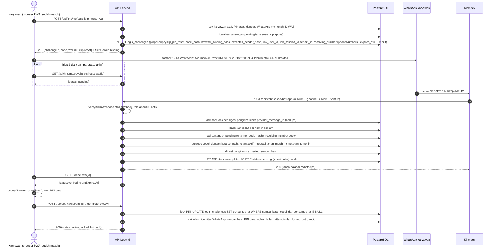

# Verifikasi WhatsApp masuk lewat Kirimdev

Kartu induk: `legend-w8dfz`. Penulis: architect, 11 Nov 2026. Basis: `origin/milestone/m1` 46352cd5.

Dokumen desain, bukan kode. Isinya: keputusan, alur, keamanan, kontrak, skema, konfigurasi, pembagian kerja, dan pertanyaan untuk founder.

## 0. Ringkasan untuk founder

- Login pelanggan lewat WhatsApp masuk **sudah dibangun** di m1 (pelanggan kirim `MASUK LEGEND <KODE>`, web menunggu, tanpa balasan WhatsApp). Yang belum ada: akun Kirimdev produksi, nomor, langganan webhook, dan uji langsung.
- Reset PIN slip gaji memakai mesin yang sama. Karyawan menekan "Lupa PIN", web menampilkan kode, karyawan mengirim `RESET PIN <KODE>` dari nomor WhatsApp yang sudah terverifikasi di akunnya, web menampilkan "Berhasil", lalu karyawan membuat PIN baru.
- Tidak ada pesan WhatsApp keluar, jadi tidak ada biaya per pesan dari Meta. Biaya yang tersisa: langganan bulanan Kirimdev (harga tidak tercantum di dokumentasi Kirimdev).
- Kunci API Kirimdev tidak dibutuhkan aplikasi. Aplikasi hanya butuh secret tanda tangan webhook (`KIRIM_WEBHOOK_SECRET`, sudah ada di `.env.example`).
- KiChat tidak berguna untuk verifikasi. KiChat adalah chat agen di browser yang dimulai oleh agen. Rekomendasi: jangan dibeli.

## 1. Yang sudah ada dan dipakai ulang

| Bagian | Lokasi di m1 |
|---|---|
| Verifikasi tanda tangan Kirimdev (`X-Kirim-Signature: t=<unix>,v1=<hex>`, HMAC-SHA256 atas `"<t>." + raw body`, toleransi 300 detik, beberapa secret saat rotasi, constant-time) | `packages/shared/src/adapters/webhook.ts` (`verifyKirimWebhook`, `signKirimWebhook`), kontrak `docs/plan/contracts.md:226` |
| Route webhook (raw body, 503 bila secret kosong) | `apps/api/src/routes/identity-wa-webhook.routes.ts`, dipasang di `/api/webhooks/whatsapp` (`app.ts:354`) |
| Parse amplop Meta dari Kirimdev (`entry[].changes[].value.messages[]`, `metadata.phone_number_id`, hanya `type: text`) | `services/identity-wa-inbound.service.ts:156` `parseKirimdevPayload` |
| Dedupe per `X-Kirim-Event-Id`, sidik jari isi (`request_hash`), isi pesan tidak disimpan | tabel `wa_inbound_messages`, `processInboundWhatsApp` (`:311`) |
| Kunci advisory per pengirim, batas 10 pesan per nomor per jam (AUTH-04) | `processInboundWhatsApp`, `underPerNumberLimit` |
| Tantangan: kode 8 simbol Crockford (40 bit), TTL 5 menit, sekali pakai, terikat browser (`browser_binding_hash` + cookie), hanya digest berkunci yang disimpan | tabel `login_challenges` (global, tanpa RLS), `packages/shared/src/identity/login-code.ts`, `identity/limits.ts` |
| Tenant dari tantangan, nomor penerima harus sama dengan integrasi `whatsapp` aktif tenant itu (`receivingNumber` untuk wa.me, `phoneNumberId` untuk webhook) | `identity-login.service.ts:101` `resolveWhatsAppChannel`, `completeChallenge` |
| Alur "tautkan WhatsApp" untuk user yang sudah masuk (`link_user_id`, `link_session_id`) | `completeLink` (`identity-wa-inbound.service.ts:684`) |
| Digest nomor berkunci (HMAC, kunci diturunkan dari `BETTER_AUTH_SECRET`) | `apps/api/src/lib/identity-digest.ts` (`whatsAppDigest`, `identityDigest`) |
| Web: layar kode, tombol wa.me, polling 2 detik | `apps/web/src/features/ws01-login/` (`whatsapp-login.tsx`, `queries.ts`, `flow.ts:20`) |
| Fake untuk test | `FakeMessagingProvider` (`packages/shared/src/adapters/fakes.ts:292`), seam `ProcessInboundDeps` (`:202`) |

Pola yang sama dipakai di repo founder `119connect-portal-alumni-main` (`apps/api/src/lib/wa-kirimdev.ts:249` `tandaTanganKirimdevSah`, `services/wa-masuk.service.ts` dengan perintah `TAUT <kode>`). Pola itu sudah berjalan di sana, jadi pilihan ini teruji.

PIN slip gaji ada di cabang lokal `fix/codex-418-pin` (912e79c5, belum di-push, belum masuk m1). Cabang itu menggabungkan `ws/qih2m-payslip-otp` dan `ws/payslip-pin-ui`. Isinya OTP keluar: `requestPayslipPinResetOtp` membuat kode 6 digit, `payslip-pin-whatsapp-sender.ts` mengirimnya lewat `MessagingProvider.send`, dan tabel `payslip_pin_reset_challenges` ada di migrasi `0246_payslip_pins.sql`.

## 2. Keputusan

### D-WA1. Satu mesin bukti WhatsApp untuk semua tujuan: kolom `purpose` di `login_challenges`

- Keputusan: tambah kolom `purpose` (`sign_in` | `payslip_pin_reset`) ke `login_challenges`. Reset PIN memakai kode, webhook, dedupe, batas, dan polling yang sama. Tidak ada tabel tantangan kedua.
- Alasan: webhook datang tanpa tenant. Pencarian kode lintas tenant sudah aman di `login_challenges` (tabel global, indeks `(channel, code_hash)`). Tabel tantangan kedua yang memakai RLS akan butuh fungsi SECURITY DEFINER atau tabel indeks global baru. Satu mesin juga berarti satu tempat untuk diuji (pemalsuan, replay, rotasi).
- Risiko: tantangan reset PIN dipakai untuk membuat sesi login, atau sebaliknya (salah tujuan).
- Penjagaan: CHECK di database (lihat §5), dispatch berdasarkan `purpose` sebelum cek `link_user_id` di `processInboundWhatsApp`, klaim sesi login (`assertLoginChallengeSessionClaimable`, `GET /api/auth/login-challenges/:id`) hanya menerima `purpose = 'sign_in'`, dan test untuk tiap arah.
- Cadangan: bila review architect menolak, pindahkan ke tabel global `wa_proof_challenges` dengan kolom yang sama. Webhook mencari di dua tabel, kontrak HRIS tidak berubah.

### D-WA2. Kata perintah harus cocok dengan tujuan

- Keputusan: login tetap `MASUK <kata brand> <KODE>` (`loginKeyword`, default `MASUK LEGEND`). Reset PIN memakai teks tetap `RESET PIN <KODE>`. Kode login yang dikirim dengan `RESET PIN` ditolak, begitu juga sebaliknya.
- Alasan: pesan yang dikirim karyawan menyebut tujuannya. Penipu yang meminta korban "kirim pesan ini" lebih sulit menyamarkan reset PIN sebagai login atau promo.
- Parser baru `whatsAppProofFromMessage(text)` di `login-code.ts` mengembalikan `{ purpose, code }` atau `null`. `loginCodeFromMessage` tetap ada untuk pemanggil lama.

### D-WA3. Reset PIN hanya dari nomor yang sudah terverifikasi sebelum masalah muncul

- Keputusan: nomor pengirim harus sama dengan identitas WhatsApp terverifikasi milik user yang sedang masuk (`user_identities`, tipe `whatsapp`, `verified_at` terisi). Identitas itu juga harus memenuhi salah satu: terverifikasi sebelum PIN saat ini dibuat (`verified_at <= payslip_pins.set_at`), atau sudah berumur minimal 7 hari.
- Alasan bisnis: PIN melindungi slip gaji dari orang yang memegang sesi karyawan (HP dipinjam, perangkat bersama). Tanpa aturan umur, orang itu bisa menautkan nomornya sendiri lewat alur tautkan WhatsApp, lalu mereset PIN. Celah ini juga ada di desain OTP keluar `fix/codex-418-pin`.
- Karyawan yang tidak memenuhi syarat melihat "Minta HR mereset PIN". HR reset sudah ada (`resetEmployeePayslipPin`, izin `payroll.run`).
- Digest pengirim yang diharapkan dihitung saat tantangan dibuat dan disimpan di `expected_sender_hash`. Webhook cukup membandingkan digest, tanpa membaca tabel HRIS. Saat PIN baru disimpan, HRIS memeriksa ulang bahwa identitas itu masih ada dan masih memenuhi syarat.
- Angka 7 hari perlu persetujuan founder (§10).

### D-WA4. Satu nomor WhatsApp platform untuk semua tenant, siap untuk nomor per brand

- Keputusan: mulai dengan satu nomor Kirimdev. Tiap tenant punya baris `tenant_integrations` `provider = 'whatsapp'` yang menunjuk nomor yang sama (`receivingNumber`, `phoneNumberId`).
- Alasan: kode tidak memuat tenant. Tenant diambil dari baris tantangan, lalu dicek terhadap integrasi aktif tenant (sudah begitu di `completeChallenge`). Jadi berbagi nomor aman dan tidak butuh kode baru. Satu nomor berarti satu langganan dan satu verifikasi Meta Business.
- Nomor per brand nanti cukup lewat konfigurasi (baris integrasi lain plus `phone_number_ids` di langganan webhook Kirimdev). Tidak ada perubahan kode.
- Risiko: satu nomor diblokir Meta berarti semua tenant kehilangan login WhatsApp dan reset PIN. Cadangan: login email dan Google tetap ada, dan HR reset tetap ada untuk PIN.

### D-WA5. Web tahu hasilnya lewat polling, bukan SSE

- Keputusan: polling tiap 2 detik selama tantangan berlaku, berhenti saat status akhir (pola `flow.ts:20`).
- Alasan: repo belum memakai SSE atau `EventSource`. Polling sudah teruji di login WhatsApp. Beban server kecil: paling lama 150 permintaan ringan per tantangan.

### D-WA6. Kode tidak pernah disimpan atau diulang

- Keputusan: `POST` pembuat tantangan reset PIN tidak memakai `idempotentHrisWrite`, karena respons yang disimpan akan memuat kode asli. Membuat tantangan baru membatalkan tantangan `pending` sebelumnya untuk user dan tujuan yang sama. Batas per user mencegah pemborosan.
- Langkah simpan PIN (`/pin`) tetap memakai `idempotentHrisWrite`, karena responsnya tidak memuat rahasia.

## 3. Alur reset PIN slip gaji



Ikatan yang dicek saat `/pin` (semua dalam satu `UPDATE ... RETURNING`):

- `id`, `purpose = 'payslip_pin_reset'`, `status = 'completed'`, `consumed_at IS NULL`.
- `tenant_id` = tenant sesi, `link_user_id` = user sesi, `link_session_id` = id sesi saat ini.
- `browser_binding_hash` = digest cookie binding.
- `completed_at > now() - 10 menit` (jendela izin).

Gagal salah satu: 403 `PIN_RESET_PROOF_INVALID` dengan satu pesan yang sama untuk semua sebab.

## 4. Keamanan

| Ancaman | Penjagaan | Sisa risiko |
|---|---|---|
| Webhook palsu | `verifyKirimWebhook` atas byte mentah sebelum parse dan sebelum routing tenant. Secret kosong: 503. Semua kegagalan: satu pesan `UNAUTHORIZED`. Kirimdev tidak punya allowlist IP (hanya HMAC). | Secret bocor berarti siapa pun bisa memalsukan `from`. Rotasi lewat daftar dipisah koma, secret disimpan di env produksi, tidak di repo. |
| Replay | Toleransi waktu 300 detik. `X-Kirim-Event-Id` unik di `wa_inbound_messages`. Isi berbeda dengan id sama: 409 `CONFLICT`. Tantangan selesai lewat `UPDATE ... WHERE status = 'pending'`. | Tidak ada. |
| Kode ditebak | Kode 40 bit, berlaku 5 menit. Untuk reset PIN, tebakan harus dikirim dari nomor korban (`expected_sender_hash`), jadi menebak tidak berguna. Untuk login: 10 pesan per nomor per jam. | Login: kemungkinan tebakan benar sekitar 10 / 2^40 per jam per nomor. Bisa diabaikan. |
| Nomor pengirim dipalsukan | `from` dijamin jaringan WhatsApp dan diteruskan Kirimdev dengan tanda tangan. Kita tidak menerima nomor dari browser. | Kita percaya pada Kirimdev. Kirimdev diretas berarti pesan palsu bisa masuk. Diterima untuk reset PIN (HR reset tetap ada). Perlu dicatat di daftar subprosesor data. |
| Kode dicuri dari tangkapan layar | Reset PIN: pengirim lain ditolak (digest tidak cocok), tantangan tetap pending, kejadian diaudit. Simpan PIN butuh sesi dan cookie browser yang sama. | Login: orang yang mencuri kode bisa membuat browser korban masuk ke akun pencuri. Lihat §8. |
| Korban ditipu mengirim kode penyerang | Penyerang harus sudah memegang sesi karyawan. Teks pesan menyebut `RESET PIN`. Layar menulis "Jangan kirim kode ini bila diminta orang lain". | Tetap ada untuk karyawan yang tertipu. Diterima. Jejak audit lengkap untuk HR. |
| Penyerang menautkan nomornya sendiri lalu mereset | D-WA3: identitas harus lebih tua dari PIN atau berumur 7 hari. | Tidak ada selama aturan dipakai. |
| Banjir permintaan | Pembuatan tantangan: 5 per 15 menit per perangkat atau IP (`CHALLENGE_RATE_LIMIT`, sudah ada) dan 5 per jam per user untuk reset PIN (baru). Webhook: slot paralel `withInboundSlot`, batas per nomor. | Batas perangkat dan IP masih di memori per instance. Cukup untuk satu VM. |
| Webhook lambat lalu di-retry | Kirimdev memberi batas 10 detik per percobaan dan mencoba 8 kali dalam 24 jam. Semua hasil yang sudah ditangani dijawab 2xx. Dedupe membuat retry aman. | Tidak ada. |
| Audit | Aksi: `payslip_pin.wa_proof_requested`, `payslip_pin.wa_proof_verified`, `payslip_pin.wa_proof_rejected` (sebab: `sender_mismatch`, `purpose_mismatch`, `unrouted`), `payslip_pin.wa_reset`, `payslip_pin.wa_proof_cancelled`. Tanpa kode, PIN, digest, atau nomor lengkap. Nomor hanya bentuk tersamar (`maskSenderForAudit`). | Tidak ada. |
| Data pribadi | Nomor disimpan sebagai digest berkunci (HMAC). Hash biasa tidak cukup karena ruang nomor 62 kecil dan bisa ditebak habis. Isi pesan tidak pernah disimpan. Nomor lengkap hanya di `user_identities` (terenkripsi, sudah ada). | Mengganti `BETTER_AUTH_SECRET` mengubah semua digest. Butuh rencana rotasi sebelum produksi. Masa simpan lihat di bawah. |

Masa simpan (rekomendasi, belum ada job-nya):

- `wa_inbound_messages`: 90 hari. Dedupe butuh minimal 7 hari (saran Kirimdev) dan retry Kirimdev hanya 24 jam.
- `login_challenges` yang sudah selesai, kedaluwarsa, atau batal: 30 hari.
- `audit_logs`: 2 tahun (aturan PRD, sudah ada).

## 5. Skema dan migrasi

Migrasi sementara `0270_wa_proof_purpose` (nomor di atas semua cabang yang sedang berjalan; merge train yang memberi nomor akhir). Satu file, dibuat lewat `pnpm db:generate` dari perubahan `apps/api/src/db/schema/identity.ts`, lalu ditambah bagian CHECK bila generator tidak membuatnya.

`login_challenges` (global, tanpa RLS, tetap seperti keputusan coordinator di `docs/plan/contracts.md`):

| Kolom baru | Tipe | Isi |
|---|---|---|
| `purpose` | `varchar(32) NOT NULL DEFAULT 'sign_in'` | `sign_in` atau `payslip_pin_reset` |
| `expected_sender_hash` | `varchar(64)` | Digest nomor yang wajib mengirim. NULL untuk `sign_in`. |
| `consumed_at` | `timestamptz` | Saat bukti dipakai untuk tindakan. NULL untuk `sign_in` (login memakai `session_issued_at`). |

Constraint baru:

- `login_challenges_purpose_check`: `purpose IN ('sign_in', 'payslip_pin_reset')`.
- `login_challenges_proof_shape_check`: `purpose = 'sign_in' OR (channel = 'whatsapp_inbound' AND tenant_id IS NOT NULL AND link_user_id IS NOT NULL AND link_session_id IS NOT NULL AND expected_sender_hash IS NOT NULL AND session_id IS NULL AND session_issued_at IS NULL)`.
- `login_challenges_consumed_check`: `consumed_at IS NULL OR (purpose <> 'sign_in' AND status = 'completed')`.

Indeks baru: `login_challenges_purpose_user_idx` pada `(purpose, link_user_id, created_at)`. Dipakai untuk batas per user dan untuk membatalkan tantangan lama.

`wa_inbound_messages`: CHECK `kind` ditambah nilai `proof` (pesan yang menyelesaikan tantangan selain login).

Baris lama: semua mendapat `purpose = 'sign_in'` dari default. Tidak ada backfill lain.

Di cabang PIN (`fix/codex-418-pin`): tabel `payslip_pin_reset_challenges` dihapus dari `0246_payslip_pins.sql` dan dari `db/schema/payslip-pin.ts`, karena migrasi itu belum pernah masuk m1 atau produksi. Bila 0246 sudah digabung saat pekerjaan dimulai, buat migrasi `DROP TABLE` terpisah dan jangan mengubah 0246.

RLS: tabel baru tidak ada. Tabel `payslip_pins` tetap memakai `app.enforce_tenant_rls`. Langkah `/pin` membaca `login_challenges` di dalam transaksi tenant, jadi filter `tenant_id` wajib ditulis eksplisit (tabel itu tanpa RLS).

## 6. Kontrak

### 6.1 Layanan identitas (baru, `apps/api/src/services/identity-wa-proof.service.ts`)

```ts
type WhatsAppProofPurpose = "payslip_pin_reset"; // sign_in tetap lewat identity-login.service

issueWhatsAppProof(tx, context, {
  purpose, userId, sessionId, bindingHash, expectedSenderHash,
  ipHash, userAgent, now,
}): Promise<{ challengeId: string; code: string; waLink: string; expiresAt: Date }>
// Membatalkan pending lama (purpose + userId), cek batas per user, menulis baris.
// 503 SERVICE_UNAVAILABLE bila tenant tanpa integrasi whatsapp aktif atau KIRIM_WEBHOOK_SECRET kosong.

readWhatsAppProof(tx, { challengeId, purpose, tenantId, userId, sessionId, bindingHash, now }):
  Promise<{ status: "pending" | "verified" | "used" | "expired" | "cancelled"; expiresAt: Date; grantExpiresAt: Date | null } | null>
// null = tidak ditemukan atau ikatan tidak cocok (route menjawab 404, tanpa membedakan sebab).

consumeWhatsAppProof(tx, { challengeId, purpose, tenantId, userId, sessionId, bindingHash, now }):
  Promise<{ matchedUserId: string } | null>
// Satu UPDATE bersyarat (§3). null = 403 PIN_RESET_PROOF_INVALID di pemanggil.

cancelWhatsAppProof(tx, { challengeId, purpose, tenantId, userId, sessionId, now }): Promise<void>
```

Perubahan di `identity-wa-inbound.service.ts`: setelah `pendingChallengeFor` menemukan tantangan, cabang pertama adalah `purpose`. `payslip_pin_reset` masuk ke `completeProof` (tenant aktif, integrasi memetakan nomor penerima, digest pengirim = `expected_sender_hash`, `UPDATE ... WHERE status = 'pending'`, `kind = 'proof'`). Cabang ini tidak pernah memanggil `completeLink`, `resolveWhatsAppAccount`, merge identitas, atau penerbitan sesi. Balasan WhatsApp (`wa-login-reply`) tidak berlaku untuk `purpose` ini.

### 6.2 Endpoint HRIS (ganti `reset-otp` di `packages/shared/src/hris/payroll/endpoints.ts`)

Semua di router karyawan sendiri yang sudah ada (`hris-payslip.routes.ts`): `requireAuth`, `requireTrustedOrigin`, konteks tenant, `loadPayslipSelf`.

| Metode dan path | Body | Respons sukses | Error |
|---|---|---|---|
| `POST /api/hris/me/payslip-pin/reset-wa` | `{}` | 201 `{ data: { challengeId, code, waLink, expiresAt } }` + cookie binding | 409 `PIN_RESET_WHATSAPP_UNAVAILABLE` (tanpa WhatsApp terverifikasi atau gagal D-WA3), 409 `PIN_NOT_SET`, 429 `RATE_LIMITED`, 503 `SERVICE_UNAVAILABLE` |
| `GET /api/hris/me/payslip-pin/reset-wa/:challengeId` | - | 200 `{ data: { status, expiresAt, grantExpiresAt } }` | 404 |
| `POST /api/hris/me/payslip-pin/reset-wa/:challengeId/pin` | `{ pin, idempotencyKey }` | 200 `payslipPinStatusSchema` `{ status: "active", lockedUntil: null }` | 403 `PIN_RESET_PROOF_INVALID`, 422 format PIN |
| `POST /api/hris/me/payslip-pin/reset-wa/:challengeId/cancel` | `{}` | 204 | 404 |

- `code` dalam bentuk `K7Q4-M2XD`. `waLink` = `https://wa.me/<receivingNumber>?text=` + `encodeURIComponent("RESET PIN K7Q4-M2XD")`.
- Cookie binding memakai helper `setBindingCookie` dari `identity-auth.routes.ts` (dipindah ke modul bersama bila belum diekspor), dengan nama terpisah dari cookie login, umur `(LOGIN_CODE_TTL_MINUTES + PAYSLIP_PIN_PROOF_GRANT_MINUTES + 1)` menit.
- Dihapus: `POST /api/hris/me/payslip-pin/reset-otp`, `POST /api/hris/me/payslip-pin/reset-otp/verify`, konstanta `PAYSLIP_PIN_OTP_*`, `payslip-pin-whatsapp-sender.ts` beserta test-nya, wiring `otpSender` di `hris-payslip.routes.ts` dan `storage-api.routes.ts:166`.

Konstanta baru di `packages/shared/src/identity/limits.ts`:

- `WA_PROOF_TTL_MINUTES = LOGIN_CODE_TTL_MINUTES` (5).
- `PAYSLIP_PIN_PROOF_GRANT_MINUTES = 10`.
- `PAYSLIP_PIN_PROOF_PER_USER_PER_HOUR = 5`.
- `WA_PROOF_IDENTITY_MIN_AGE_DAYS = 7`.

### 6.3 Layar (ganti `ws10-payslip/components/pin-forgot.tsx`)

Langkah: `choose` (penjelasan + tombol "Verifikasi lewat WhatsApp") → `send` (kode besar, tombol "Buka WhatsApp", QR untuk desktop, hitung mundur, teks "Kirim dari nomor yang terdaftar: ••••1234", peringatan penipuan) → `verified` (popup sukses, form PIN baru + ulangi) → `done`. Keadaan lain: kedaluwarsa (tombol "Buat kode baru"), `PIN_RESET_WHATSAPP_UNAVAILABLE` (kartu "Minta HR mereset PIN"), 503 (kartu "belum tersedia", sudah ada), 429 (kartu sendiri, sudah ada). Komponen kode dan QR diambil dari `ws01-login/whatsapp-login.tsx` bila bisa dipakai bersama.

Tampilan nomor tersamar butuh field tambahan `senderHint` (4 digit terakhir) di respons `POST`. Field itu milik user sendiri, jadi aman.

## 7. Konfigurasi, dev, dan test

Env (nama saja, nilai tidak di repo):

| Key | Status | Fungsi |
|---|---|---|
| `KIRIM_WEBHOOK_SECRET` | sudah ada (`config/env.ts:222`, `.env.example:57`) | Secret tanda tangan webhook. Dipisah koma saat rotasi. Kosong: webhook dan pembuatan tantangan menjawab 503. |
| `BETTER_AUTH_SECRET` | sudah ada | Sumber kunci digest nomor dan kode. |
| `NOTIFICATION_WHATSAPP_PROVIDER` | sudah ada, tetap `disabled` | Pesan keluar tidak dipakai. |

Tidak ada key baru. Kunci API Kirimdev (`kdv_live_...`) hanya dipakai sekali oleh orang yang mendaftarkan langganan webhook, tidak oleh aplikasi.

Konfigurasi per tenant (data, bukan env): baris `tenant_integrations` `provider = 'whatsapp'`, `status = 'active'`, `config = { receivingNumber: "628...", phoneNumberId: "<id dari GET /v1/accounts Kirimdev>", loginKeyword: "MASUK LEGEND" }`.

Dev dan test:

- Kirimdev tidak punya sandbox atau key test. Dev memakai simulator lokal: script `scripts/wa-simulate-inbound.mjs --from 628... --text "RESET PIN K7Q4-M2XD"` yang membaca `KIRIM_WEBHOOK_SECRET` dari env proses, menandatangani dengan `signKirimWebhook`, lalu POST ke `/api/webhooks/whatsapp` lokal. Script tidak mencetak secret.
- Test API memakai `signKirimWebhook` dan seam `ProcessInboundDeps`. `FakeMessagingProvider` tetap untuk `verifyWebhook`.
- Uji produksi sekali sebelum rilis (kartu ops): pemalsuan (tanda tangan salah: 401), replay (event id sama: duplikat), rotasi (dua secret aktif), nomor tidak terdaftar, pesan dari tenant lain.

## 8. Login pelanggan lewat WhatsApp

Sudah ada di m1 (WS-01, `docs/DECISIONS.md` sekitar baris 617-640). Desain di atas tidak mengubah alur login. Yang bisa dipakai ulang untuk tujuan baru berikutnya: kolom `purpose`, `expected_sender_hash`, `consumed_at`, dan layanan `identity-wa-proof.service.ts`. Contoh tujuan nanti: konfirmasi ganti rekening, konfirmasi penukaran poin besar. Tiap tujuan baru = satu nilai `purpose`, satu kata perintah, satu test.

Yang perlu dicek atau diputuskan sebelum login WhatsApp produksi:

- Risiko "masuk ke akun orang lain": orang yang melihat kode di layar korban bisa mengirimnya dari nomornya sendiri, lalu browser korban masuk ke akun orang itu. Repo alumni punya langkah `konfirmasi-nama` dan `bukan-saya` untuk ini. Perlu dicek apakah layar login Legend menampilkan nomor tersamar dan tombol "Bukan saya" sebelum sesi dipakai. Bila belum ada, ini kartu kecil terpisah.
- Teks PRD AUTH-02 masih menyebut `X-Hub-Signature-256`. Kode dan `docs/plan/contracts.md:226` memakai `X-Kirim-Signature` atas keputusan owner. `docs/plan/providers.md` masih menyebutnya release blocker sampai PRD diubah.
- Balasan WhatsApp untuk login (AUTH-03) tetap mati. Rekomendasi: biarkan mati, karena pesan keluar berbayar.

## 9. Pembagian kerja

| Kartu | Isi | File (tidak bertumpuk) | Basis | Peran dan model | Review |
|---|---|---|---|---|---|
| A `legend-lgfru` Bukti WhatsApp di identitas | Migrasi `0270_wa_proof_purpose`, kolom dan CHECK §5, parser `whatsAppProofFromMessage`, konstanta, `identity-wa-proof.service.ts`, dispatch `purpose` di inbound, klaim sesi login hanya `sign_in`. Test gagal-dulu: salah tujuan dua arah, pengirim salah, nomor penerima tenant lain, replay, kedaluwarsa, tidak pernah link, merge, atau sesi. | `apps/api/drizzle/0270_*`, `drizzle/meta`, `apps/api/src/db/schema/identity.ts`, `packages/shared/src/identity/login-code.ts`, `packages/shared/src/identity/limits.ts`, `apps/api/src/services/identity-wa-proof.service.ts`, `apps/api/src/services/identity-wa-inbound.service.ts`, `apps/api/src/services/identity-login.service.ts` (klaim), `apps/api/src/test/wa-proof.test.ts` | `origin/milestone/m1` | engineer Opus (desain baru di akses dan migrasi) | architect (K), xhigh |
| B `legend-9h2oj` Reset PIN lewat WhatsApp masuk (API) | Hapus OTP keluar dan `payslip_pin_reset_challenges`, endpoint §6.2, aturan D-WA3, audit, cek ulang identitas saat simpan PIN. | `apps/api/drizzle/0246_payslip_pins.sql`, `apps/api/src/db/schema/payslip-pin.ts`, `apps/api/src/services/payslip-pin.service.ts`, `apps/api/src/routes/hris-payslip.routes.ts`, `apps/api/src/routes/storage-api.routes.ts`, `packages/shared/src/hris/payroll/endpoints.ts`, `packages/shared/src/hris/payroll/payslips.ts`, hapus `payslip-pin-whatsapp-sender.ts` + test, `apps/api/src/test/payslip-pin-db.test.ts` | `fix/codex-418-pin` + kartu A | engineer Sonnet; test-writer bisa mulai bersamaan dengan A dari kontrak §6 | architect (K), xhigh |
| C `legend-ur82k` Layar lupa PIN | §6.3, wa.me + QR + polling + PIN baru. | `apps/web/src/features/ws10-payslip/components/pin-forgot.tsx`, `pin-api.ts`, `pin-hooks.ts`, `apps/web/src/routes/_karyawan/karyawan.slip-gaji.lupa-pin.tsx` | kartu B | ui-engineer (Sonnet, layar kecil) | ui-auditor, review UI founder |
| D `legend-s5rgo` Simulator dev dan dokumen | `scripts/wa-simulate-inbound.mjs`, langkah setup Kirimdev di `docs/deployment.md`, runbook rotasi secret `docs/runbooks/kirimdev-webhook.md`, entri `docs/DECISIONS.md` (D-WA1 sampai D-WA6). | file itu saja | `origin/milestone/m1` | engineer Sonnet + tech-writer | reviewer (S) |
| E `legend-axmob` Kirimdev produksi (ops) | Akun dan paket, nomor, verifikasi Meta Business, langganan webhook (`POST /v1/webhook_subscriptions`, event `message.received`, filter `phone_number_ids`), secret lewat `ghostex secret request`, baris `tenant_integrations`, uji produksi §7. | tidak ada kode | setelah A, B, C | CTO + founder | second-opinion Codex area identitas sebelum gerbang rilis |

Urutan: A dan D jalan bersamaan. Test-writer B jalan bersamaan dengan A. Implementasi B setelah A digabung ke cabang kerja B. C setelah B. E menunggu keputusan founder, tidak menahan A sampai D.

## 10. Keputusan founder

1. **Paket Kirimdev dan biaya bulanan.** Harga tidak tercantum di dokumentasi Kirimdev, perlu dicek di situs atau ke sales. Rekomendasi: paket terendah (Starter). Batas Starter (60 tulis per menit) hanya berlaku untuk pesan keluar, dan kita tidak mengirim.
2. **Nomor WhatsApp.** Rekomendasi: satu nomor baru khusus Legend untuk semua tenant. Nomor itu tidak boleh dipakai di aplikasi WhatsApp biasa, dan butuh verifikasi Meta Business serta nama tampilan.
3. **Aturan nomor yang baru ditautkan.** Rekomendasi: nomor WhatsApp yang ditautkan setelah PIN dibuat baru bisa dipakai reset PIN setelah 7 hari. Sebelum itu karyawan minta HR.
4. **Karyawan tanpa WhatsApp terverifikasi.** Rekomendasi: hanya lewat HR reset (sudah ada). Nomor yang diketik HR di data karyawan tidak dipakai, karena belum terbukti milik karyawan.
5. **Teks PRD AUTH-02.** Rekomendasi: ubah dari `X-Hub-Signature-256` ke tanda tangan Kirimdev (`X-Kirim-Signature`), sesuai keputusan owner yang sudah dipakai di kode.
6. **Masa simpan log.** Rekomendasi: log pesan masuk 90 hari, tantangan selesai 30 hari, audit 2 tahun.
