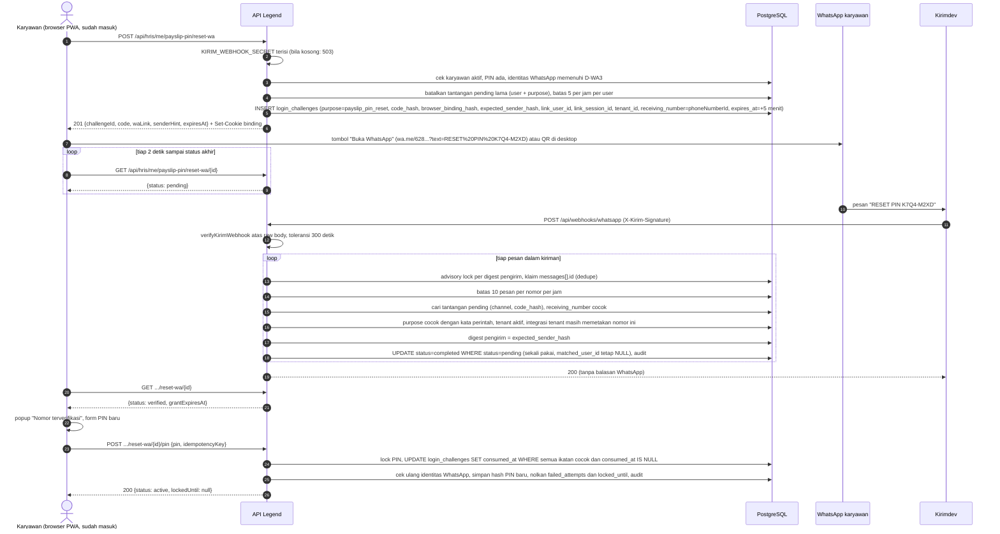

# Verifikasi WhatsApp masuk lewat Kirimdev

Kartu induk: `legend-w8dfz`. Penulis: architect, 11 Nov 2026. Basis: `origin/milestone/m1` 46352cd5.

Dokumen desain, bukan kode. Isinya: keputusan, alur, keamanan, kontrak, skema, konfigurasi, pembagian kerja, dan pertanyaan untuk founder.

Revisi 2 (11 Nov 2026): memasukkan 10 temuan review architect atas revisi 1 (§11).

## 0. Ringkasan untuk founder

- Login pelanggan lewat WhatsApp masuk **sudah dibangun** di m1 (pelanggan kirim `MASUK LEGEND <KODE>`, web menunggu, tanpa balasan WhatsApp). Yang belum ada: akun Kirimdev produksi, nomor, langganan webhook, dan uji langsung.
- Reset PIN slip gaji memakai mesin yang sama. Karyawan menekan "Lupa PIN", web menampilkan kode, karyawan mengirim `RESET PIN <KODE>` dari nomor WhatsApp yang sudah lama tertaut di akunnya, web menampilkan "Berhasil", lalu karyawan membuat PIN baru.
- Tidak ada pesan WhatsApp keluar, jadi tidak ada biaya per pesan dari Meta. Biaya yang tersisa: langganan bulanan Kirimdev (harga tidak tercantum di dokumentasi Kirimdev).
- Satu nomor WhatsApp hanya untuk satu tenant. Aturan ini sudah dipasang di database. Saat peluncuran hanya ada satu tenant, jadi cukup satu nomor.
- Kunci API Kirimdev tidak dibutuhkan aplikasi. Aplikasi hanya butuh secret tanda tangan webhook (`KIRIM_WEBHOOK_SECRET`, sudah ada di `.env.example`).
- KiChat tidak berguna untuk verifikasi. KiChat adalah chat agen di browser yang dimulai oleh agen. Rekomendasi: jangan dibeli.

## 1. Yang sudah ada dan dipakai ulang

| Bagian | Lokasi di m1 |
|---|---|
| Verifikasi tanda tangan Kirimdev (`X-Kirim-Signature: t=<unix>,v1=<hex>`, HMAC-SHA256 atas `"<t>." + raw body`, toleransi 300 detik, beberapa secret saat rotasi, constant-time) | `packages/shared/src/adapters/webhook.ts` (`verifyKirimWebhook`, `signKirimWebhook`), kontrak `docs/plan/contracts.md:226` |
| Route webhook (raw body, 503 bila secret kosong, loop per pesan dalam satu kiriman) | `apps/api/src/routes/identity-wa-webhook.routes.ts`, dipasang di `/api/webhooks/whatsapp` (`app.ts:354`) |
| Parse amplop Meta dari Kirimdev (`entry[].changes[].value.messages[]`, `metadata.phone_number_id`, hanya `type: text`) | `services/identity-wa-inbound.service.ts:156` `parseKirimdevPayload` |
| Dedupe per pesan: kunci `messages[].id` (wamid, `:173`), disimpan di `wa_inbound_messages.provider_message_id` (unik), plus sidik jari isi `request_hash`. Isi pesan tidak disimpan. Header `X-Kirim-Event-Id` hanya dipakai saat verifikasi. | `processInboundWhatsApp` (`:311`, klaim di `:337`) |
| Kunci advisory per pengirim, batas 10 pesan per nomor per jam (AUTH-04) | `processInboundWhatsApp`, `underPerNumberLimit` |
| Tantangan: kode 8 simbol Crockford (40 bit), TTL 5 menit, sekali pakai, terikat browser (`browser_binding_hash` + cookie), hanya digest berkunci yang disimpan | tabel `login_challenges` (global, tanpa RLS), `packages/shared/src/identity/login-code.ts`, `identity/limits.ts` |
| Cookie binding browser (`<app id>.login_binding`, path `/api/auth/login-challenges`, keduanya tetap) | `apps/api/src/lib/login-binding.ts` (`BINDING_COOKIE` `:19`, `setBindingCookie` `:71`) |
| Tenant dari tantangan, nomor penerima harus sama dengan integrasi `whatsapp` aktif tenant itu (`receivingNumber` untuk wa.me, `phoneNumberId` untuk webhook) | `identity-login.service.ts:101` `resolveWhatsAppChannel`, `completeChallenge` |
| Satu nomor hanya untuk satu tenant (legend-mbd2): indeks unik `tenant_integrations_whatsapp_number_key` dan `tenant_integrations_whatsapp_routing_key` | `apps/api/drizzle/0178_tenant_claims.sql:113-114`, `apps/api/src/db/schema/platform-integrations.ts:89-97` |
| Alur "tautkan WhatsApp" untuk user yang sudah masuk (`link_user_id`, `link_session_id`), termasuk merge akun WhatsApp-saja | `completeLink` (`identity-wa-inbound.service.ts:684`) |
| Digest nomor berkunci (HMAC, kunci diturunkan dari `BETTER_AUTH_SECRET`) | `apps/api/src/lib/identity-digest.ts` (`whatsAppDigest`, `identityDigest`) |
| Web: layar kode, tombol wa.me, polling 2 detik | `apps/web/src/features/ws01-login/` (`whatsapp-login.tsx`, `queries.ts`, `flow.ts:20`) |
| Fake untuk test | `FakeMessagingProvider` (`packages/shared/src/adapters/fakes.ts:292`), seam `ProcessInboundDeps` (`:202`) |

Pola yang sama dipakai di repo founder `119connect-portal-alumni-main` (`apps/api/src/lib/wa-kirimdev.ts:249` `tandaTanganKirimdevSah`, `services/wa-masuk.service.ts` dengan perintah `TAUT <kode>`). Pola itu sudah berjalan di sana, jadi pilihan ini teruji.

PIN slip gaji ada di cabang `fix/codex-418-pin` (`origin` 912e79c5, sudah di-push, belum masuk m1). Cabang itu menggabungkan `ws/qih2m-payslip-otp` dan `ws/payslip-pin-ui`. Isinya OTP keluar: `requestPayslipPinResetOtp` membuat kode 6 digit, `payslip-pin-whatsapp-sender.ts` mengirimnya lewat `MessagingProvider.send`, dan tabel `payslip_pin_reset_challenges` ada di migrasi `0246_payslip_pins.sql`.

## 2. Keputusan

### D-WA1. Satu mesin bukti WhatsApp untuk semua tujuan: kolom `purpose` di `login_challenges`

- Keputusan: tambah kolom `purpose` (`sign_in` | `payslip_pin_reset`) ke `login_challenges`. Reset PIN memakai kode, webhook, dedupe, batas, dan polling yang sama. Tidak ada tabel tantangan kedua.
- Alasan: webhook datang tanpa tenant. Pencarian kode lintas tenant sudah aman di `login_challenges` (tabel global, indeks `(channel, code_hash)`). Tabel tantangan kedua yang memakai RLS akan butuh fungsi SECURITY DEFINER atau tabel indeks global baru. Satu mesin juga berarti satu tempat untuk diuji (pemalsuan, replay, rotasi).
- Risiko: tantangan reset PIN dipakai untuk membuat sesi login, atau sebaliknya (salah tujuan).
- Penjagaan:
  - CHECK di database (§5).
  - Dispatch berdasarkan `purpose` sebelum cek `link_user_id` di `processInboundWhatsApp`.
  - Semua jalur login yang memuat tantangan berdasarkan id hanya menerima `purpose = 'sign_in'`: `loadChallenge` untuk poll (`pollWhatsAppChallenge`, `identity-login.service.ts:470`) dan untuk cancel (`:636-643`). Tanpa filter ini, cabang `absorbedIntoSurvivor` (`:477-481`) bisa menerbitkan sesi untuk baris reset PIN yang `matched_user_id`-nya berbeda dari `link_user_id`.
  - `completeProof` tidak pernah mengisi `matched_user_id`. Baris reset PIN selalu punya `matched_user_id IS NULL` (dijaga CHECK).
  - Test untuk tiap arah.
- Cadangan: bila implementasi menunjukkan terlalu banyak jalur login yang harus difilter, pindahkan ke tabel global `wa_proof_challenges` dengan kolom yang sama. Webhook mencari di dua tabel, kontrak HRIS tidak berubah.

### D-WA2. Kata perintah harus cocok dengan tujuan

- Keputusan: login tetap `MASUK <kata brand> <KODE>` (`loginKeyword`, default `MASUK LEGEND`). Reset PIN memakai teks tetap `RESET PIN <KODE>`. Kode login yang dikirim dengan `RESET PIN` ditolak, begitu juga sebaliknya.
- Alasan: pesan yang dikirim karyawan menyebut tujuannya. Penipu yang meminta korban "kirim pesan ini" lebih sulit menyamarkan reset PIN sebagai login atau promo.
- Parser baru `whatsAppProofFromMessage(text)` di `login-code.ts` mengembalikan `{ purpose, code }` atau `null`. `loginCodeFromMessage` tetap ada untuk pemanggil lama.

### D-WA3. Reset PIN hanya dari nomor yang sudah lama tertaut ke akun ini

- Keputusan: nomor pengirim harus sama dengan identitas WhatsApp terverifikasi milik user yang sedang masuk (`user_identities`, tipe `whatsapp`, `verified_at` terisi), dan identitas itu sudah tertaut ke user ini minimal 7 hari (`linked_at <= now() - 7 hari`).
- Kolom baru `user_identities.linked_at`: diisi saat baris dibuat, dan diisi ulang ke `now()` oleh trigger database setiap kali `user_id` berubah (merge, pindah identitas). Trigger, bukan kode aplikasi, supaya tidak ada jalur merge yang lupa.
- Mengapa bukan `verified_at`: merge akun membawa `verified_at` lama (`completeLink` hanya mengisi `verifiedAt` bila kosong, `identity-wa-inbound.service.ts:889-896`). Orang yang memegang sesi karyawan bisa menautkan nomor akun lamanya sendiri dan langsung lolos.
- Mengapa tidak ada syarat "lebih tua dari PIN": HR reset menghapus PIN, jadi PIN baru membuat nomor yang ditautkan sebelumnya ikut lolos. Syarat umur 7 hari saja lebih sederhana dan tidak bisa diakali dengan urutan kejadian.
- Alasan bisnis: PIN melindungi slip gaji dari orang yang memegang sesi karyawan (HP dipinjam, perangkat bersama). Celah yang sama ada di desain OTP keluar `fix/codex-418-pin`.
- Karyawan yang tidak memenuhi syarat melihat "Minta HR mereset PIN". HR reset sudah ada (`resetEmployeePayslipPin`, izin `payroll.run`).
- Digest pengirim yang diharapkan dihitung saat tantangan dibuat dan disimpan di `expected_sender_hash`. Webhook cukup membandingkan digest, tanpa membaca tabel HRIS. Saat PIN baru disimpan, HRIS memeriksa ulang bahwa identitas itu masih milik user, masih terverifikasi, dan masih memenuhi syarat umur.
- Isi awal `linked_at` untuk baris lama: waktu migrasi. Semua nomor lama baru bisa dipakai 7 hari setelah deploy. Tidak merugikan, karena reset PIN lewat WhatsApp adalah fitur baru.
- Angka 7 hari perlu persetujuan founder (§10).

### D-WA4. Satu nomor WhatsApp per tenant (aturan yang sudah ada)

- Keputusan: ikuti aturan legend-mbd2. Tiap tenant punya nomor Kirimdev sendiri di baris `tenant_integrations` `provider = 'whatsapp'` (`receivingNumber`, `phoneNumberId`). Saat peluncuran hanya ada satu tenant, jadi cukup satu nomor.
- Alasan: dua indeks unik sudah menolak nomor yang sama di dua tenant aktif. Kode login juga memilih tenant dari konfigurasi itu. Membuka nomor bersama butuh migrasi dan audit semua kode yang mencari tenant dari nomor. Itu tidak perlu sekarang.
- Risiko: tenant kedua dan seterusnya butuh nomor dan langganan sendiri, jadi biayanya naik per tenant.
- Cadangan: bila banyak tenant kecil muncul, buat kartu terpisah untuk nomor bersama. Kode tidak memuat tenant, dan tenant diambil dari baris tantangan, jadi jalannya ada. Kartu itu harus menghapus dua indeks di atas dan memeriksa ulang semua pencarian tenant dari nomor.
- Risiko lain: satu nomor diblokir Meta berarti tenant itu kehilangan login WhatsApp dan reset PIN. Login email dan Google tetap ada, dan HR reset tetap ada untuk PIN.

### D-WA5. Web tahu hasilnya lewat polling, bukan SSE

- Keputusan: polling tiap 2 detik selama tantangan berlaku, berhenti saat status akhir (pola `flow.ts:20`).
- Alasan: repo belum memakai SSE atau `EventSource`. Polling sudah teruji di login WhatsApp. Beban server kecil: paling lama 150 permintaan ringan per tantangan.

### D-WA6. Kode tidak pernah disimpan atau diulang

- Keputusan: `POST` pembuat tantangan reset PIN tidak memakai `idempotentHrisWrite`, karena respons yang disimpan akan memuat kode asli. Membuat tantangan baru membatalkan tantangan `pending` sebelumnya untuk user dan tujuan yang sama. Batas per user mencegah pemborosan.
- Langkah simpan PIN (`/pin`) tetap memakai `idempotentHrisWrite`, karena responsnya tidak memuat rahasia.

## 3. Alur reset PIN slip gaji



Ikatan yang dicek saat `/pin` (semua dalam satu `UPDATE ... RETURNING`):

- `id`, `purpose = 'payslip_pin_reset'`, `status = 'completed'`, `consumed_at IS NULL`.
- `tenant_id` = tenant sesi, `link_user_id` = user sesi, `link_session_id` = id sesi saat ini.
- `browser_binding_hash` = digest cookie binding.
- `completed_at > now() - 10 menit` (jendela izin).

Gagal salah satu: 403 `PAYSLIP_PIN_RESET_PROOF_INVALID` dengan satu pesan yang sama untuk semua sebab.

HR reset (`resetEmployeePayslipPin`) membatalkan semua baris `payslip_pin_reset` milik user itu yang masih `pending`, atau `completed` tetapi belum dipakai. Ini menggantikan langkah lama yang menghanguskan tantangan OTP terbuka (fix-418 `payslip-pin.service.ts:557-566`).

## 4. Keamanan

| Ancaman | Penjagaan | Sisa risiko |
|---|---|---|
| Webhook palsu | `verifyKirimWebhook` atas byte mentah sebelum parse dan sebelum routing tenant. Secret kosong: 503. Semua kegagalan: satu pesan `UNAUTHORIZED`. Kirimdev tidak punya allowlist IP (hanya HMAC). | Secret bocor berarti siapa pun bisa memalsukan `from`. Rotasi lewat daftar dipisah koma, secret disimpan di env produksi, tidak di repo. |
| Replay | Toleransi waktu 300 detik. `messages[].id` unik di `wa_inbound_messages`. Isi berbeda dengan id sama: `CONFLICT`. Tantangan selesai lewat `UPDATE ... WHERE status = 'pending'`. | Tidak ada. |
| Satu pesan bermasalah menghentikan kiriman | Saat ini `CONFLICT` pada satu pesan (`identity-wa-inbound.service.ts:359`) menghentikan loop (`identity-wa-webhook.routes.ts:79-80`). Kirimdev menganggap sebagian besar 4xx gagal permanen, jadi pesan lain di kiriman itu hilang. Perbaikan (kartu A): tangkap `CONFLICT` per pesan, catat, lanjutkan, jawab 200. | Tidak ada setelah perbaikan. |
| Kode ditebak | Kode 40 bit, berlaku 5 menit. Untuk reset PIN, tebakan harus dikirim dari nomor korban (`expected_sender_hash`), jadi menebak tidak berguna. Untuk login: 10 pesan per nomor per jam. | Login: kemungkinan tebakan benar sekitar 10 / 2^40 per jam per nomor. Bisa diabaikan. |
| Nomor pengirim dipalsukan | `from` dijamin jaringan WhatsApp dan diteruskan Kirimdev dengan tanda tangan. Kita tidak menerima nomor dari browser. | Kita percaya pada Kirimdev. Kirimdev diretas berarti pesan palsu bisa masuk. Diterima untuk reset PIN (HR reset tetap ada). Perlu dicatat di daftar subprosesor data. |
| Kode dicuri dari tangkapan layar | Reset PIN: pengirim lain ditolak (digest tidak cocok), tantangan tetap pending, kejadian diaudit. Simpan PIN butuh sesi dan cookie browser yang sama. | Login: orang yang mencuri kode bisa membuat browser korban masuk ke akun pencuri. Lihat §8. |
| Korban ditipu mengirim kode penyerang | Penyerang harus sudah memegang sesi karyawan. Teks pesan menyebut `RESET PIN`. Layar menulis "Jangan kirim kode ini bila diminta orang lain". | Tetap ada untuk karyawan yang tertipu. Diterima. Jejak audit lengkap untuk HR. |
| Penyerang menautkan nomornya sendiri (atau lewat merge) lalu mereset | D-WA3: `linked_at` minimal 7 hari, diisi ulang trigger setiap `user_id` berubah. | Tidak ada selama trigger terpasang. Test wajib: merge akun lama tidak lolos. |
| Banjir permintaan | Pembuatan tantangan reset PIN: 5 per jam per user (baru), dan satu tantangan aktif per user. Reset PIN tidak ikut batas 5 per 15 menit per IP milik login (`identity-login.service.ts:197-218`), supaya karyawan di Wi-Fi outlet tidak terkena 429 karena tamu yang login. Webhook: slot paralel `withInboundSlot`, batas per nomor. | Batas login per perangkat dan IP masih di memori per instance. Cukup untuk satu VM. |
| Webhook lambat lalu di-retry | Kirimdev memberi batas 10 detik per percobaan dan mencoba 8 kali dalam 24 jam. Semua hasil yang sudah ditangani dijawab 2xx. Dedupe membuat retry aman. | Tidak ada. |
| Audit | Aksi: `payslip_pin.wa_proof_requested`, `payslip_pin.wa_proof_verified`, `payslip_pin.wa_proof_rejected` (sebab: `sender_mismatch`, `purpose_mismatch`, `unrouted`), `payslip_pin.wa_reset`, `payslip_pin.wa_proof_cancelled` (oleh user atau oleh HR reset). Tanpa kode, PIN, digest, atau nomor lengkap. Nomor hanya bentuk tersamar (`maskSenderForAudit`). | Tidak ada. |
| Data pribadi | Nomor disimpan sebagai digest berkunci (HMAC). Hash biasa tidak cukup karena ruang nomor 62 kecil dan bisa ditebak habis. Isi pesan tidak pernah disimpan. Nomor lengkap hanya di `user_identities` (terenkripsi, sudah ada). | Mengganti `BETTER_AUTH_SECRET` mengubah semua digest. Butuh rencana rotasi sebelum produksi. Masa simpan lihat di bawah. |

Masa simpan (rekomendasi, belum ada job-nya):

- `wa_inbound_messages`: 90 hari. Dedupe butuh minimal 7 hari (saran Kirimdev) dan retry Kirimdev hanya 24 jam.
- `login_challenges` yang sudah selesai, kedaluwarsa, atau batal: 30 hari.
- `audit_logs`: 2 tahun (aturan PRD, sudah ada).

## 5. Skema dan migrasi

### 5.1 Kartu A: migrasi sementara `0270_wa_proof_purpose`

Nomor di atas semua cabang yang sedang berjalan; merge train yang memberi nomor akhir. Dibuat lewat `pnpm db:generate` dari perubahan `apps/api/src/db/schema/identity.ts`, lalu ditambah CHECK dan trigger di bagian custom SQL bila generator tidak membuatnya.

`login_challenges` (global, tanpa RLS, tetap seperti keputusan coordinator di `docs/plan/contracts.md`):

| Kolom baru | Tipe | Isi |
|---|---|---|
| `purpose` | `varchar(32) NOT NULL DEFAULT 'sign_in'` | `sign_in` atau `payslip_pin_reset` |
| `expected_sender_hash` | `varchar(64)` | Digest nomor yang wajib mengirim. NULL untuk `sign_in`. |
| `consumed_at` | `timestamptz` | Saat bukti dipakai untuk tindakan. NULL untuk `sign_in` (login memakai `session_issued_at`). |

Constraint baru:

- `login_challenges_purpose_check`: `purpose IN ('sign_in', 'payslip_pin_reset')`.
- `login_challenges_proof_shape_check`: `purpose = 'sign_in' OR (channel = 'whatsapp_inbound' AND tenant_id IS NOT NULL AND link_user_id IS NOT NULL AND link_session_id IS NOT NULL AND expected_sender_hash IS NOT NULL AND matched_user_id IS NULL AND session_id IS NULL AND session_issued_at IS NULL)`.
- `login_challenges_consumed_check`: `consumed_at IS NULL OR (purpose <> 'sign_in' AND status = 'completed')`.

Indeks baru: `login_challenges_purpose_user_idx` pada `(purpose, link_user_id, created_at)`. Dipakai untuk batas per user dan untuk membatalkan tantangan lama.

`user_identities`:

- Kolom baru `linked_at timestamptz NOT NULL DEFAULT now()`. Baris lama terisi waktu migrasi.
- Trigger `user_identities_linked_at_on_owner_change` (BEFORE UPDATE OF `user_id`): bila `NEW.user_id IS DISTINCT FROM OLD.user_id`, set `NEW.linked_at = now()`.

`wa_inbound_messages`: CHECK `kind` ditambah nilai `proof` (pesan yang menyelesaikan tantangan selain login).

### 5.2 Kartu B: migrasi sementara `0271_drop_payslip_pin_reset_challenges`

`fix/codex-418-pin` sudah di-push dan `0246_payslip_pins.sql` sudah dijalankan di DB dev beberapa worktree. Jadi 0246 tidak diubah. Migrasi terpisah menjalankan `DROP TABLE payslip_pin_reset_challenges`, dan tabel itu dihapus dari `db/schema/payslip-pin.ts`.

### 5.3 RLS

Tabel baru tidak ada. `payslip_pins` tetap memakai `app.enforce_tenant_rls`. Langkah `/pin` membaca `login_challenges` di dalam transaksi tenant, jadi filter `tenant_id` wajib ditulis eksplisit (tabel itu tanpa RLS).

## 6. Kontrak

### 6.1 Layanan identitas (baru, `apps/api/src/services/identity-wa-proof.service.ts`)

```ts
type WhatsAppProofPurpose = "payslip_pin_reset"; // sign_in tetap lewat identity-login.service

issueWhatsAppProof(tx, context, {
  purpose, userId, sessionId, bindingHash, expectedSenderHash,
  ipHash, userAgent, now,
}): Promise<{ challengeId: string; code: string; waLink: string; expiresAt: Date }>
// Membatalkan pending lama (purpose + userId), cek batas per user (bukan per IP), menulis baris.
// 503 SERVICE_UNAVAILABLE bila KIRIM_WEBHOOK_SECRET kosong atau tenant tanpa integrasi whatsapp aktif.
// Cek secret ini syarat baru khusus bukti; pembuatan tantangan login saat ini tidak memeriksanya.

readWhatsAppProof(tx, { challengeId, purpose, tenantId, userId, sessionId, bindingHash, now }):
  Promise<{ status: "pending" | "verified" | "used" | "expired" | "cancelled"; expiresAt: Date; grantExpiresAt: Date | null } | null>
// null = tidak ditemukan atau ikatan tidak cocok (route menjawab 404, tanpa membedakan sebab).

consumeWhatsAppProof(tx, { challengeId, purpose, tenantId, userId, sessionId, bindingHash, now }): Promise<boolean>
// Satu UPDATE bersyarat (§3). false = 403 PAYSLIP_PIN_RESET_PROOF_INVALID di pemanggil.

cancelWhatsAppProof(tx, { challengeId, purpose, tenantId, userId, sessionId, now }): Promise<void>

cancelOpenWhatsAppProofs(tx, { purpose, tenantId, userId, now }): Promise<number>
// Untuk HR reset: batalkan pending dan completed-belum-dipakai.
```

Perubahan di `identity-wa-inbound.service.ts`:

- Setelah `pendingChallengeFor` menemukan tantangan, cabang pertama adalah `purpose`. `payslip_pin_reset` masuk ke `completeProof`: tenant aktif, integrasi memetakan nomor penerima, digest pengirim = `expected_sender_hash`, `UPDATE ... WHERE status = 'pending'`, `kind = 'proof'`, `matched_user_id` tidak diisi.
- Cabang ini tidak pernah memanggil `completeLink`, `resolveWhatsAppAccount`, merge identitas, atau penerbitan sesi. Balasan WhatsApp (`wa-login-reply`) tidak berlaku untuk `purpose` ini.

Perubahan di `identity-wa-webhook.routes.ts`: `CONFLICT` dari satu pesan ditangkap per pesan, dihitung, dan tidak menghentikan pesan lain.

Perubahan di `identity-login.service.ts`: `loadChallenge` (dipakai poll dan cancel login) hanya mengembalikan baris `purpose = 'sign_in'`.

Perubahan di `apps/api/src/lib/login-binding.ts`: nama cookie, path, dan label digest jadi parameter. Login tetap `<app id>.login_binding` di `/api/auth/login-challenges`. Reset PIN memakai `<app id>.pin_reset_binding` di `/api/hris/me/payslip-pin/reset-wa`, umur `(WA_PROOF_TTL_MINUTES + PAYSLIP_PIN_PROOF_GRANT_MINUTES + 1)` menit.

### 6.2 Endpoint HRIS (ganti `reset-otp` di `packages/shared/src/hris/payroll/endpoints.ts`)

Semua di router karyawan sendiri yang sudah ada (`hris-payslip.routes.ts`): `requireAuth`, `requireTrustedOrigin`, konteks tenant, `loadPayslipSelf`.

| Metode dan path | Body | Respons sukses | Error |
|---|---|---|---|
| `POST /api/hris/me/payslip-pin/reset-wa` | `{}` | 201 `{ data: { challengeId, code, waLink, senderHint, expiresAt } }` + cookie binding | 409 `PAYSLIP_PIN_RESET_WHATSAPP_UNAVAILABLE` (tanpa WhatsApp terverifikasi atau gagal D-WA3), 409 `PAYSLIP_PIN_NOT_SET` (sudah ada), 429 `RATE_LIMITED`, 503 `SERVICE_UNAVAILABLE` |
| `GET /api/hris/me/payslip-pin/reset-wa/:challengeId` | - | 200 `{ data: { status, expiresAt, grantExpiresAt } }` | 404 |
| `POST /api/hris/me/payslip-pin/reset-wa/:challengeId/pin` | `{ pin, idempotencyKey }` | 200 `payslipPinStatusSchema` `{ status: "active", lockedUntil: null }` | 403 `PAYSLIP_PIN_RESET_PROOF_INVALID`, 422 format PIN |
| `POST /api/hris/me/payslip-pin/reset-wa/:challengeId/cancel` | `{}` | 204 | 404 |

- Kode error baru (`PAYSLIP_PIN_RESET_WHATSAPP_UNAVAILABLE`, `PAYSLIP_PIN_RESET_PROOF_INVALID`) didaftarkan di `packages/shared/src/hris/payroll/errors.ts`.
- `code` dalam bentuk `K7Q4-M2XD`. `waLink` = `https://wa.me/<receivingNumber>?text=` + `encodeURIComponent("RESET PIN K7Q4-M2XD")`. `senderHint` = 4 digit terakhir nomor user sendiri.
- `resetEmployeePayslipPin` (HR) memanggil `cancelOpenWhatsAppProofs`.
- Dihapus: `POST /api/hris/me/payslip-pin/reset-otp`, `POST /api/hris/me/payslip-pin/reset-otp/verify`, konstanta `PAYSLIP_PIN_OTP_*`, `payslip-pin-whatsapp-sender.ts` beserta test-nya, wiring `otpSender` di `hris-payslip.routes.ts` dan `storage-api.routes.ts:166`.

Konstanta baru di `packages/shared/src/identity/limits.ts`:

- `WA_PROOF_TTL_MINUTES = LOGIN_CODE_TTL_MINUTES` (5).
- `PAYSLIP_PIN_PROOF_GRANT_MINUTES = 10`.
- `PAYSLIP_PIN_PROOF_PER_USER_PER_HOUR = 5`.
- `WA_PROOF_IDENTITY_MIN_AGE_DAYS = 7`.

### 6.3 Layar (ganti `ws10-payslip/components/pin-forgot.tsx`)

Langkah:

1. `choose`: penjelasan dan tombol "Verifikasi lewat WhatsApp".
2. `send`: kode besar, tombol "Buka WhatsApp", QR untuk desktop, hitung mundur, teks "Kirim dari nomor yang terdaftar: ••••1234", peringatan penipuan.
3. `verified`: popup sukses, form PIN baru dan ulangi PIN.
4. `done`.

Keadaan lain: kedaluwarsa (tombol "Buat kode baru"), `PAYSLIP_PIN_RESET_WHATSAPP_UNAVAILABLE` (kartu "Minta HR mereset PIN"), 503 (kartu "belum tersedia", sudah ada), 429 (kartu sendiri, sudah ada). Komponen kode dan QR diambil dari `ws01-login/whatsapp-login.tsx` bila bisa dipakai bersama.

## 7. Konfigurasi, dev, dan test

Env (nama saja, nilai tidak di repo):

| Key | Status | Fungsi |
|---|---|---|
| `KIRIM_WEBHOOK_SECRET` | sudah ada (`config/env.ts:222`, `.env.example:57`) | Secret tanda tangan webhook. Dipisah koma saat rotasi. Kosong: webhook menjawab 503 (sudah ada), dan pembuatan tantangan reset PIN menjawab 503 (baru, kartu A, dengan test). |
| `BETTER_AUTH_SECRET` | sudah ada | Sumber kunci digest nomor dan kode. |
| `NOTIFICATION_WHATSAPP_PROVIDER` | sudah ada, tetap `disabled` | Pesan keluar tidak dipakai. |

Tidak ada key baru. Kunci API Kirimdev (`kdv_live_...`) hanya dipakai sekali oleh orang yang mendaftarkan langganan webhook, tidak oleh aplikasi.

Konfigurasi per tenant (data, bukan env): baris `tenant_integrations` `provider = 'whatsapp'`, `status = 'active'`, `config = { receivingNumber: "628...", phoneNumberId: "<id dari GET /v1/accounts Kirimdev>", loginKeyword: "MASUK LEGEND" }`. Satu nomor hanya boleh aktif di satu tenant (D-WA4).

Dev dan test:

- Kirimdev tidak punya sandbox atau key test. Dev memakai simulator lokal `scripts/wa-simulate-inbound.ts`, dijalankan lewat `tsx` (sumber TS di `packages/shared` tidak bisa diimpor dari `.mjs`). Contoh: `pnpm exec tsx scripts/wa-simulate-inbound.ts --from 628... --text "RESET PIN K7Q4-M2XD"`. Script membaca `KIRIM_WEBHOOK_SECRET` dari env proses, menandatangani dengan `signKirimWebhook`, lalu POST ke `/api/webhooks/whatsapp` lokal. Script tidak mencetak secret.
- Test API memakai `signKirimWebhook` dan seam `ProcessInboundDeps`. `FakeMessagingProvider` tetap untuk `verifyWebhook`.
- Uji produksi sekali sebelum rilis (kartu E): pemalsuan (tanda tangan salah: 401), replay (pesan sama: duplikat), rotasi (dua secret aktif), nomor tidak terdaftar, kiriman berisi beberapa pesan.

## 8. Login pelanggan lewat WhatsApp

Sudah ada di m1 (WS-01, `docs/DECISIONS.md` sekitar baris 617-640). Desain di atas tidak mengubah alur login, kecuali filter `purpose = 'sign_in'` di poll dan cancel, dan penanganan `CONFLICT` per pesan di webhook. Yang bisa dipakai ulang untuk tujuan baru berikutnya: kolom `purpose`, `expected_sender_hash`, `consumed_at`, `user_identities.linked_at`, dan layanan `identity-wa-proof.service.ts`. Contoh tujuan nanti: konfirmasi ganti rekening, konfirmasi penukaran poin besar. Tiap tujuan baru = satu nilai `purpose`, satu kata perintah, satu test.

Yang perlu dicek atau diputuskan sebelum login WhatsApp produksi:

- Risiko "masuk ke akun orang lain": orang yang melihat kode di layar korban bisa mengirimnya dari nomornya sendiri, lalu browser korban masuk ke akun orang itu. Repo alumni punya langkah `konfirmasi-nama` dan `bukan-saya` untuk ini. Perlu dicek apakah layar login Legend menampilkan nomor tersamar dan tombol "Bukan saya" sebelum sesi dipakai. Bila belum ada, ini kartu kecil terpisah.
- Teks PRD AUTH-02 masih menyebut `X-Hub-Signature-256`. Kode dan `docs/plan/contracts.md:226` memakai `X-Kirim-Signature` atas keputusan owner. `docs/plan/providers.md` masih menyebutnya release blocker sampai PRD diubah.
- `docs/plan/contracts.md:226` menyebut `X-Kirim-Event-Id` sebagai kunci dedupe, padahal kode memakai `messages[].id`. Kode benar (satu kiriman bisa berisi beberapa pesan). Teks kontrak dibetulkan di kartu D.
- Balasan WhatsApp untuk login (AUTH-03) tetap mati. Rekomendasi: biarkan mati, karena pesan keluar berbayar.

## 9. Pembagian kerja

| Kartu | Isi | File (tidak bertumpuk) | Basis | Peran dan model | Review |
|---|---|---|---|---|---|
| A `legend-lgfru` Bukti WhatsApp di identitas | Migrasi `0270_wa_proof_purpose` (§5.1), parser `whatsAppProofFromMessage`, konstanta, `identity-wa-proof.service.ts`, dispatch `purpose` di inbound, filter `purpose` di poll dan cancel login, cookie binding berparameter, `CONFLICT` per pesan, cek secret saat membuat bukti. Test gagal-dulu: salah tujuan dua arah, poll login atas baris reset PIN tidak menerbitkan sesi, pengirim salah, nomor penerima tenant lain, replay, kedaluwarsa, tidak pernah link, merge, atau sesi, merge mengisi ulang `linked_at`, satu `CONFLICT` tidak menghentikan kiriman. | `apps/api/drizzle/0270_*` + `drizzle/meta`, `apps/api/src/db/schema/identity.ts`, custom SQL identitas, `packages/shared/src/identity/login-code.ts`, `packages/shared/src/identity/limits.ts`, `apps/api/src/services/identity-wa-proof.service.ts`, `apps/api/src/services/identity-wa-inbound.service.ts`, `apps/api/src/services/identity-login.service.ts`, `apps/api/src/routes/identity-wa-webhook.routes.ts`, `apps/api/src/lib/login-binding.ts`, `apps/api/src/test/wa-proof.test.ts` | `origin/milestone/m1` | engineer Opus (desain baru di akses dan migrasi) | architect (K), xhigh |
| B `legend-9h2oj` Reset PIN lewat WhatsApp masuk (API) | Migrasi `0271_drop_payslip_pin_reset_challenges` (§5.2), hapus OTP keluar, endpoint §6.2, aturan D-WA3 (`linked_at`), HR reset membatalkan bukti, audit, cek ulang identitas saat simpan PIN. | `apps/api/drizzle/0271_*` + `drizzle/meta`, `apps/api/src/db/schema/payslip-pin.ts`, `apps/api/src/services/payslip-pin.service.ts`, `apps/api/src/routes/hris-payslip.routes.ts`, `apps/api/src/routes/storage-api.routes.ts`, `packages/shared/src/hris/payroll/endpoints.ts`, `packages/shared/src/hris/payroll/payslips.ts`, `packages/shared/src/hris/payroll/errors.ts`, hapus `payslip-pin-whatsapp-sender.ts` + test, `apps/api/src/test/payslip-pin-db.test.ts` | `fix/codex-418-pin` + kartu A | engineer Sonnet; test-writer bisa mulai bersamaan dengan A dari kontrak §6 | architect (K), xhigh |
| C `legend-ur82k` Layar lupa PIN | §6.3, wa.me + QR + polling + PIN baru. | `apps/web/src/features/ws10-payslip/components/pin-forgot.tsx`, `pin-api.ts`, `pin-hooks.ts`, `apps/web/src/routes/_karyawan/karyawan.slip-gaji.lupa-pin.tsx` | kartu B | ui-engineer (Sonnet, layar kecil) | ui-auditor, review UI founder |
| D `legend-s5rgo` Simulator dev dan dokumen | `scripts/wa-simulate-inbound.ts` (lewat `tsx`), langkah setup Kirimdev di `docs/deployment.md`, runbook rotasi secret `docs/runbooks/kirimdev-webhook.md`, entri `docs/DECISIONS.md` (D-WA1 sampai D-WA6), koreksi kunci dedupe di `docs/plan/contracts.md:226`. | file itu saja | `origin/milestone/m1` | engineer Sonnet + tech-writer | reviewer (S) |
| E `legend-axmob` Kirimdev produksi (ops) | Akun dan paket, nomor, verifikasi Meta Business, langganan webhook (`POST /v1/webhook_subscriptions`, event `message.received`, filter `phone_number_ids`), secret lewat `ghostex secret request`, baris `tenant_integrations`, uji produksi §7. | tidak ada kode | setelah A, B, C | CTO + founder | second-opinion Codex area identitas sebelum gerbang rilis |

Urutan: A dan D jalan bersamaan. Test-writer B jalan bersamaan dengan A. Implementasi B setelah A digabung ke cabang kerja B. C setelah B. E menunggu keputusan founder, tidak menahan A sampai D.

## 10. Keputusan founder

1. **Paket Kirimdev dan biaya bulanan.** Harga tidak tercantum di dokumentasi Kirimdev, perlu dicek di situs atau ke sales. Rekomendasi: paket terendah (Starter). Batas Starter (60 tulis per menit) hanya berlaku untuk pesan keluar, dan kita tidak mengirim.
2. **Nomor WhatsApp.** Aturan yang sudah ada: satu nomor per tenant. Rekomendasi: satu nomor baru khusus Legend untuk tenant pertama. Nomor itu tidak boleh dipakai di aplikasi WhatsApp biasa, dan butuh verifikasi Meta Business serta nama tampilan. Tenant berikutnya butuh nomor dan biaya sendiri, kecuali nanti dibuat kartu nomor bersama.
3. **Aturan nomor yang baru ditautkan.** Rekomendasi: nomor WhatsApp baru bisa dipakai reset PIN setelah 7 hari tertaut ke akun. Sebelum itu karyawan minta HR. Semua nomor yang sudah ada juga menunggu 7 hari setelah fitur ini dirilis.
4. **Karyawan tanpa WhatsApp terverifikasi.** Rekomendasi: hanya lewat HR reset (sudah ada). Nomor yang diketik HR di data karyawan tidak dipakai, karena belum terbukti milik karyawan.
5. **Teks PRD AUTH-02.** Rekomendasi: ubah dari `X-Hub-Signature-256` ke tanda tangan Kirimdev (`X-Kirim-Signature`), sesuai keputusan owner yang sudah dipakai di kode.
6. **Masa simpan log.** Rekomendasi: log pesan masuk 90 hari, tantangan selesai 30 hari, audit 2 tahun.

## 11. Temuan review architect atas revisi 1 (11 Nov 2026)

| No | Temuan | Status di revisi 2 |
|---|---|---|
| 1 | Nomor bersama antar tenant ditolak dua indeks unik (legend-mbd2) | D-WA4 diganti: satu nomor per tenant |
| 2 | D-WA3 bisa diakali lewat merge (membawa `verified_at` lama) dan lewat HR reset (syarat `set_at`) | `user_identities.linked_at` + trigger, syarat umur 7 hari saja |
| 3 | Cookie binding terkunci ke path login (`login-binding.ts:19-20`) | Nama, path, label jadi parameter; file masuk kartu A |
| 4 | Poll dan cancel login memuat baris hanya berdasarkan id; cabang `absorbedIntoSurvivor` bisa menerbitkan sesi | Filter `purpose = 'sign_in'`, `matched_user_id` NULL untuk bukti, `consumeWhatsAppProof` mengembalikan boolean |
| 5 | HR reset tidak membatalkan bukti terbuka | `cancelOpenWhatsAppProofs` dipanggil dari `resetEmployeePayslipPin` |
| 6 | Kode error salah nama (`PAYSLIP_PIN_NOT_SET`), `errors.ts` tidak di daftar kartu B | Dibetulkan |
| 7 | Kunci dedupe adalah `messages[].id`, bukan header; satu `CONFLICT` menghentikan kiriman | Teks dibetulkan; `CONFLICT` per pesan masuk kartu A |
| 8 | Pembuatan tantangan login tidak memeriksa secret webhook | Ditulis sebagai syarat baru khusus bukti, dengan test |
| 9 | `fix/codex-418-pin` sudah di-push; mengubah 0246 meninggalkan tabel basi | Migrasi `DROP TABLE` terpisah (§5.2) |
| 10 | Batas per IP dihitung bersama tamu; simulator `.mjs` tidak bisa impor TS | Reset PIN tidak ikut batas per IP; simulator `.ts` lewat `tsx` |
